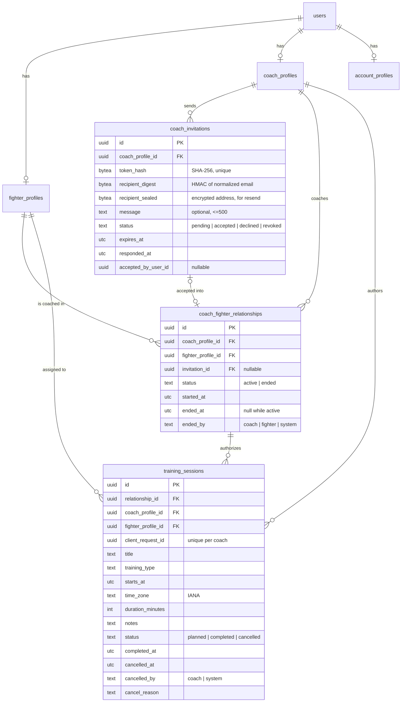
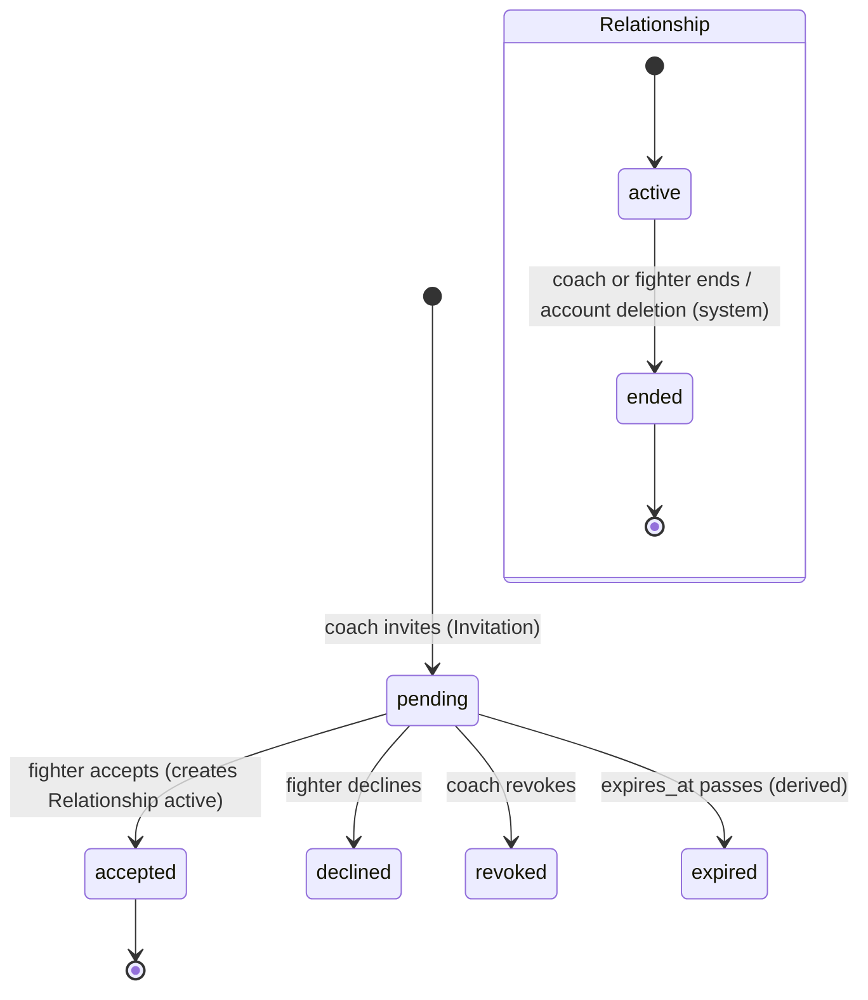
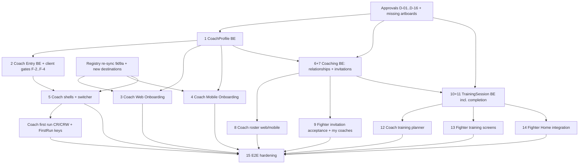

# SF-49 — Coach & Training Domain Architecture + Design Reconciliation

**Status: PROPOSED. Nothing here is approved.** Every decision below waits
for explicit product/architecture approval. No migration, schema,
controller, OpenAPI operation, client or screen was created for SF-49.

Epic SF-48 (Coach–Fighter Coaching & Training MVP). Discovery date
2026-10-13.

---

## 1. Baseline

| Repo | Branch | HEAD | State |
|---|---|---|---|
| simplefit-api | main | `76926f2` (merge of SF-30, PR #20) | clean |
| simplefit-platform | main | `dbc7afd` (merge of SF-30, PR #31) | clean |
| simplefit-mobile | main | `5850402` (merge of SF-28, PR #29) | clean |

SF-18 (SF-19…SF-30) is merged in all three repos.

### Existing backend contexts (production-ready)

| Context | Owns | ADR |
|---|---|---|
| `SimpleFit.Accounts` | `users`, `identities`, `sessions`, `session_refresh_tokens`, `email_auth_challenges`, `account_profiles`, `account_consents` | 0009, 0010, 0012–0014, 0016 |
| `SimpleFit.Fighters` | `fighter_profiles` (one per user; `not_started` = no row / `in_progress` / `completed`; immutable completion trigger; unique `lower(username)`) | 0015 |
| `SimpleFit.Entry` | read-only resolver `GET /api/v1/me/entry` (no table) | 0017 |
| `SimpleFit.FirstRun` | `first_run_outcomes` (`fighter_web_tour`, `fighter_mobile_first_run`; first outcome wins) | 0018 |
| `SimpleFit.Email` + `Templates` | Oban delivery with encrypted payloads; **E08 `coach_invite` template exists, render-only, no trigger** | 0011 |
| `SimpleFit.RateLimit`, `Observability.Redaction`, `SimpleFitWeb.ClientIP` | Abuse limits (Postgres windows), log/Sentry redaction (`sf[argv]_` tokens), IPv6 /64 keys | 0012, 0019 |

8 migrations exist; none touches Coach, relationships, invitations or training.

**No Coach, Gym, relationship, invitation, workspace or training code exists
in the backend.** No admin capability exists in the backend (`ADMIN` appears
only in the route registry).

### Existing clients

* Web and mobile `docs/route-registry.json` are byte-identical (SF-31,
  design version `1791448557-b0b9`, read 2026-10-08). Registry `COACH` is
  `grantedBy: CoachProfile`; onboarding routes need only a session
  (`D-ONBOARDING-ENTRY-CAPABILITY`, resolved).
* Every Coach route in web (`/app/coach/*`, 17 pages) and mobile (`(coach)`
  group, tabs Today/Fighters/Board/Requests/Inbox) is a
  **`placeholderRoute` only**. The shells (`WorkspaceShell` web, `ShellTabs`
  mobile) are real. Registry status "IMPLEMENTED" means "route exists".
* `entryDestinations.coach_onboarding` already maps to
  `web.app.onboarding.coach` / `mobile.onboarding.coach`.
* All 32 design-proposed API rows (incl. `/api/v1/invites`,
  `/api/v1/sessions`, `/api/v1/me/workspaces`) are `DEFERRED` inventory
  (`D-BACKEND-PROPOSED`).

### Implementation findings (code, not design)

| ID | Finding | Evidence | Impact |
|---|---|---|---|
| F-1 | `Entry` rule 4 assumes FighterProfile is the only role state | `lib/simple_fit/entry.ex` `fighter_route/2`, `capabilities/1` | Must be extended (not rewritten) for Coach |
| F-2 | Web `FighterGate` renders only when `destination == "fighter_home"` | `simplefit-platform/src/features/session-gate/ui/fighter-gate.tsx` | A user who is completed Fighter **and** Coach would be bounced out of Fighter pages if the no-intent entry ever resolves elsewhere. Gate must check `capabilities` instead |
| F-3 | `entryHref` treats only `fighter_home` as "journey complete" | `features/session-gate/model/entry.ts` (web + mobile) | Generalise to every `*_home` destination |
| F-4 | Mobile `(fighter)`/`(coach)` layouts do not enforce capability ("registry metadata only") | `simplefit-mobile/src/app/(coach)/_layout.tsx` | Coach shell needs a capability gate like web |
| F-5 | No IANA time-zone database dependency (`tz`/`tzdata` absent) | `mix.exs`, `mix.lock` | TrainingSession time zones need a dependency decision (CLAUDE.md rule 18, ADR 0004) |
| F-6 | Redaction covers `sfa_ sfr_ sfv_ sfg_` only | `observability/redaction.ex:37` | A new invitation token prefix must be added |

---

## 2. Claude Design — version and inventory

* Artifact `JEsBg51MjX8KiHWEro8omY`, **live version `1791877903-9d9a`**
  (read 2026-10-13), 492 artboards, 11 pages. Structured `.dc.html` files
  and `project/canvas.json` were read; no screenshots used.
* The route registry was built from `1791448557-b0b9`. Every Coach **screen**
  artboard below is still referenced by the registry; the 44 boards the
  registry does not reference are flow/route/sheet boards (`FlowCoach`,
  `RouteCoach`, `FlowAuthModel`, tour-step sheets…). Content changes between
  the two versions were **not** diffed (no access to the old version) →
  D-SF49-17.

Status legend: **MVP** = proposed for SF-48; **REDUCED** = MVP with only real
data; **DEFER** = keep placeholder; **FUTURE** = design marks it future.

### 2.1 Coach registration and first run

| Artboard | File | Route | Owner | Required API | Existing | Gap / note |
|---|---|---|---|---|---|---|
| O05 Choose role | Onboarding | `mobile.onboarding.role` | Entry | entry | real (SF-47) | — |
| WA6 Where to start | WebRoleSelect | `web.app.onboarding.role` | Entry | entry | real | — |
| OC1 Coach profile | OnbCProfile | `mobile.onboarding.coach` | Coaches | coach-profile | placeholder | MVP · vocabulary differs from web (D-01) |
| OC2 Coaching type | OnbCType | same `?step` | Coaches | coach-profile | placeholder | MVP · D-01 |
| OC3 Credentials (optional) | OnbCCredentials | same | Trust (future) | uploads | placeholder | DEFER (uploads, review) D-02 |
| OC4 Business size | OnbCSize | same | Billing (future) | — | placeholder | DEFER D-02 |
| OC5 Where (gym) | OnbCWhere | same | Gyms (future) | — | placeholder | DEFER gym part D-03 |
| OC6 Plan | OnbCPlan | same | Billing (future) | — | placeholder | DEFER D-02 |
| OC7 Services | OnbCServices | same | Commerce (future) | — | placeholder | DEFER |
| OC8 Payouts | OnbCPayouts | same | Payments (future) | — | placeholder | DEFER |
| OC9 Invite fighters | OnbCInvite | same | Coaching | invitations | placeholder | MVP (email invite only) D-07 |
| OC10 Data rules | OnbCPrivacy | same | Coaching / legal | acknowledgement | placeholder | MVP, needs SF-48 legal D-10 |
| OC11 Complete | OnbCReady | same | Coaches | coach-profile | placeholder | REDUCED (no trial/payout/licence states) |
| WCR1 Profile | WebRegCProfile | `web.app.onboarding.coach?step=profile` | Coaches | coach-profile | placeholder | MVP · D-01 |
| WCR2 Coaching type | WebRegCType | `?step=type` | Coaches | coach-profile | placeholder | MVP · D-01 |
| WCR3 Credentials | WebRegCCreds | `?step=credentials` | Trust (future) | uploads | placeholder | DEFER |
| WCR4 Business size | WebRegCSize | `?step=size` | Billing (future) | — | placeholder | DEFER |
| WCR5 Gym | WebRegCGym | `?step=gym` | Gyms (future) | — | placeholder | DEFER |
| WCR6 Plan | WebRegCPlan | `?step=plan` | Billing (future) | checkout | placeholder | DEFER |
| WCR7 Complete | WebRegCDone | `?step=complete` | Coaches | coach-profile | placeholder | REDUCED |
| CR1–CR3 Intro | FirstRunC1–C3 | `mobile.coach.welcome` | FirstRun | first-run | placeholder | MVP (copy shows invented team data → REDUCED) |
| CR4 Today checklist | FirstRunCToday | `mobile.coach.today` | FirstRun + Coaching | entry, first-run | placeholder | REDUCED (only profile/invite/session items) |
| CR5 Tour | FirstRunCSessionTip(+Steps) | `mobile.coach.today?tour` | FirstRun | first-run | placeholder | MVP if tour targets exist |
| CRW1 Dashboard first run | FirstRunWebC | `web.app.coach` | FirstRun | first-run | placeholder | REDUCED |
| CRW2 Tour | FirstRunWebCTour(+Steps) | `web.app.coach.sessions.new?tour=2` | FirstRun | first-run | placeholder | MVP if targets exist |
| E03 Welcome coach | EmailWelcomeCoach | — | Email | — | template exists | trigger on completion (optional) |

### 2.2 Coach application

| Artboard | File | Route | Owner | API | Existing | Gap |
|---|---|---|---|---|---|---|
| WC1 Dashboard | WebCoachDashboard | `web.app.coach` | projection | sessions, roster, invitations | placeholder | REDUCED: KPIs (attendance, rounds, camp), AI, sparring, booking requests are absent domains D-04 |
| Coach web nav | CoachWebNav | shell | client | entry | shell real, items placeholder | MVP items: Dashboard, Fighters, Programs & sessions, Calendar, Coach settings; others DEFER |
| C01 Today | CoachToday | `mobile.coach.today` | projection | sessions, roster | placeholder | REDUCED (AI summary, weight flags, video, booking absent) |
| Coach tab bar | CoachTabs | shell | client | — | real | Board/Requests/Inbox tabs DEFER |
| WC7 Fighters | WebCoachFighters | `web.app.coach.fighters` | Coaching | roster | placeholder | REDUCED: weight/camp/attendance/flags absent; groups absent D-06 |
| C03 Fighters | Fighters | `mobile.coach.fighters` | Coaching | roster | placeholder | REDUCED |
| WC4 Fighter 360 | WebFighter360 | `web.app.coach.fighters._fighter-id` | Coaching | roster detail, sessions | placeholder | REDUCED: Overview + Sessions only; Weight, Video, Notes, Medical DEFER D-10 |
| C04 Fighter quick view | FighterQuick | `mobile.coach.fighters._fighter-id` | Coaching | roster detail | placeholder | REDUCED |
| WC3 Program & session builder | WebProgramBuilder | `web.app.coach.sessions.new` | Training | training-sessions | placeholder | REDUCED: "Single fighter" (and "Group" = N individual sessions) only; blocks/timer/shared/class DEFER D-12 |
| W08 Calendar (shared) | WebCalendar | `web.app.calendar` | Training projection | training-sessions | placeholder | MVP subset (training layer only) |
| WC6 / CS1 Coach settings | WebCoachSettings / CoachSettings | `web.app.coach.settings` / `mobile.settings.coach` | Coaches | coach-profile | placeholder | REDUCED: profile edit only; services, booking rules, payouts, assistants, access log DEFER |
| A04 Workspaces | Workspaces | `mobile.workspaces` | Entry projection | entry | placeholder | MVP (personal Fighter + Coach contexts only; no gym rows) D-05 |
| WA2 Choose workspace | WebLoginWorkspace | `web.login?step=workspace` | Entry | entry | not built | MVP when ≥2 completed contexts (§6) |
| WC2/C12 Team activity, WC8/C11 Board, WC5/C14 Sparring, C05 Session control, C06 Sparring control, C02 Roster & attendance, C07 Quick note, C08 Video, C09 Booking requests, C10 AI drafts, C13 Shared roster, C15 Challenge, F07 Fight camp | various | various | Sparring / Camp / Social / Booking / Video / AI (future) | — | placeholder | DEFER — no approved domain |
| CC1–CC10, AV3–AV5, CO1 | commerce | `/app/coach/{services,earnings,payouts}…` | Commerce/Payments (future) | — | placeholder | DEFER |

### 2.3 Invitations and Fighter side

| Artboard | File | Route | Owner | API | Existing | Gap |
|---|---|---|---|---|---|---|
| E08 Coach invited you | EmailCoachInvite | email | Coaching → Email | invitation create | template only | MVP (variables need `coaching_name`, D-01) |
| INV1 Coach invites fighter (landing) | InviteCoach | `mobile.invite._code` | Coaching | invitation preview | placeholder | MVP; copy "land straight in Marek's team" conflicts with consent D-08 |
| A03 Join with invite | JoinInvite | `mobile.join._code` | Gyms (future) | — | placeholder | DEFER (gym member invite) |
| INV2 Gym invites coach | InviteGymCoach | `mobile.invite.coach._token` | Gyms (future) | — | placeholder | DEFER |
| OF7 Fighter · coach | OnbFCoach | fighter onboarding step 7 | Coaching | — | not built (ADR 0015 approved OF1–OF4 only) | DEFER; "Request coach"/"Find a coach" are fighter→coach requests + marketplace |
| WF3 Fighter web · coach | WebRegFCoach | — | Coaching | — | **FUTURE in design** ("needs the Coach domain") | DEFER |
| Invitation accept + consent | **missing** | — | Coaching | accept/decline | — | **Missing artboard (web + mobile)** D-08 |
| Fighter "My coaches" / remove access | **missing** | — | Coaching | list/end | — | **Missing artboard** D-09 |
| F24 Training hub | TrainingHub | `mobile.training` | Training projection | training-sessions | placeholder | REDUCED: "Up next · assigned by coach" + history of assigned sessions |
| F04 Session plan | SessionDetail | `mobile.sessions._session-id` | Training | training-session | placeholder | REDUCED: no block/timer structure D-12 |
| F05 Live training | LiveTraining | `…/live` | Timer (future) | — | placeholder | DEFER |
| F06 Training complete | SessionLog | `…/complete` | Training | complete | placeholder | REDUCED: done only; RPE/body flags/rounds DEFER D-14 |
| F12 Calendar | Calendar | `mobile.calendar` | Training projection | training-sessions | placeholder | MVP subset |
| Fighter Home (FRW1/W01, F01) | FirstRunWebF / WebHome / Main | `web.app.home`, `mobile.home` | projection | training-sessions | real (SF-40/41) | Add "next assigned session" card when sessions exist |
| S10/S16/S08 Shared sessions | SessionCreator, TrainingInvite, SharedSession | `mobile.shared-session.*` | Social training (future) | — | placeholder | DEFER (multi-participant) |

### 2.4 Shared flows read

FlowAuthModel (SF-21), RouteAuth, RouteCoach, FlowCoach, FlowWeb,
FlowWebRoute, FlowFirstRun, FlowOnboarding, GalleryIndex 1–4 were read for
paths and transitions. RouteAuth: "Sign-in … lands in the last workspace or
asks which one" (WA2 web, A04 mobile).

---

## 3. Proposed bounded contexts

```text
Accounts ◄── Fighters ◄──┐
   ▲            ▲         │
   │            │         │
   ├── Coaches ◄┼── Coaching (relationships + invitations) ◄── Training
   │            │         ▲                                     ▲
   └── Entry ───┴─────────┴─── (reads profiles, never writes)   │
FirstRun ── reads Fighters/Coaches completion ──────────────────┘ (no dep)
Email ◄── Coaching (E08 delivery)          RateLimit ◄── Coaching
```

Arrows point at the dependency. No cycles: Fighters and Coaches never call
Coaching or Training; Coaching never calls Training except the single
"relationship ended" hook, which is inverted (Training subscribes by being
called from Coaching's transaction through a public `Training.cancel_for_relationship/2`;
see §9). If that call direction is unacceptable, use an Oban job.

| Context | Responsibility | Owns | Owned transitions | Public interface (indicative) | Authorizes | Must NOT own |
|---|---|---|---|---|---|---|
| **Accounts** (existing) | Identity, sessions, account registration, consents | users, identities, sessions, account_profiles, account_consents | as today | unchanged | own data | roles, profiles of other domains |
| **Fighters** (existing) | Fighter profile + onboarding | fighter_profiles | not_started→in_progress→completed | + `get_profile_by_id/1` (internal), `coach_projection/1` (non-body fields) | owner access | relationships, who may see the fighter |
| **Coaches** (new) | Coach profile + onboarding | coach_profiles | not_started→in_progress→completed | `get_profile/1`, `update_profile/2`, `complete_onboarding/1`, `onboarding_status/1` | owner access | gyms, plans, services, payouts, credentials review, fighters |
| **Coaching** (new) | Coach↔Fighter relationships and the invitations that create them | coach_fighter_relationships, coach_invitations | invitation pending→accepted/declined/revoked/(expired); relationship active→ended | `invite/2`, `preview_invitation/2`, `accept/2`, `decline/2`, `revoke/2`, `list_roster/2`, `get_roster_entry/2`, `list_my_coaches/1`, `end_relationship/2`, `authorize(actor, relationship_id, action)` | **every coach→fighter data access** | training content, fighter profile fields, gym membership |
| **Training** (new) | Coach-assigned training sessions | training_sessions | planned→completed / planned→cancelled | `create/2`, `update/3`, `cancel/2`, `complete/2`, `list_for_coach/2`, `list_for_fighter/2`, `cancel_for_relationship/2` | session-level rules, delegating "is this coach related to this fighter" to Coaching | relationships, timer, programs, bookings, logs |
| **Entry** (existing, extended) | Post-auth destination | — | — | `resolve/2` | none (projection) | any write |
| **FirstRun** (existing, extended) | Tour outcomes | first_run_outcomes | first outcome wins | + coach keys | owner | — |
| Gyms, Fight Camps, Sparring, Booking/Payments, Timer/Training Log | **future** | — | — | — | — | — |

Events: none needed in MVP. Telemetry `[:simple_fit, :coaching, :invitation, …]`
counts outcomes only (ADR 0008/0019).

---

## 4. CoachProfile

### 4.1 Identity and ownership (proposed)

* `coach_profiles`, one row per user (`unique (user_id)`), created on first
  meaningful save; no row = `not_started`. Same structure as ADR 0015.
* **One CoachProfile per user.** Gym-coach roles later are
  *workspace memberships* (`gym_memberships` with role coach), not a second
  CoachProfile. Design A04 shows "Yauheni Coaching · COACH" and
  "Warsaw BC · COACH" as two *workspaces*; only the first is the personal
  CoachProfile.
* No `gym_id`. No role on `users`. Coexists with FighterProfile.

### 4.2 Field contract — PROPOSED, vocabularies NOT final

| Field | Type | Required at completion | Owner | Validation | Editable after | Design source |
|---|---|---|---|---|---|---|
| `display_name` | text 1..60 | **yes** | Coaches | trimmed, printable | yes | OC1 (name shown), CoachWebNav "Coach Marek" |
| `brand_name` | text 1..80 | **decision D-01** | Coaches | trimmed | yes | WCR1 "Brand name", OC5 "Brand name", E08 `coaching_name` |
| `country_code` | ISO 3166-1 alpha-2 | **yes** (decision: web lacks it) | Coaches | `CountryCodes` (reuse) | yes | OC1 |
| `city` | text 1..80 | **yes** | Coaches | trimmed | yes | OC1, WCR1 |
| `bio` | text ≤ 500 (length decision) | no | Coaches | plain text | yes | OC1, WCR1 |
| `languages` | array of ISO 639-1, ≤ 10 | no | Coaches | allow-list | yes | OC1 (en, pl, ru, be, uk), WCR1 (pl, en, be, ru) |
| `years_coaching` | enum `under_1, 1_3, 3_5, 5_10, 10_plus` | decision | Coaches | enum | yes | OC1 only |
| `boxing_background` | text ≤ 120 | no | Coaches | plain text | yes | OC1, WCR3 |
| `specialties` | array enum (≥1) | **yes** (decision) | Coaches | enum | yes | OC2 vs WCR2 — **conflicting lists, D-01** |
| `delivery_modes` | array enum `in_person, online` | decision | Coaches | enum | yes | WCR2 "Delivery"; OC2 "Online Coaching" |
| `data_rules_accepted_version` / `_at` | text / timestamp | **yes** (decision D-10) | Coaches (or Accounts consents) | current version | re-accept on new version | OC10 "I agree" |
| `onboarding_completed_at` | timestamp | set by completion | Coaches | immutable (trigger) | no | — |

Explicitly **not** CoachProfile (deferred, other owners): credentials and
verification documents (Trust + uploads), business size (Billing),
plan/trial (Billing), services/prices (Commerce), payouts (Payments),
gym affiliation (Gyms), public slug `sfit.box/c/…` (Marketplace),
photo (uploads, as for Fighter), assistants/access log (future).

`display_name` is separate from `AccountProfile.full_name` (private, legal
name) exactly as Fighter `display_name` is (ADR 0015).

### 4.3 Lifecycle — reuse the FighterProfile pattern

Recommended: identical semantics to ADR 0015.

* First save with at least one changed field creates the row (`in_progress`);
  empty or no-op PATCH returns current state and never creates.
* PATCH is partial; invalid PATCH changes nothing; row lock
  (`SELECT … FOR UPDATE`) serializes concurrent edits; last write per field
  wins, untouched fields preserved.
* `POST …/complete-onboarding` requires every required field **and**
  completed account registration (same `account_registration: required`
  error as Fighter); missing → `validation_error` with `required` per field.
* Repeat completion is a no-op returning the original `completed_at`
  (DB trigger forbids change, like `fighter_profiles_completion_immutable`).
* After completion every field stays editable with the same validation;
  removing a required field after completion is rejected (`required`).

---

## 5. Coach capability and SF-45 integration

### 5.1 Facts and capabilities

Entry facts gain `coach_profile: :not_started | :in_progress | :completed`.
Capabilities: `FIGHTER` iff fighter completed; `COACH` iff coach completed.
The response gains `coach_profile` (additive).

### 5.2 Decision table (extends ADR 0017; rules 1–3 unchanged in spirit)

| # | account | intent | fighter | coach | destination | mandatory |
|---|---|---|---|---|---|---|
| 1 | not complete | any | any | any | `account_registration` | yes |
| 2 | complete | fighter | not completed | any | `fighter_onboarding` | yes |
| 3 | complete | fighter | completed | any | `fighter_home` | no |
| 4 | complete | coach | any | not completed | `coach_onboarding` | yes (proposed: like fighter) |
| 5 | complete | coach | any | completed | **`coach_home`** (new) | no |
| 6 | complete | gym / sponsor | any | any | unchanged | no |
| 7 | complete | none | completed | completed | **`workspace_selection`** (new) | no |
| 8 | complete | none | completed | not completed | `fighter_home` | no |
| 9 | complete | none | not completed | completed | `coach_home` | no |
| 10 | complete | none | in_progress | not_started | `fighter_onboarding` (today) | yes |
| 11 | complete | none | not_started | in_progress | `coach_onboarding` | yes |
| 12 | complete | none | in_progress | in_progress | `role_selection` (user picks which to resume) — decision | no |
| 13 | complete | none | not_started | not_started | `role_selection` | no |

Rows 8/9 keep a completed context ahead of an unfinished one (an unfinished
Coach onboarding never blocks a working Fighter); the unfinished journey is
reachable from the context switcher with `intent`.

New reasons: `coach_onboarding_not_started`, `coach_onboarding_in_progress`,
`coach_onboarding_completed`, `multiple_contexts`. `coach_intent` is retired
only if the API versioning rule allows (keep it otherwise; additive only).

### 5.3 Context selection and switching (no new state machine)

* **The route is the context** for personal contexts: `/app/home` = Fighter,
  `/app/coach` = Coach (web); `(fighter)` / `(coach)` groups (mobile). No
  server-side "active context" is introduced for personal contexts
  (`D-WORKSPACE-NOT-IN-URL` reserves session context for future gym
  workspaces).
* **Switching** = navigating to the other home through the switcher (web
  in-shell action per `D-WEB-WORKSPACE-SWITCHER`, mobile A04), listing the
  entries of `capabilities` plus "set up …" for unstarted/in-progress roles
  (`intent=…`).
* **"Remember my choice on this device"** (WA2) is a device-local preference
  that the client sends as `intent` — the resolver already treats intent as
  navigation, so no backend preference is stored.
* **Deep links / returnTo**: `usableReturnTo` already drops a target behind
  a capability the user does not hold; with F-2/F-3 fixed, a Coach deep link
  for a Fighter-only user re-resolves, and a dual user keeps the link.
* **Session restore**: entry is re-resolved on restore (SF-28), unchanged.
* **WA6** stays the "choose a journey" screen; it lists all four journeys,
  regardless of existing roles (copy already says choosing adds nothing).
* **WA2 / A04** become reachable as `workspace_selection` when ≥2 contexts
  are completed (row 7). Registry mapping is a later registry ticket.

### 5.4 Client changes required (implementation tickets)

* Web/mobile: `knowsDestination` + `entryDestinations` gain `coach_home`
  (→ `web.app.coach` / `mobile.coach.today`) and `workspace_selection`
  (→ WA2 web / A04 mobile).
* F-2: gates check capability (`FIGHTER` / `COACH` ∈ `entry.capabilities`),
  not destination equality. New `CoachGate` (web) and coach-group gate (mobile, F-4).
* F-3: `entryHref` treats any `*_home` as a completed journey.
* Query cache isolation (SF-28) already clears per identity; no change.

---

## 6. Coach–Fighter relationship

### 6.1 Cardinality — recommendation: **Option B, multiple active coaches, no primary**

| | A: one active coach | B: many, no primary | C: many + primary |
|---|---|---|---|
| Design evidence | OF7 "Do you have a coach?" (singular) | WC4/WC7 "visible to the fighter's **coaches** only"; WC3 "Coaches: Marek · Ola (pads)"; WC6 assistant coach; A04 coach in two workspaces | no artboard shows "primary" |
| Boxing reality | breaks boxing coach + S&C coach, club coach + personal coach | fits | fits, extra concept |
| Future gyms | gym coach + independent coach collide | independent rows, gym relationship separate | primary ambiguous across gyms |
| Training assignment | trivially one author | each session names its coach | primary-only assignment unclear |
| Privacy | simplest | each relationship is its own grant, revocable alone | same as B |
| Complexity | lowest | low: unique per pair | + rules for primary transfer |

Recommendation B because the design consistently speaks of a fighter's
*coaches*, real training uses several, and each relationship is an
independent, revocable grant. **Not enforced until approved (D-11).**

### 6.2 Model



Constraints:

* `unique (coach_profile_id, fighter_profile_id) where status = 'active'`
  — at most one active relationship per pair; re-connection after `ended`
  inserts a new row (history kept).
* `check (status = 'active' and ended_at is null or status = 'ended' and ended_at is not null)`.
* Self-coaching forbidden (coach and fighter profiles of the same user) —
  enforced in Coaching (cross-table, not a DB check); tested.
* `ended` is terminal (trigger, like other append-only rows).
* Both profiles must be **completed** to relate (decision D-15).

### 6.3 Lifecycle



Pending lives **only** on the invitation; the relationship has no pending
state (single source of truth).

| Action | Who | Effect |
|---|---|---|
| Invite | completed Coach | pending invitation + E08 email |
| Accept | the signed-in user holding the token, with a completed FighterProfile | invitation accepted; relationship `active` (or the existing active one, idempotently) |
| Decline | token holder (signed in) | invitation declined; coach sees "declined" without reason |
| Revoke | the inviting coach | pending → revoked |
| End | either side | relationship `ended`; future planned sessions cancelled (`system`, `relationship_ended`); access revoked immediately |
| Re-invite | coach, after decline/expiry/revoke/end | new invitation; rate-limited per recipient digest |

### 6.4 Privacy and historical access (proposed, D-10)

Granted by an **active** relationship, to that coach only:

| Data | Coach access | Basis |
|---|---|---|
| Fighter public identity (display_name, username, country, city) | read | relationship |
| Boxing profile (experience, stance, bouts, goals, next fight) | read | relationship |
| Weight class, current weight, height | **none in MVP** (ADR 0015: owner-only) | needs explicit consent scope (D-10) |
| Sessions the coach authored for this fighter, incl. completion status | read/write per §8 | relationship |
| Sessions by other coaches / fighter self-training | **none** | — |
| AccountProfile (legal name, DOB), consents, email, identities | **never** | — |
| Messages with others, location, sponsor/ad data | **never** (OC10/E08) | — |

After **end**: the coach immediately loses every read above; the ended
relationship appears in the coach's history with the fighter's display name
only (decision). Planned sessions are cancelled; completed sessions stay in
the fighter's own history. Re-connecting does **not** restore old access to
sessions from the earlier relationship (they are bound to `relationship_id`).

Gym admins never see coach↔fighter data (WC4: "Gym admins can't open fighter
videos or DMs").

---

## 7. Invitation domain

### 7.1 MVP mechanism (decision D-07)

Recommended MVP: **coach → fighter email invitation (E08)**, single-use,
accepted explicitly by a signed-in fighter. Deferred: the coach's standing
share link/QR with coach approval (OC9 "You approve each fighter"),
fighter→coach requests (OF7 "Request Coach Marek"), invite codes (WF3
`YB-7Q2K`), roster import (OC9), marketplace.

### 7.2 Security

* Token: 32 random bytes, base64url, prefix `sfi_`; stored only as
  SHA-256 hash (`unique`); shown once in the email link
  `…/invite/coach#token=sfi_…` (URL fragment, as ADR 0012 link tokens — never
  in server logs or referrers). Add `i` to the Redaction prefix class (F-6).
* Expiry: 14 days (decision); one-time use; accept/decline/revoke under a row
  lock; a used/expired/revoked/unknown token yields one normalized error
  `invitation_unavailable` (no enumeration of states).
* **No email matching**: acceptance does not require the accepting
  account's email to equal the invited address (Google/Apple emails differ;
  ADR 0009 forbids linking by email). Mitigation: explicit consent screen
  showing coach identity and data scope; the coach learns the identity of
  whoever accepted and can end it. Recipient address is never shown to the
  accepting user.
* No account, FighterProfile or relationship is created by sending.
* Rate limits (`RateLimit`): per coach per hour/day, per recipient digest
  per day, preview/accept per IP (`ClientIP.limit_key`).
* Stored: recipient HMAC digest (duplicate detection) + sealed address
  (Plug.Crypto, existing key pattern) for resend; never plaintext; never logged.
* Duplicate pending invite to the same digest → returns the existing pending
  invitation (idempotent), resend rotates the token.
* Concurrency: two accepts of one token → one wins, the other gets the
  same result idempotently if it is the same user, `invitation_unavailable`
  otherwise; an already active pair → invitation accepted, existing
  relationship returned.

### 7.3 Deep links

Web: `/invite/coach#token=…` → if signed out, auth with continuation
(token kept client-side like `intent`), account registration, Fighter
onboarding if needed (`intent=fighter`), then the **accept/consent screen
(missing artboard)**. Mobile: same via universal link to
`mobile.invite._code`; SecureStore not needed (short-lived continuation in
memory/router params). Never auto-accept (D-08).

---

## 8. TrainingSession

### 8.1 Terminology

| Term | Meaning | MVP? |
|---|---|---|
| **TrainingSession** | one planned training for one fighter, authored by a coach within a relationship; it carries its own completion | **yes** |
| Scheduled class | gym timetable entry, many members book | no (Gyms) |
| Booking | a purchase/reservation of a coach or class slot | no (Booking/Payments) |
| Training program / template | reusable multi-session plan, blocks library (WC3) | no |
| Shared session | several fighters train together (S10/S08) | no |
| Training log / completed workout | fighter's self-logged training, rounds, RPE, body flags | no (Training Log) |
| Round/timer execution | timer run (F05, T-screens) | no (Timer) |

MVP TrainingSession = **plan + its completion** in one row (no separate
execution entity yet). Group assignment ("same plan, trained separately",
WC3) = N TrainingSessions created in one request.

### 8.2 Field contract (proposed)

| Field | Type | Required | Set by | Validation | Editable |
|---|---|---|---|---|---|
| `relationship_id` | uuid | yes | coach (server-checked) | active, owned by caller | no |
| `coach_profile_id`, `fighter_profile_id` | uuid | derived | server | from relationship | no |
| `client_request_id` | uuid | yes | client | unique per coach (idempotency) | no |
| `title` | text 1..80 | yes | coach | — | while planned |
| `training_type` | enum (D-13) | yes | coach | allow-list | while planned |
| `starts_at` | UTC instant | yes | coach | within −1 day … +1 year (decision) | while planned |
| `time_zone` | IANA name | yes | coach client | needs tz DB (F-5, D-16) | while planned |
| `duration_minutes` | int 5..600 | yes | coach | — | while planned |
| `notes` | text ≤ 2000 | no | coach | plain text | while planned |
| `status` | `planned/completed/cancelled` | server | transitions | — | — |
| `completed_at` | UTC | server | on complete | — | no |
| `cancelled_at`, `cancelled_by`, `cancel_reason` | UTC, enum, enum | server | on cancel | — | no |

No metrics, calories, AI scores, RPE or body flags in MVP (D-14).

### 8.3 Temporal semantics

UTC instant + IANA zone of where the training happens. Clients compute the
instant from local date/time in that zone; the server re-validates the zone
(dependency decision D-16) and stores both. Display in the session's zone;
show the viewer's zone if it differs. Rescheduling replaces both. DST: an
instant is unambiguous; a non-existent local time is rejected client-side
and server-side. Completion time is server `now()`.

### 8.4 State transitions

| From | Action | Actor | To | Repeat | Conflict |
|---|---|---|---|---|---|
| — | create | coach (active relationship) | planned | same `client_request_id` → same row (200) | — |
| planned | update | authoring coach | planned | — | non-planned → 409 `conflict` |
| planned | complete | **fighter** (D-14) | completed | completed → 200 same | cancelled → 409 |
| planned | cancel | authoring coach | cancelled | cancelled → 200 same | completed → 409 |
| planned | relationship ends | system | cancelled (`relationship_ended`) | — | — |
| completed / cancelled | any | — | terminal | — | 409 |

Concurrent complete vs cancel: row lock; first wins, second gets 409.

### 8.5 Permissions

| Operation | Authoring coach (active rel.) | Same coach after end | Other coach | Fighter (assignee) | Other user |
|---|---|---|---|---|---|
| Create | ✓ | ✗ | ✗ | ✗ (self-training future) | ✗ |
| Read | ✓ | ✗ (D-10) | ✗ | ✓ (always, own history) | ✗ → 404 |
| Update / cancel | ✓ while planned | ✗ | ✗ | ✗ | ✗ |
| Complete | ✗ (D-14) | ✗ | ✗ | ✓ while planned | ✗ |

Extension points: nullable `coach_profile_id` for self-training, a
`training_session_participants` table for shared/group sessions, a
`program_id` for templates, a separate `training_logs` for execution data —
all added only by their tickets. `gym_id` never required.

---

## 9. Gym boundary

* Personal: CoachProfile, COACH capability, independent relationships,
  coach-authored sessions — work with no gym.
* Organizational (future): gym workspace, gym memberships with roles
  (owner, coach, staff, member), classes, gym-coach access to gym members.
* A gym-coach seeing gym members' data will come from **gym membership +
  gym consent**, never from `coach_fighter_relationships`. A relationship
  belongs to the coach (personal), not the gym; leaving a gym never ends
  personal relationships (WC6: "Your private clients stay").
* A coach may later hold memberships in several gyms; each is a separate
  workspace (A04), switched via session context (`D-WORKSPACE-NOT-IN-URL`).
* No foundational permission change is needed now; no `gym_id` anywhere.

---

## 10. Authorization matrix (backend; every grant from session identity + persisted state)

| Actor \ Resource | Own CoachProfile | Own FighterProfile | Invitations | Relationships | TrainingSessions |
|---|---|---|---|---|---|
| Anonymous | ✗ 401 | ✗ 401 | preview by token only (rate-limited) | ✗ | ✗ |
| Auth, no profiles | create/update (in_progress) | create/update | accept/decline ✗ (needs completed fighter) | ✗ | ✗ |
| Fighter incomplete | create/update | update | accept ✗ (D-15) | ✗ | ✗ |
| Fighter completed | create/update | read/update | accept/decline by token; list none | list/end own | read/complete own |
| Coach incomplete | update/complete | — | ✗ (needs completed coach) | ✗ | ✗ |
| Coach completed | read/update | — | create/list/revoke/resend own | list/read/end own roster | create/update/cancel/list own |
| Coach, no relationship with F | — | — | — | F's data → **404** | create for F → 404 |
| Coach + Fighter (same user) | both | both | cannot invite self | no self-relationship | as each role |
| Future gym member | boundary only: no access through gym | — | — | — | — |
| Platform admin | **no backend capability exists**; no admin path proposed (D-18) | | | | |

IDOR rules: no endpoint accepts `coach_id`, `fighter_id` or `user_id` as
authority; coach endpoints address fighters by **relationship id** checked
against the caller's CoachProfile and `status = active`; foreign or ended
ids answer `404 not_found` (never 403, no existence oracle). Tests per ticket:
cross-coach, cross-fighter, ended relationship, self-relationship.

---

## 11. Proposed API (indicative; nothing added to OpenAPI)

| Method | Path | Owner | Auth | Notes |
|---|---|---|---|---|
| GET | `/api/v1/me/coach-profile` | Coaches | session | `CoachProfileResponse` with `onboarding {status, completed_at, missing_requirements}` |
| PATCH | `/api/v1/me/coach-profile` | Coaches | session | partial; 422 field_codes |
| POST | `/api/v1/me/coach-profile/complete-onboarding` | Coaches | session | idempotent |
| GET | `/api/v1/me/entry` | Entry | session | **additive**: `coach_profile`, `coach_home`, `workspace_selection`, `COACH` |
| PUT | `/api/v1/me/first-run/{experience}` | FirstRun | session | **additive** keys `coach_web_tour`, `coach_mobile_first_run` |
| POST | `/api/v1/me/coach/invitations` | Coaching | completed coach | `{email, message?}` → 201/200 existing; 429 |
| GET | `/api/v1/me/coach/invitations` | Coaching | completed coach | cursor pagination, `status` filter; email masked |
| POST | `/api/v1/me/coach/invitations/{id}/resend` · `/revoke` | Coaching | inviting coach | 404 foreign; 409 non-pending |
| POST | `/api/v1/coach-invitations/preview` | Coaching | none (token in body) | coach display info + data scope; `invitation_unavailable` |
| POST | `/api/v1/me/coach-invitations/accept` · `/decline` | Coaching | completed fighter | `{token}`; idempotent per user |
| GET | `/api/v1/me/coach/fighters` | Coaching | completed coach | roster (active), cursor pagination |
| GET | `/api/v1/me/coach/fighters/{relationshipId}` | Coaching | completed coach | fighter projection (§6.4) |
| POST | `/api/v1/me/coach/fighters/{relationshipId}/end` | Coaching | coach | 200 idempotent |
| GET | `/api/v1/me/coaches` | Coaching | completed fighter | fighter's active coaches |
| POST | `/api/v1/me/coaches/{relationshipId}/end` | Coaching | fighter | 200 idempotent |
| POST | `/api/v1/me/coach/training-sessions` | Training | completed coach | single or `relationship_ids[]` batch; `client_request_id` |
| GET | `/api/v1/me/coach/training-sessions` | Training | coach | `from`,`to`, `relationship_id`; cursor |
| PATCH | `/api/v1/me/coach/training-sessions/{id}` | Training | authoring coach | planned only |
| POST | `/api/v1/me/coach/training-sessions/{id}/cancel` | Training | authoring coach | idempotent |
| GET | `/api/v1/me/training-sessions` · `/{id}` | Training | fighter | own sessions |
| POST | `/api/v1/me/training-sessions/{id}/complete` | Training | fighter | idempotent |

Errors: existing envelope and codes (`validation_error`, `unauthorized`,
`not_found`, `conflict`, `rate_limited`) plus one new
`invitation_unavailable`. Generated clients: web + mobile via
`pnpm api:generate`. Premature (not proposed): `/api/v1/me/workspaces`,
public coach pages, programs, bookings, shared sessions, admin.

---

## 12. Web and mobile module map

| Screen | Route | UI owner (FSD) | API | Current | Ticket |
|---|---|---|---|---|---|
| Coach onboarding (WCR1–2, 7 reduced) | `web.app.onboarding.coach` | `widgets/coach-onboarding` + `features/coach-profile-form` + `entities/coach-profile` | coach-profile | placeholder | Coach Web Onboarding |
| Coach onboarding (OC1–2, 9, 10, 11 reduced) | `mobile.onboarding.coach` | same layering in mobile | coach-profile, invitations | placeholder | Coach Mobile Onboarding |
| Coach shell + gate | `web.app.coach` layout / `(coach)` | `widgets/workspace-shell`, `features/session-gate` | entry | shell real | Coach Shells + Entry |
| Context switcher / WA2 / A04 | in-shell / `web.login?step=workspace` / `mobile.workspaces` | `features/context-switch` | entry | placeholder | Coach Entry |
| Coach dashboard / Today (reduced) | `web.app.coach` / `mobile.coach.today` | `widgets/coach-home` | sessions, roster, invitations | placeholder | Coach Home |
| Roster | `web.app.coach.fighters` / `mobile.coach.fighters` | `widgets/coach-roster`, `entities/coach-relationship` | roster | placeholder | Coach Roster |
| Fighter 360 / quick view (reduced) | `…/fighters/:fighterId` (= relationship id) | `widgets/fighter-detail-coach` | roster detail, sessions | placeholder | Coach Roster |
| Invite fighters | web composer (**missing artboard**), OC9 | `features/invite-fighter` | invitations | placeholder | Invitations UI |
| Invitation accept/consent | **missing artboard**; INV1 landing | `features/accept-coach-invitation` | preview/accept | placeholder | Fighter Invitation Acceptance |
| My coaches / remove access | **missing artboard** | `features/my-coaches` | coaches | — | Fighter Invitation Acceptance |
| Session planner (single/group) | `web.app.coach.sessions.new` | `widgets/session-planner`, `entities/training-session` | training-sessions | placeholder | Coach Training Planner |
| Coach calendar | `web.app.calendar` (coach context) | `widgets/calendar` | training-sessions | placeholder | Coach Training Planner |
| Fighter training hub / detail / complete | `mobile.training`, `mobile.sessions._session-id(+/complete)`; web `web.app.calendar` | `widgets/fighter-training` | training-sessions | placeholder | Fighter Training Screens |
| Fighter Home next session | `web.app.home` / `mobile.home` | existing home widgets | training-sessions | real | Fighter Home Integration |

Registry: **no change in SF-49**. Later registry ticket: `coach_home`,
`workspace_selection` destinations, design version re-sync to
`1791877903-9d9a`, invitation accept route(s) once designed.

---

## 13. Future compatibility

| Future domain | Supported by model? | Future addition | Not now |
|---|---|---|---|
| Gym management | yes (no gym coupling) | Gyms context, gym memberships, workspace session context | gym_id, fake memberships |
| Gym coach memberships | yes | membership role `coach` | second CoachProfile |
| Templates / programs | yes | `training_programs`, `program_id` on sessions | block library, JSON plan |
| Round Timer | yes | Timer executions referencing a session | timer fields on session |
| Training Log | yes | `training_logs` (RPE, rounds, body flags) with consent scopes | RPE/body on session |
| Fight Camps | yes | `fight_camps` per relationship | camp fields |
| Sparring | yes | sparring pairs/requests context | — |
| Booking & payments | yes | services, bookings, payouts | plan/trial on profile |
| Live Board / graph | yes (relationships are edges) | projections | graph DB |

---

## 14. Discrepancy register

| ID | Source | Conflict | Sev. | Recommended resolution | Owning task | Approval |
|---|---|---|---|---|---|---|
| D-01 | OnbCProfile/OnbCType vs WebRegCProfile/WebRegCType | Coach fields differ by platform: mobile has years coaching, boxing background, country, languages {en,pl,ru,be,uk}, 7 "coaching types" mixing format/level/service; web has brand name, practice model (independent/gym/both), "what you coach" {amateur, pro, fitness, youth, women's}, delivery {in person, online, fight camps}, languages {pl,en,be,ru} | **High** | One backend vocabulary (§4.2) chosen by product; both clients render it | CoachProfile BE | **Yes** |
| D-02 | OC3/4/6/7/8, WCR3/4/6 | Credentials, business size, plan, services, payouts are non-skippable or prominent registration steps but their domains (uploads/trust, billing, commerce, payments) do not exist | **High** | MVP registration = profile + type + data rules (+ optional invite); other steps hidden, not faked; done screens drop trial/licence/payout states | Coach onboarding (web/mobile) | **Yes** |
| D-03 | OC5, WCR5 | Gym affiliation/pending owner approval inside registration | High | Defer to Gyms; keep "independent/online" only if D-01 keeps practice model | Coach onboarding | Yes |
| D-04 | WC1, C01, CR1, CRW1, FighterQuick | Home/dashboard filled with absent domains (AI summary, weight corridor, attendance %, rounds, camp, sparring approvals, bookings, video, revenue) | High | Reduced home with real data + designed empty states (as SF-40 Fighter home) — needs reduced-state artboards or explicit approval to omit cards | Coach Home | **Yes** |
| D-05 | Workspaces (A04), CoachWebNav | Coach identity shown as gym context ("WARSAW BC · HEAD COACH", "Competition Team") | Med | MVP shows personal coach context only | Coach shells | Yes |
| D-06 | WC7, C03, C01 | Groups/teams ("Competition 14", "In camp 4") not modelled | Med | Defer groups; roster = active relationships | Coach Roster | Yes |
| D-07 | OC9, E08, OF7, WF3 | Four invitation mechanisms/directions (share link with coach approval, email invite, fighter request, invite code) | **High** | MVP: email invite only (§7) | Invitation BE | **Yes** |
| D-08 | InviteCoach (INV1) | "After you sign in you land straight in Marek's team" implies auto-join; no consent step artboard | **High** | Explicit accept + data-scope consent screen (new artboard web + mobile); never auto-accept | Invitation acceptance | **Yes** |
| D-09 | E08 "remove access any time", OC10 | No fighter-side "my coaches / remove access" screen | High | New artboard (mobile + web) | Invitation acceptance | **Yes** |
| D-10 | OnbCPrivacy (OC10), E08, ADR 0015 | Consent categories (logs, RPE/pain/body, weight in camp, videos) "only with fighter's consent"; ADR 0015 makes body data owner-only; no per-category consent UI | **High** | MVP shares no body/weight data; relationship acceptance = consent to the §6.4 scope; category consents later; legal text via SF-48 | Coaching BE + legal | **Yes** |
| D-11 | Design plurality vs OF7 singular | Coach cardinality undefined | **High** | Option B (§6.1) | Relationship BE | **Yes** |
| D-12 | WebProgramBuilder (WC3), S10 | Builder is block/timer/program based with 4 assign modes; mobile coach has no single-fighter session creator | High | MVP: single + batch "group" sessions with notes; mobile creator artboard missing or web-only planner for MVP | Training planner | **Yes** |
| D-13 | SessionCreator, TrainingHub, WebFighter360, Calendar | Training type vocabulary inconsistent (Technical+Sparring, Bag work, Roadwork, S&C, Pads, Technical Boxing, Sparring) | Med | One enum approved by product | TrainingSession BE | **Yes** |
| D-14 | SessionLog (F06), SessionControl (C05) | Completion = fighter's rich log (rounds per block, RPE "private by default", body flags "coach only") vs coach "End session"; actor differs | High | MVP: fighter marks complete; no metrics; coach cannot complete | TrainingSession BE | **Yes** |
| D-15 | — | Can an incomplete Fighter accept? (OF7 sits inside fighter onboarding, ADR 0015 built only OF1–OF4) | Med | Require completed FighterProfile; continuation carries token through onboarding | Invitation BE | Yes |
| D-16 | F-5 | IANA zones need a tz database dependency | Med | Add `tz` (or `tzdata`) with ADR 0004 justification, or accept client-asserted zone | TrainingSession BE | **Yes** (dependency) |
| D-17 | registry `source.version` | Registry built from `1791448557-b0b9`; live is `1791877903-9d9a`; content not diffed | Med | Registry re-sync ticket before Coach UI tickets | Registry | No (process) |
| D-18 | registry `ADMIN` | Admin capability has no backend; matrix row "platform admin" empty | Low | No admin access to coaching data in MVP | — | Yes |
| D-19 | WebCoachSettings, CoachSettings | Assistant coaches ("can see logs, not notes"), fighter-visible access log | Med | Future; record that access is per relationship so delegation can be added | — | No |
| D-20 | WebRegCType "Youth" vs ADR 0016 under-16 rejection | Coaching minors implied but minors cannot register | Med | Remove "Youth" or define guardian flow (legal) | Product/legal | **Yes** |
| D-21 | OnbCProfile vs WebRegCProfile | Coach public name: account full name (mobile shows it) vs brand name (web) | Med | `display_name` separate from `full_name`; brand optional (D-01) | CoachProfile BE | Yes |
| D-22 | OnbCInvite, OnbCReady, FirstRunWebC | Public coach link `sfit.box/c/…` (slug) | Low | Defer with marketplace; no slug in MVP | — | Yes |
| D-23 | F-2, F-3, F-4 | Client gates hard-code Fighter | Med (code) | Fix in Coach Entry ticket | Coach Entry | No |
| D-24 | D-WEB-COACH-FIGHTER-INVITE (registry) | Web "Invite fighters" targets mobile INV1 | Med | Web invite composer artboard | Invitations UI | Yes |

---

## 15. Proposed ADRs (all PROPOSED)

1. **ADR 0020 — Coach profile and onboarding** (new; mirrors 0015).
   Problem: a Coach capability needs a backend profile. Constraints: ADR
   0009 (no roles on users), 0015 pattern, 0016 registration gate. Options:
   reuse FighterProfile with a role flag (rejected: one profile per role,
   ADR 0009); generic `role_profiles` JSON (rejected: speculative, untyped);
   dedicated `coach_profiles` (recommended). Trade-off: duplication of the
   lifecycle code with Fighters (acceptable, two instances; extract later if
   a third appears). Compatibility: additive. Open: D-01, D-02, D-10, D-21.
   Includes the personal-Coach vs Gym boundary (§9).
2. **ADR 0017 amendment — Coach entry and multiple contexts.** Adds
   `coach_profile` fact, `coach_home`, `workspace_selection`, `COACH`
   capability, rules §5.2. Rejected: server "active context" state
   (unnecessary for personal contexts), client-only resolution (duplicated
   state machines). Compatibility: additive enum values; clients already fail
   safely on unknown destinations. Open: row 12, row 4 mandatory flag.
3. **ADR 0018 amendment — Coach first-run keys** (`coach_web_tour`,
   `coach_mobile_first_run`); availability = coach completed.
4. **ADR 0021 — Coach–Fighter relationships and invitations.**
   Cardinality B, invitation-only creation, pending on invitation only,
   relationship id as the access handle, privacy scope §6.4, token security
   §7.2, termination and history. Rejected: relationship with `pending`
   state (two sources of truth), email-matched acceptance (ADR 0009),
   gym-membership-as-relationship. Open: D-07, D-08, D-10, D-11, D-15.
5. **ADR 0022 — Training sessions.** Plan + completion in one row,
   relationship-anchored authorization, fighter completes, UTC + IANA zone,
   `client_request_id` idempotency, cancellation on relationship end.
   Rejected: generic polymorphic activity table, JSON plan blocks, booking
   coupling. Open: D-12, D-13, D-14, D-16.
6. Personal Coach vs Gym workspace boundary: **folded into 0020/0021**
   (no separate ADR, to avoid a redundant document).

---

## 16. Decision log (requires approval)

| # | Question | Options | Recommendation | Blocks |
|---|---|---|---|---|
| D-01 | Coach field vocabulary (specialties, delivery, years, brand, languages, country) | mobile set / web set / merged canonical | Merged canonical set, product-approved enums | CoachProfile BE, both onboardings |
| D-02 | Coach registration scope for MVP | full 11/7 steps with fakes / reduced | Reduced: profile, type, data rules, optional invite | both onboardings |
| D-04 | Coach home without absent domains | wait for design / reduced with empty states | Reduced-state artboards (like Fighter home "Not available yet") | Coach Home |
| D-07 | Invitation mechanism | email / link+approval / request / code | Email invite only | Invitation BE |
| D-08 / D-09 | Acceptance consent + "my coaches" screens | design them / build without | Design both (web + mobile) | Fighter acceptance UI |
| D-10 | What a coach may see | profile only / + weight / + logs | Profile (non-body) + coach-authored sessions | Coaching BE, roster UI |
| D-11 | Cardinality | A / B / C | B | Relationship BE |
| D-12 | Planner scope | full builder / single+batch with notes | Single + batch, notes | Planner UI, Training BE |
| D-13 | Training type enum | — | product list | Training BE |
| D-14 | Completion actor and data | fighter / coach / both; metrics | Fighter only, no metrics | Training BE |
| D-15 | Accept with incomplete FighterProfile | allow / require completion | Require completion | Invitation BE |
| D-16 | Time-zone database | add `tz` / client-asserted | Add `tz` (ADR 0004 update) | Training BE |
| D-20 | Youth coaching vs 16+ | remove / guardian flow | Remove for MVP | onboarding copy |
| Row 12 | Both roles in progress, no intent | role_selection / last started | role_selection | Entry |

Minor (implementer's choice): bio length, invitation expiry (14 d),
pagination size, batch limit, exact error field names.

---

## 17. Delivery plan (SF-48)



Recommendations:

* **Merge 6+7** (relationship has no creation path without invitations) and
  **10+11** (completion is part of the session state machine).
* **Add** tickets: registry re-sync; Coach first run (CR1–CR5, CRW1–CRW2,
  FirstRun keys); design tickets for D-04, D-08/D-09, D-12, D-24.
* **Parallel**: 3 ∥ 4 after 1's contract; 6 ∥ 2; 8 ∥ 9 after 6; 12 ∥ 13 ∥ 14 after 10.
* **Blocked by artboards**: 9 (accept/consent, my coaches), 12 mobile (no
  coach session creator), Coach Home (reduced states), web invite composer.
* **Blocked by decisions**: 1 (D-01, D-02, D-10 legal), 6 (D-07, D-10,
  D-11, D-15), 10 (D-12–D-14, D-16).
* Milestones: **M1** Coach exists (1–5 + first run) · **M2** Coach↔Fighter
  connected (6–9) · **M3** Training (10–14) · **M4** E2E (15).

Acceptance gates per backend ticket: ExUnit incl. concurrency + IDOR tests,
OpenAPI regenerated, Redocly, SF-29 canary probe extended to new endpoints,
`mix quality`. Per client ticket: generated client current, design QA from
`.dc.html`, Playwright geometry + real-backend journey (SF-30 harness),
mobile quality; native E2E remains blocked by the Xcode 26 toolchain.

**Next implementation task after approval: SF-48 #1 — CoachProfile
Backend**, blocked on D-01, D-02, D-10 (+ D-21).
