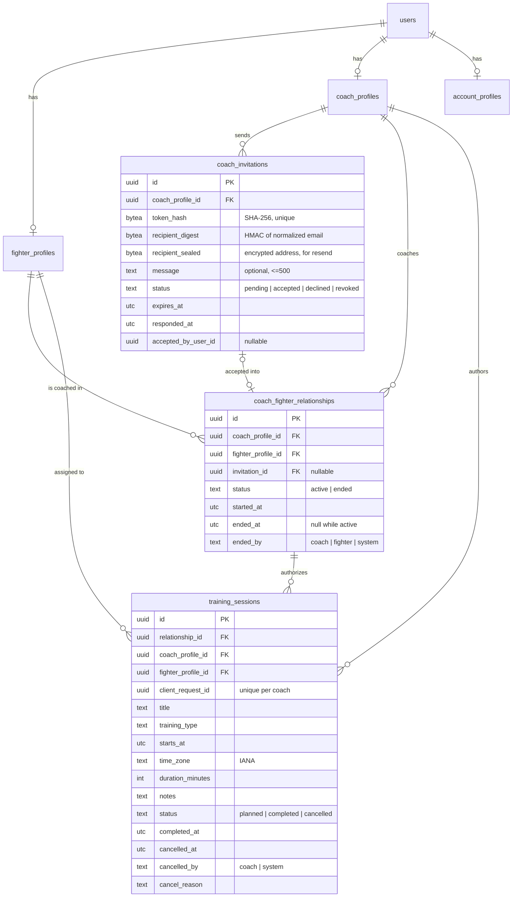
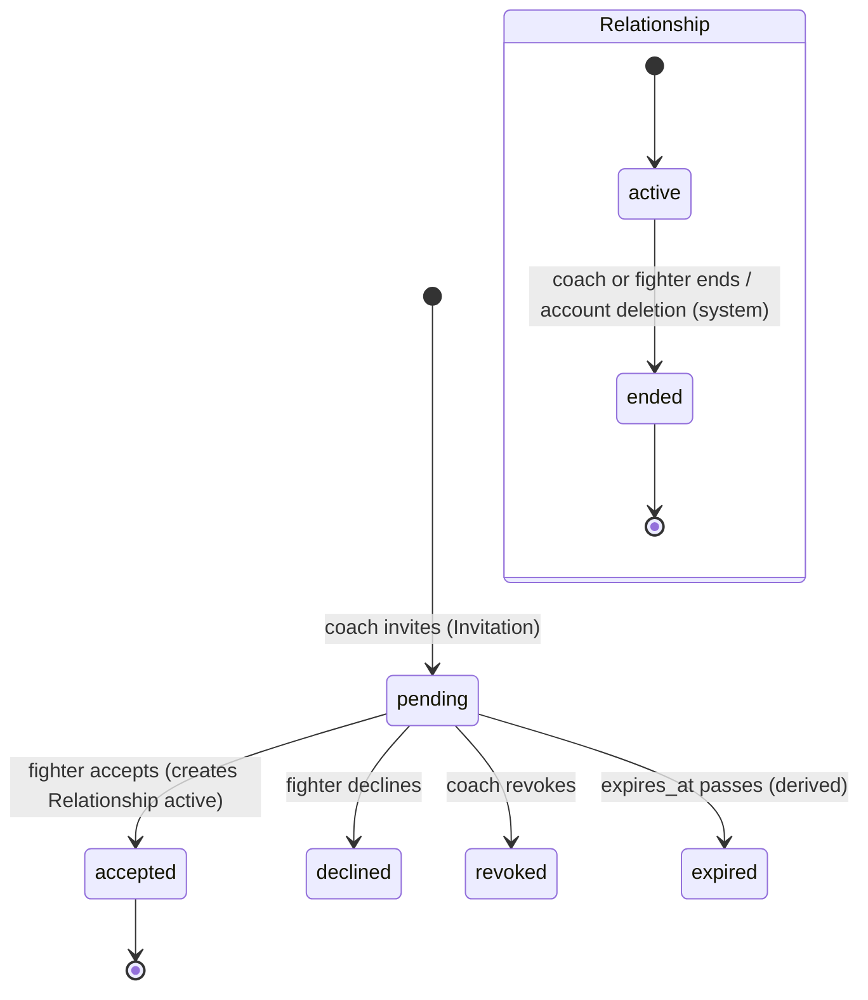
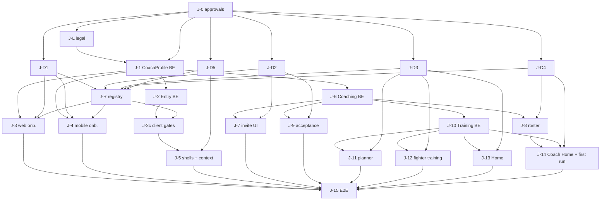

# SF-49 — Coach & Training Domain Architecture + Design Reconciliation

**Status: PROPOSED. Nothing here is approved.** Every decision below waits
for explicit product/architecture approval. No migration, schema,
controller, OpenAPI operation, client or screen was created for SF-49.

Epic SF-48 (Coach–Fighter Coaching & Training MVP). Discovery date
2026-10-13.

**Revision 2 (2026-10-13).** Reconciles the product owner's approved
direction (§0), replaces the rejected "a completed role always wins" entry
rule with a deterministic precedence (§5), and fixes the CoachProfile
contract (§4.2), the Fighter data whitelist (§6.4) and the training-type
vocabulary (§8.2) to design evidence. Adds the Claude Design change request
(§18) and the SF-25/SF-44/SF-45 contradictions (§19). The document as a
whole remains **PROPOSED**: approved *direction* is recorded as such; every
concrete contract below still needs final approval.

---

## 0. Architecture decision table

"Direction approved" = the product owner approved the principle (revision 2
brief). "Proposed" = the concrete contract derived from it, awaiting final
approval. "Open" = needs a product-owner choice (§16).

| # | Decision | Status | Where |
|---|---|---|---|
| A-1 | CoachProfile is independent of AccountProfile, FighterProfile and any GymWorkspace | Direction approved | §4.1 |
| A-2 | One user may be Coach and Fighter at once | Direction approved | §4.1, §5 |
| A-3 | `CoachProfile.display_name` is its own public field, never copied from `AccountProfile.full_name` | Direction approved | §4.2 |
| A-4 | Coach onboarding MVP uses only backend-supported fields with one vocabulary for web and mobile | Direction approved; vocabulary **Open** (O-1, O-2) | §4.2 |
| A-5 | Multiple active coaches per fighter, no primary | Direction approved | §6.1 |
| A-6 | Invitation and relationship are separate authoritative entities | Direction approved | §6.2, §7 |
| A-7 | MVP invitations: email, authenticated explicit fighter acceptance | Direction approved | §7 |
| A-8 | Coach sees only approved fighter fields + coach-authored sessions | Direction approved; whitelist **Open** (O-4) | §6.4 |
| A-9 | Ending a relationship revokes private access at once; history kept; explicit policy for future sessions | Direction approved; policy Proposed, coach history view **Open** (O-6) | §6.3, §6.4 |
| A-10 | TrainingSession MVP: one coach → one fighter; planned/completed/cancelled; backend-confirmed completion | Direction approved; completion actor **Open** (O-7) | §8 |
| A-11 | Completion invents no metrics or training logs | Direction approved | §8.2 |
| A-12 | UTC timestamps + validated IANA zone ids | Direction approved; tz database dependency **Open** (O-8) | §8.3 |
| A-13 | Coaches work without gym membership | Direction approved | §9 |
| A-14 | No under-16 participation in the MVP | Direction approved | §4.2 (no "Youth"), §19 |
| A-15 | SF-45 precedence: explicit intent > requested context > default by role state; profile contexts ≠ gym workspaces | Proposed (replaces rev. 1 rows 8–12) | §5 |
| A-16 | Training types = the design's five-value taxonomy | Proposed; **Open** (O-5) | §8.2 |
| A-17 | Mixed state (one role completed, another in progress, no intent/context) → `context_selection` | Proposed; **Open** (O-3) | §5.3 |

---

## 1. Baseline

| Repo | Branch | HEAD | State |
|---|---|---|---|
| simplefit-api | main | `76926f2` (merge of SF-30, PR #20) | clean |
| simplefit-platform | main | `dbc7afd` (merge of SF-30, PR #31) | clean |
| simplefit-mobile | main | `5850402` (merge of SF-28, PR #29) | clean |

SF-18 (SF-19…SF-30) is merged in all three repos.

### Existing backend contexts (production-ready)

| Context | Owns | ADR |
|---|---|---|
| `SimpleFit.Accounts` | `users`, `identities`, `sessions`, `session_refresh_tokens`, `email_auth_challenges`, `account_profiles`, `account_consents` | 0009, 0010, 0012–0014, 0016 |
| `SimpleFit.Fighters` | `fighter_profiles` (one per user; `not_started` = no row / `in_progress` / `completed`; immutable completion trigger; unique `lower(username)`) | 0015 |
| `SimpleFit.Entry` | read-only resolver `GET /api/v1/me/entry` (no table) | 0017 |
| `SimpleFit.FirstRun` | `first_run_outcomes` (`fighter_web_tour`, `fighter_mobile_first_run`; first outcome wins) | 0018 |
| `SimpleFit.Email` + `Templates` | Oban delivery with encrypted payloads; **E08 `coach_invite` template exists, render-only, no trigger** | 0011 |
| `SimpleFit.RateLimit`, `Observability.Redaction`, `SimpleFitWeb.ClientIP` | Abuse limits (Postgres windows), log/Sentry redaction (`sf[argv]_` tokens), IPv6 /64 keys | 0012, 0019 |

8 migrations exist; none touches Coach, relationships, invitations or training.

**No Coach, Gym, relationship, invitation, workspace or training code exists
in the backend.** No admin capability exists in the backend (`ADMIN` appears
only in the route registry).

### Existing clients

* Web and mobile `docs/route-registry.json` are byte-identical (SF-31,
  design version `1791448557-b0b9`, read 2026-10-08). Registry `COACH` is
  `grantedBy: CoachProfile`; onboarding routes need only a session
  (`D-ONBOARDING-ENTRY-CAPABILITY`, resolved).
* Every Coach route in web (`/app/coach/*`, 17 pages) and mobile (`(coach)`
  group, tabs Today/Fighters/Board/Requests/Inbox) is a
  **`placeholderRoute` only**. The shells (`WorkspaceShell` web, `ShellTabs`
  mobile) are real. Registry status "IMPLEMENTED" means "route exists".
* `entryDestinations.coach_onboarding` already maps to
  `web.app.onboarding.coach` / `mobile.onboarding.coach`.
* All 32 design-proposed API rows (incl. `/api/v1/invites`,
  `/api/v1/sessions`, `/api/v1/me/workspaces`) are `DEFERRED` inventory
  (`D-BACKEND-PROPOSED`).

### Implementation findings (code, not design)

| ID | Finding | Evidence | Impact |
|---|---|---|---|
| F-1 | `Entry` rule 4 assumes FighterProfile is the only role state | `lib/simple_fit/entry.ex` `fighter_route/2`, `capabilities/1` | Must be extended (not rewritten) for Coach |
| F-2 | Web `FighterGate` renders only when `destination == "fighter_home"` | `simplefit-platform/src/features/session-gate/ui/fighter-gate.tsx` | A user who is completed Fighter **and** Coach would be bounced out of Fighter pages if the no-intent entry ever resolves elsewhere. Gate must check `capabilities` instead |
| F-3 | `entryHref` treats only `fighter_home` as "journey complete" | `features/session-gate/model/entry.ts` (web + mobile) | Generalise to every `*_home` destination |
| F-4 | Mobile `(fighter)`/`(coach)` layouts do not enforce capability ("registry metadata only") | `simplefit-mobile/src/app/(coach)/_layout.tsx` | Coach shell needs a capability gate like web |
| F-5 | No IANA time-zone database dependency (`tz`/`tzdata` absent) | `mix.exs`, `mix.lock` | TrainingSession time zones need a dependency decision (CLAUDE.md rule 18, ADR 0004) |
| F-6 | Redaction covers `sfa_ sfr_ sfv_ sfg_` only | `observability/redaction.ex:37` | A new invitation token prefix must be added |

---

## 2. Claude Design — version and inventory

* Artifact `JEsBg51MjX8KiHWEro8omY`, **live version `1791877903-9d9a`**
  (read 2026-10-13), 492 artboards, 11 pages. Structured `.dc.html` files
  and `project/canvas.json` were read; no screenshots used.
* The route registry was built from `1791448557-b0b9`. Every Coach **screen**
  artboard below is still referenced by the registry; the 44 boards the
  registry does not reference are flow/route/sheet boards (`FlowCoach`,
  `RouteCoach`, `FlowAuthModel`, tour-step sheets…). Content changes between
  the two versions were **not** diffed (no access to the old version) →
  D-SF49-17.

Status legend: **MVP** = proposed for SF-48; **REDUCED** = MVP with only real
data; **DEFER** = keep placeholder; **FUTURE** = design marks it future.

### 2.1 Coach registration and first run

| Artboard | File | Route | Owner | Required API | Existing | Gap / note |
|---|---|---|---|---|---|---|
| O05 Choose role | Onboarding | `mobile.onboarding.role` | Entry | entry | real (SF-47) | — |
| WA6 Where to start | WebRoleSelect | `web.app.onboarding.role` | Entry | entry | real | — |
| OC1 Coach profile | OnbCProfile | `mobile.onboarding.coach` | Coaches | coach-profile | placeholder | MVP · vocabulary differs from web (D-01) |
| OC2 Coaching type | OnbCType | same `?step` | Coaches | coach-profile | placeholder | MVP · D-01 |
| OC3 Credentials (optional) | OnbCCredentials | same | Trust (future) | uploads | placeholder | DEFER (uploads, review) D-02 |
| OC4 Business size | OnbCSize | same | Billing (future) | — | placeholder | DEFER D-02 |
| OC5 Where (gym) | OnbCWhere | same | Gyms (future) | — | placeholder | DEFER gym part D-03 |
| OC6 Plan | OnbCPlan | same | Billing (future) | — | placeholder | DEFER D-02 |
| OC7 Services | OnbCServices | same | Commerce (future) | — | placeholder | DEFER |
| OC8 Payouts | OnbCPayouts | same | Payments (future) | — | placeholder | DEFER |
| OC9 Invite fighters | OnbCInvite | same | Coaching | invitations | placeholder | MVP (email invite only) D-07 |
| OC10 Data rules | OnbCPrivacy | same | Coaching / legal | acknowledgement | placeholder | MVP, needs SF-48 legal D-10 |
| OC11 Complete | OnbCReady | same | Coaches | coach-profile | placeholder | REDUCED (no trial/payout/licence states) |
| WCR1 Profile | WebRegCProfile | `web.app.onboarding.coach?step=profile` | Coaches | coach-profile | placeholder | MVP · D-01 |
| WCR2 Coaching type | WebRegCType | `?step=type` | Coaches | coach-profile | placeholder | MVP · D-01 |
| WCR3 Credentials | WebRegCCreds | `?step=credentials` | Trust (future) | uploads | placeholder | DEFER |
| WCR4 Business size | WebRegCSize | `?step=size` | Billing (future) | — | placeholder | DEFER |
| WCR5 Gym | WebRegCGym | `?step=gym` | Gyms (future) | — | placeholder | DEFER |
| WCR6 Plan | WebRegCPlan | `?step=plan` | Billing (future) | checkout | placeholder | DEFER |
| WCR7 Complete | WebRegCDone | `?step=complete` | Coaches | coach-profile | placeholder | REDUCED |
| CR1–CR3 Intro | FirstRunC1–C3 | `mobile.coach.welcome` | FirstRun | first-run | placeholder | MVP (copy shows invented team data → REDUCED) |
| CR4 Today checklist | FirstRunCToday | `mobile.coach.today` | FirstRun + Coaching | entry, first-run | placeholder | REDUCED (only profile/invite/session items) |
| CR5 Tour | FirstRunCSessionTip(+Steps) | `mobile.coach.today?tour` | FirstRun | first-run | placeholder | MVP if tour targets exist |
| CRW1 Dashboard first run | FirstRunWebC | `web.app.coach` | FirstRun | first-run | placeholder | REDUCED |
| CRW2 Tour | FirstRunWebCTour(+Steps) | `web.app.coach.sessions.new?tour=2` | FirstRun | first-run | placeholder | MVP if targets exist |
| E03 Welcome coach | EmailWelcomeCoach | — | Email | — | template exists | trigger on completion (optional) |

### 2.2 Coach application

| Artboard | File | Route | Owner | API | Existing | Gap |
|---|---|---|---|---|---|---|
| WC1 Dashboard | WebCoachDashboard | `web.app.coach` | projection | sessions, roster, invitations | placeholder | REDUCED: KPIs (attendance, rounds, camp), AI, sparring, booking requests are absent domains D-04 |
| Coach web nav | CoachWebNav | shell | client | entry | shell real, items placeholder | MVP items: Dashboard, Fighters, Programs & sessions, Calendar, Coach settings; others DEFER |
| C01 Today | CoachToday | `mobile.coach.today` | projection | sessions, roster | placeholder | REDUCED (AI summary, weight flags, video, booking absent) |
| Coach tab bar | CoachTabs | shell | client | — | real | Board/Requests/Inbox tabs DEFER |
| WC7 Fighters | WebCoachFighters | `web.app.coach.fighters` | Coaching | roster | placeholder | REDUCED: weight/camp/attendance/flags absent; groups absent D-06 |
| C03 Fighters | Fighters | `mobile.coach.fighters` | Coaching | roster | placeholder | REDUCED |
| WC4 Fighter 360 | WebFighter360 | `web.app.coach.fighters._fighter-id` | Coaching | roster detail, sessions | placeholder | REDUCED: Overview + Sessions only; Weight, Video, Notes, Medical DEFER D-10 |
| C04 Fighter quick view | FighterQuick | `mobile.coach.fighters._fighter-id` | Coaching | roster detail | placeholder | REDUCED |
| WC3 Program & session builder | WebProgramBuilder | `web.app.coach.sessions.new` | Training | training-sessions | placeholder | REDUCED: "Single fighter" (and "Group" = N individual sessions) only; blocks/timer/shared/class DEFER D-12 |
| W08 Calendar (shared) | WebCalendar | `web.app.calendar` | Training projection | training-sessions | placeholder | MVP subset (training layer only) |
| WC6 / CS1 Coach settings | WebCoachSettings / CoachSettings | `web.app.coach.settings` / `mobile.settings.coach` | Coaches | coach-profile | placeholder | REDUCED: profile edit only; services, booking rules, payouts, assistants, access log DEFER |
| A04 Workspaces | Workspaces | `mobile.workspaces` | Entry projection | entry | placeholder | MVP (personal Fighter + Coach contexts only; no gym rows) D-05 |
| WA2 Choose workspace | WebLoginWorkspace | `web.login?step=workspace` | Entry | entry | not built | MVP when ≥2 completed contexts (§6) |
| WC2/C12 Team activity, WC8/C11 Board, WC5/C14 Sparring, C05 Session control, C06 Sparring control, C02 Roster & attendance, C07 Quick note, C08 Video, C09 Booking requests, C10 AI drafts, C13 Shared roster, C15 Challenge, F07 Fight camp | various | various | Sparring / Camp / Social / Booking / Video / AI (future) | — | placeholder | DEFER — no approved domain |
| CC1–CC10, AV3–AV5, CO1 | commerce | `/app/coach/{services,earnings,payouts}…` | Commerce/Payments (future) | — | placeholder | DEFER |

### 2.3 Invitations and Fighter side

| Artboard | File | Route | Owner | API | Existing | Gap |
|---|---|---|---|---|---|---|
| E08 Coach invited you | EmailCoachInvite | email | Coaching → Email | invitation create | template only | MVP (variables need `coaching_name`, D-01) |
| INV1 Coach invites fighter (landing) | InviteCoach | `mobile.invite._code` | Coaching | invitation preview | placeholder | MVP; copy "land straight in Marek's team" conflicts with consent D-08 |
| A03 Join with invite | JoinInvite | `mobile.join._code` | Gyms (future) | — | placeholder | DEFER (gym member invite) |
| INV2 Gym invites coach | InviteGymCoach | `mobile.invite.coach._token` | Gyms (future) | — | placeholder | DEFER |
| OF7 Fighter · coach | OnbFCoach | fighter onboarding step 7 | Coaching | — | not built (ADR 0015 approved OF1–OF4 only) | DEFER; "Request coach"/"Find a coach" are fighter→coach requests + marketplace |
| WF3 Fighter web · coach | WebRegFCoach | — | Coaching | — | **FUTURE in design** ("needs the Coach domain") | DEFER |
| Invitation accept + consent | **missing** | — | Coaching | accept/decline | — | **Missing artboard (web + mobile)** D-08 |
| Fighter "My coaches" / remove access | **missing** | — | Coaching | list/end | — | **Missing artboard** D-09 |
| F24 Training hub | TrainingHub | `mobile.training` | Training projection | training-sessions | placeholder | REDUCED: "Up next · assigned by coach" + history of assigned sessions |
| F04 Session plan | SessionDetail | `mobile.sessions._session-id` | Training | training-session | placeholder | REDUCED: no block/timer structure D-12 |
| F05 Live training | LiveTraining | `…/live` | Timer (future) | — | placeholder | DEFER |
| F06 Training complete | SessionLog | `…/complete` | Training | complete | placeholder | REDUCED: done only; RPE/body flags/rounds DEFER D-14 |
| F12 Calendar | Calendar | `mobile.calendar` | Training projection | training-sessions | placeholder | MVP subset |
| Fighter Home (FRW1/W01, F01) | FirstRunWebF / WebHome / Main | `web.app.home`, `mobile.home` | projection | training-sessions | real (SF-40/41) | Add "next assigned session" card when sessions exist |
| S10/S16/S08 Shared sessions | SessionCreator, TrainingInvite, SharedSession | `mobile.shared-session.*` | Social training (future) | — | placeholder | DEFER (multi-participant) |

### 2.4 Shared flows read

FlowAuthModel (SF-21), RouteAuth, RouteCoach, FlowCoach, FlowWeb,
FlowWebRoute, FlowFirstRun, FlowOnboarding, GalleryIndex 1–4 were read for
paths and transitions. RouteAuth: "Sign-in … lands in the last workspace or
asks which one" (WA2 web, A04 mobile).

---

## 3. Proposed bounded contexts

```text
Accounts ◄── Fighters ◄──┐
   ▲            ▲         │
   │            │         │
   ├── Coaches ◄┼── Coaching (relationships + invitations) ◄── Training
   │            │         ▲                                     ▲
   └── Entry ───┴─────────┴─── (reads profiles, never writes)   │
FirstRun ── reads Fighters/Coaches completion ──────────────────┘ (no dep)
Email ◄── Coaching (E08 delivery)          RateLimit ◄── Coaching
```

Arrows point at the dependency. No cycles: Fighters and Coaches never call
Coaching or Training; Coaching never calls Training except the single
"relationship ended" hook, which is inverted (Training subscribes by being
called from Coaching's transaction through a public `Training.cancel_for_relationship/2`;
see §9). If that call direction is unacceptable, use an Oban job.

| Context | Responsibility | Owns | Owned transitions | Public interface (indicative) | Authorizes | Must NOT own |
|---|---|---|---|---|---|---|
| **Accounts** (existing) | Identity, sessions, account registration, consents | users, identities, sessions, account_profiles, account_consents | as today | unchanged | own data | roles, profiles of other domains |
| **Fighters** (existing) | Fighter profile + onboarding | fighter_profiles | not_started→in_progress→completed | + `get_profile_by_id/1` (internal), `coach_projection/1` (non-body fields) | owner access | relationships, who may see the fighter |
| **Coaches** (new) | Coach profile + onboarding | coach_profiles | not_started→in_progress→completed | `get_profile/1`, `update_profile/2`, `complete_onboarding/1`, `onboarding_status/1` | owner access | gyms, plans, services, payouts, credentials review, fighters |
| **Coaching** (new) | Coach↔Fighter relationships and the invitations that create them | coach_fighter_relationships, coach_invitations | invitation pending→accepted/declined/revoked/(expired); relationship active→ended | `invite/2`, `preview_invitation/2`, `accept/2`, `decline/2`, `revoke/2`, `list_roster/2`, `get_roster_entry/2`, `list_my_coaches/1`, `end_relationship/2`, `authorize(actor, relationship_id, action)` | **every coach→fighter data access** | training content, fighter profile fields, gym membership |
| **Training** (new) | Coach-assigned training sessions | training_sessions | planned→completed / planned→cancelled | `create/2`, `update/3`, `cancel/2`, `complete/2`, `list_for_coach/2`, `list_for_fighter/2`, `cancel_for_relationship/2` | session-level rules, delegating "is this coach related to this fighter" to Coaching | relationships, timer, programs, bookings, logs |
| **Entry** (existing, extended) | Post-auth destination | — | — | `resolve/2` | none (projection) | any write |
| **FirstRun** (existing, extended) | Tour outcomes | first_run_outcomes | first outcome wins | + coach keys | owner | — |
| Gyms, Fight Camps, Sparring, Booking/Payments, Timer/Training Log | **future** | — | — | — | — | — |

Events: none needed in MVP. Telemetry `[:simple_fit, :coaching, :invitation, …]`
counts outcomes only (ADR 0008/0019).

---

## 4. CoachProfile

### 4.1 Identity and ownership (proposed)

* `coach_profiles`, one row per user (`unique (user_id)`), created on first
  meaningful save; no row = `not_started`. Same structure as ADR 0015.
* **One CoachProfile per user.** Gym-coach roles later are
  *workspace memberships* (`gym_memberships` with role coach), not a second
  CoachProfile. Design A04 shows "Yauheni Coaching · COACH" and
  "Warsaw BC · COACH" as two *workspaces*; only the first is the personal
  CoachProfile.
* No `gym_id`. No role on `users`. Coexists with FighterProfile.

### 4.2 Field contract — revision 2 (PROPOSED)

**Rule used:** a field enters the MVP only if (a) the backend can own it
today without an absent domain, and (b) it is on *both* platforms once the
design change request (§18, CR-1) lands. Enum keys are snake_case forms of
the design labels; no value below is invented.

#### 4.2.1 Design source inventory (verbatim)

| Concept | Mobile (OC1/OC2/OC5) | Web (WCR1/WCR2/WCR5) |
|---|---|---|
| Public name | none: OC1 shows the account name "Yauheni Bykouski" read-only under the photo | none: only "Brand name" |
| Brand name | OC5 "Brand name" (under "Independent coach", skippable step) | WCR1 "Brand name" (profile step) |
| City | OC1 "City" | WCR1 "City" |
| Country | OC1 "Country" | **absent** |
| Bio | OC1 "Bio" | WCR1 "Bio" |
| Languages | OC1 chips: English, Polski, Русский, Беларуская, Українська | WCR1 chips: Polish, English, Belarusian, Russian |
| Years coaching | OC1: < 1 · 1–3 · 3–5 · 5–10 · 10+ (single) | **absent** |
| Boxing background | OC1 free text | WCR3 (credentials step) free text |
| Coaching type | OC2 "How do you coach?" (multi): Personal Training · Group Coaching · Amateur Competition · Professional Boxing · Online Coaching · Fight Camps · Strength & Conditioning | WCR2 three facets — **practice** (single): Independent · Gym coach · Both; **what you coach** (multi): Amateur boxing · Pro boxing · Fitness boxing · Youth · Women's boxing; **delivery** (multi): In person · Online coaching · Fight camps |
| Practice / gym | OC5: Join existing gym · Create gym · Independent coach | WCR2 practice facet + WCR5 gym search, Own space, Online only |

#### 4.2.2 Proposed canonical vocabulary (O-1, needs approval)

Mobile OC2 mixes *what kind of service* with *what level*; web separates
them. Recommendation: two orthogonal facets built only from those labels.

**`coaching_formats`** (multi; "how you coach"):

| Key | Mobile label | Web label |
|---|---|---|
| `personal_training` | Personal Training | — (web: delivery "In person" is broader) |
| `group_coaching` | Group Coaching | — |
| `online_coaching` | Online Coaching | Online coaching (delivery) |
| `fight_camps` | Fight Camps | Fight camps (delivery) |
| `strength_conditioning` | Strength & Conditioning | — |

Web delivery "In person" has no mobile counterpart and overlaps
`personal_training` + `group_coaching`; recommendation: drop it (O-1b).

**`coaching_levels`** (multi; "who you coach"):

| Key | Mobile label | Web label |
|---|---|---|
| `amateur` | Amateur Competition | Amateur boxing |
| `professional` | Professional Boxing | Pro boxing |
| `fitness` | — | Fitness boxing |
| `womens` | — | Women's boxing |
| ~~`youth`~~ | — | Youth — **excluded** (A-14; also ambiguous vs the 16+ rule) |

`fitness` and `womens` exist only on web; either mobile gains them (CR-1) or
they are dropped (O-1c).

Not in MVP: **practice model** (Independent / Gym coach / Both) and every
gym option (A-13: no gym domain; personal coaching is implied).

**`languages`**: ISO 639-1 codes limited to the union of the design chips:
`en`, `pl`, `ru`, `be`, `uk`. Widening to the app locales (`de`, `es`, `fr`)
or to full ISO 639-1 is a product choice (O-2).

#### 4.2.3 Field contract

| Field | Type | Required at completion | Owner | Validation | Editable after completion | Design source / CR |
|---|---|---|---|---|---|---|
| `display_name` | text 1..60 | **yes** | Coaches | trimmed, printable, never prefilled from `full_name` (A-3) | yes | **new input on OC1 + WCR1 (CR-1)**; shown as "Coach Marek" in CoachWebNav |
| `brand_name` | text 1..80 | no | Coaches | trimmed | yes | WCR1; moved from OC5 to OC1 (CR-1) |
| `country_code` | ISO 3166-1 alpha-2 | **yes** | Coaches | `SimpleFit.Fighters.CountryCodes` list (reuse, SF-25) | yes | OC1; **added to WCR1 (CR-1)** |
| `city` | text 1..80 | **yes** | Coaches | trimmed | yes | OC1, WCR1 |
| `bio` | text 0..500 | no | Coaches | plain text, no HTML | yes | OC1, WCR1 |
| `languages` | array of `en`,`pl`,`ru`,`be`,`uk` (O-2), ≤ 5, unique | no | Coaches | allow-list | yes | OC1, WCR1 |
| `coaching_formats` | array of 5 keys above, ≥ 1, unique | **yes** (OC2/WCR2 have no Skip) | Coaches | allow-list | yes (stays ≥ 1) | OC2, WCR2 (CR-1) |
| `coaching_levels` | array of `amateur`,`professional`(,`fitness`,`womens`) | no | Coaches | allow-list | yes | OC2, WCR2 (CR-1) |
| `onboarding_completed_at` | UTC timestamp | set by completion | Coaches | immutable (trigger) | no | — |

Deferred (each needs another domain or exists on one platform only):
`years_coaching` (mobile only; marketplace use), `boxing_background`
(mobile profile vs web credentials step), photo (uploads), credentials and
verification, business size, plan/trial, services, payouts, gym
affiliation, practice model, public slug.

#### 4.2.4 Minimal completion requirements (recommendation)

1. Account registration complete (SF-44; adult by construction, A-14).
2. `display_name`, `country_code`, `city`.
3. `coaching_formats` with at least one value.
4. **Coach data-rules acknowledgement (OC10 "I agree")** — recommended
   required, but it is a versioned legal text: it needs an SF-48 legal
   document and a consent record (an `account_consents` kind, ADR 0016
   style, or a coach-owned record). Until that text exists, either block
   Coach completion or show OC10 as information only (O-9).

Rejected: requiring brand name (optional on both designs), languages,
levels, or any deferred field.

### 4.3 Lifecycle — reuse the FighterProfile pattern

Recommended: identical semantics to ADR 0015.

* First save with at least one changed field creates the row (`in_progress`);
  empty or no-op PATCH returns current state and never creates.
* PATCH is partial; invalid PATCH changes nothing; row lock
  (`SELECT … FOR UPDATE`) serializes concurrent edits; last write per field
  wins, untouched fields preserved.
* `POST …/complete-onboarding` requires every required field **and**
  completed account registration (same `account_registration: required`
  error as Fighter); missing → `validation_error` with `required` per field.
* Repeat completion is a no-op returning the original `completed_at`
  (DB trigger forbids change, like `fighter_profiles_completion_immutable`).
* After completion every field stays editable with the same validation;
  removing a required field after completion is rejected (`required`).

---

## 5. Coach capability and SF-45 entry precedence (revision 2)

Revision 1's rule "a completed role always takes precedence over an
unfinished one" is **withdrawn**. An explicit, authorized Coach journey is
never overridden by a completed FighterProfile.

### 5.1 Vocabulary — three different things

| Term | Meaning | Values | Grants anything? |
|---|---|---|---|
| **Journey intent** (`intent`, exists) | "I want to set up / enter this role's journey" — may start or resume onboarding | `fighter`, `coach`, `gym`, `sponsor` | no |
| **Requested context** (`context`, new, additive) | "Open my existing application context" — selects among *completed* profile contexts only, never starts onboarding | `fighter`, `coach` | no |
| **Workspace** (future, Gyms) | Which organization inside an organizational context (which gym) | gym ids | membership-based |

Profile contexts (Fighter, Coach) are the user's own roles; a gym workspace
is an organization. The entry resolver lists profile contexts and, later,
"Gym" as one context; choosing *which* gym is a separate step owned by Gyms
(session-scoped active workspace, `D-WORKSPACE-NOT-IN-URL`). The resolver
never lists individual gyms.

Facts: `account_registration`, `fighter_profile`, `coach_profile`
(`not_started | in_progress | completed`). Capabilities: `FIGHTER` iff
fighter completed, `COACH` iff coach completed (projection only; every API
call is still authorized by its context).

### 5.2 Deterministic precedence (backend, `GET /api/v1/me/entry`)

Evaluated top to bottom; the first matching step decides.

| Step | Condition | Destination | `mandatory` | Reason (new ones *italic*) |
|---|---|---|---|---|
| P1 | account registration not complete | `account_registration` (intent/context/returnTo carried as continuation) | yes | `account_registration_incomplete` |
| P2a | `intent=fighter`, fighter completed | `fighter_home` | no | `fighter_onboarding_completed` |
| P2b | `intent=fighter`, fighter not completed | `fighter_onboarding` | yes | `fighter_onboarding_not_started` / `_in_progress` |
| P2c | `intent=coach`, coach completed | *`coach_home`* | no | *`coach_onboarding_completed`* |
| P2d | `intent=coach`, coach not completed — **whatever the Fighter state** | `coach_onboarding` | yes | *`coach_onboarding_not_started`* / *`coach_onboarding_in_progress`* |
| P2e | `intent=gym` / `sponsor` | `gym_onboarding` / `sponsor_application` (unchanged) | no | `gym_intent` / `sponsor_intent` |
| P3a | `context=X` and X completed | X's home | no | *`requested_context`* |
| P3b | `context=X` and X not completed | ignored → continue at P4 (never starts onboarding); response `context: null` | — | — |
| P4a | no completed context, no role started | `role_selection` | no | `no_role_started` |
| P4b | no completed context, exactly one role in progress | that role's onboarding | yes | `…_onboarding_in_progress` |
| P4c | exactly one completed context, no other role started | that home | no | `…_onboarding_completed` |
| P4d | ≥ 2 completed contexts | *`context_selection`* | no | *`multiple_contexts`* |
| P4e | one completed + another in progress | *`context_selection`* (lists the completed context and "Continue coach setup") | no | *`unfinished_role`* — **O-3** |
| P4f | none completed, ≥ 2 in progress | *`context_selection`* (which setup to continue) | no | *`multiple_contexts`* |

`intent` and `context` together: `intent` wins (explicit journey), `context`
ignored. Invalid values of either: `validation_error` (`invalid_choice`), as
today. `coach_intent` stays in the API enum (additive-only rule) but is no
longer emitted.

**O-3 alternatives for P4e** (completed Fighter, Coach in progress, nothing
requested): (a) `context_selection` — recommended: honest, user decides
once per device via the remembered context; (b) `fighter_home` plus a
"continue coach setup" prompt — needs a new response field; (c)
`coach_onboarding` mandatory — rejected: an abandoned optional journey would
block a working context.

### 5.3 Client application order (returnTo is client-only)

`returnTo` never reaches the API (SF-24/SF-45 path policy). After the
resolver answers, the client decides in this order:

1. `mandatory` destination → go there; `returnTo` kept as continuation.
2. Destination from **P2** (intent) → go there; a `returnTo` is used only if
   it is a home destination (P2a/P2c) and the `returnTo` route's capability
   is the intent's capability.
3. Otherwise a **usable `returnTo`** (safe path, not the entry route, route
   capability held — `usableReturnTo`) wins over P3/P4.
4. Otherwise the destination.

Examples:

| Situation | Result |
|---|---|
| Completed Fighter taps "Become a coach" (`intent=coach`) | `coach_onboarding` (P2d), mandatory |
| Same user, Coach in progress, signs in on a new device, no intent | `context_selection` (P4e) |
| Dual user opens `/app/coach/fighters` deep link | P4d → `context_selection`, but step 3: `returnTo` held → opens the link |
| Fighter-only user opens `/app/coach/fighters` | `returnTo` dropped (COACH not held) → `fighter_home` |
| Dual user's device remembers "Coach" | client sends `context=coach` → `coach_home` (P3a) |
| Remembered "Coach" but the device is now used by another account | remembered choice is keyed by user id and cleared on sign-out (SF-28 boundary) → not sent |

### 5.4 Context selection and switching

* `context_selection` → web WA2 (post-auth variant, CR-9) / mobile A04.
  Lists completed profile contexts, in-progress setups ("Continue coach
  setup" = `intent=coach`), and "Set up another role" (→ WA6/O05). No gym
  rows until Gyms exist; no fabricated workspace entries.
* "Remember my choice on this device" = device-local, per user id, sent as
  `context`. Nothing stored server-side.
* In-shell switcher (web `D-WEB-WORKSPACE-SWITCHER`, mobile A04) navigates
  to the chosen home; it lists the same items from `capabilities` + profile
  states.
* The URL is the context for profile contexts (`/app/home`, `/app/coach`;
  `(fighter)`, `(coach)`); no server "active context".
* Session restore re-resolves (SF-28); deep links follow §5.3.

### 5.5 Gates and required client changes

* Area gates check capability (`FIGHTER` / `COACH` ∈ `capabilities`), never
  destination equality (F-2). A gate that lacks its capability resolves with
  no intent/context and redirects with the page as `returnTo`.
* `entryHref` treats every `*_home` as a completed journey (F-3) and applies
  §5.3.
* Mobile `(coach)` and `(fighter)` groups get capability gates (F-4).
* `knowsDestination` / `entryDestinations` gain `coach_home` and
  `context_selection` (registry reconciliation R-2); unknown destinations
  stay a controlled failure.

### 5.6 Decision table summary for ADR 0017 amendment

Rule order: registration → explicit journey intent → requested completed
context → default by role state (single completed home, otherwise choice).
Nothing written by the resolver; intent and context grant nothing.

---

## 6. Coach–Fighter relationship

### 6.1 Cardinality — **Option B, multiple active coaches, no primary** (direction approved, A-5)

| | A: one active coach | B: many, no primary | C: many + primary |
|---|---|---|---|
| Design evidence | OF7 "Do you have a coach?" (singular) | WC4/WC7 "visible to the fighter's **coaches** only"; WC3 "Coaches: Marek · Ola (pads)"; WC6 assistant coach; A04 coach in two workspaces | no artboard shows "primary" |
| Boxing reality | breaks boxing coach + S&C coach, club coach + personal coach | fits | fits, extra concept |
| Future gyms | gym coach + independent coach collide | independent rows, gym relationship separate | primary ambiguous across gyms |
| Training assignment | trivially one author | each session names its coach | primary-only assignment unclear |
| Privacy | simplest | each relationship is its own grant, revocable alone | same as B |
| Complexity | lowest | low: unique per pair | + rules for primary transfer |

Option B is the approved direction (A-5): the design consistently speaks
of a fighter's *coaches*, real training uses several, and each relationship
is an independent, revocable grant.

### 6.2 Model



Constraints:

* `unique (coach_profile_id, fighter_profile_id) where status = 'active'`
  — at most one active relationship per pair; re-connection after `ended`
  inserts a new row (history kept).
* `check (status = 'active' and ended_at is null or status = 'ended' and ended_at is not null)`.
* Self-coaching forbidden (coach and fighter profiles of the same user) —
  enforced in Coaching (cross-table, not a DB check); tested.
* `ended` is terminal (trigger, like other append-only rows).
* Both profiles must be **completed** to relate (O-10).

### 6.3 Lifecycle



Pending lives **only** on the invitation; the relationship has no pending
state (single source of truth).

| Action | Who | Effect |
|---|---|---|
| Invite | completed Coach | pending invitation + E08 email |
| Accept | the signed-in user holding the token, with a completed FighterProfile | invitation accepted; relationship `active` (or the existing active one, idempotently) |
| Decline | token holder (signed in) | invitation declined; coach sees "declined" without reason |
| Revoke | the inviting coach | pending → revoked |
| End | either side | relationship `ended`; future planned sessions cancelled (`system`, `relationship_ended`); access revoked immediately |
| Re-invite | coach, after decline/expiry/revoke/end | new invitation; rate-limited per recipient digest |

### 6.4 Fighter data whitelist and historical access (revision 2, PROPOSED — O-4, O-6)

Three tiers. Only tiers 1 and 2 can ever reach a coach in the MVP, and only
through an **active** relationship of **that** coach. Every row needs
explicit product-owner approval (A-8); nothing outside this table is
granted.

**Tier 1 — public fighter identity** (ADR 0015 calls these the public
fighter identity; visible to a coach with an active relationship).

| FighterProfile field | Coach access | Evidence |
|---|---|---|
| `display_name` | read | WC7/C03/C04/WC4 show the fighter name |
| `username` | read | WC7 roster (`@handle` pattern from SF-25 preview) |
| `country_code` | read | — (identity; not exact location) |
| `city` | read | ADR 0015 public identity; OC10 forbids *exact* location only |

**Tier 2 — boxing profile, shared by the acceptance consent** (must be
listed on the acceptance screen, CR-2; recommended individually).

| FighterProfile field | Coach access | Recommendation | Evidence |
|---|---|---|---|
| `experience_level` | read | include | WC7 "LEVEL", WC4 "Amateur" |
| `stance` | read | include | WC4 "orthodox", C04 |
| `amateur_bout_count` | read | include | coaching-relevant; C04 shows a record "7-2-0" (wins/losses/draws are **not** in FighterProfile — not provided) |
| `goals` | read | include | coaching-relevant (fight_preparation, competition…) |
| `next_fight_on`, `next_fight_name` | read | include | WC7 "Fight Nov 3", C04 "NEXT FIGHT", WC4 "31 days to Nov 3" |
| onboarding status | — | not needed (a relationship requires completed profiles) | — |

**Tier 3 — private / sensitive, never to a coach in the MVP.**

| Data | Why | Future path |
|---|---|---|
| `weight_class`, `current_weight_kg`, `height_cm` | ADR 0015: returned only to the owner; E08/OC10: weight only "during a camp", "only if you allow" | per-category consent + ADR 0015 amendment (Fight Camp / consent ticket) |
| AccountProfile `full_name`, `date_of_birth`, consents, product news | SF-44 private account data (A-3) | never |
| Email, identities, sessions, devices | identity data | never |
| First-run outcomes, entry state | internal | never |
| Training by other coaches, self-training, RPE, pain/body flags, videos, messages | other owners / absent domains; OC10 "NEVER: messages with others" | Training Log with consent scopes |
| Other relationships of the fighter (who else coaches them) | privacy between coaches | product decision later |

**Coach-authored sessions**: the authoring coach reads and manages the
sessions they created for this fighter, including status and
`completed_at` (A-8).

**On termination (A-9)** — proposed policy:

* Immediately: every tier 1/2 read and every session read/write of that
  coach for that fighter stops (404).
* Future `planned` sessions of the relationship → `cancelled`,
  `cancelled_by = system`, `cancel_reason = relationship_ended`, in the same
  transaction (explicit policy for future scheduled sessions).
* Records are preserved: the relationship row (`ended`), invitations and all
  sessions stay in the database; the fighter keeps full read access to
  their own sessions.
* **O-6 — coach's view of history after end.** Recommended: the coach keeps
  only a relationship stub (fighter `display_name`, `started_at`,
  `ended_at`) in an "ended" list, and no session or profile data.
  Alternative: the coach keeps read access to the plan fields of sessions
  they authored, without fighter completion data.
* Re-connection creates a new relationship; sessions bound to the old one
  never become visible again through it.

---

## 7. Invitation domain

### 7.1 MVP mechanism (direction approved, A-7)

Recommended MVP: **coach → fighter email invitation (E08)**, single-use,
accepted explicitly by a signed-in fighter. Deferred: the coach's standing
share link/QR with coach approval (OC9 "You approve each fighter"),
fighter→coach requests (OF7 "Request Coach Marek"), invite codes (WF3
`YB-7Q2K`), roster import (OC9), marketplace.

### 7.2 Security

* Token: 32 random bytes, base64url, prefix `sfi_`; stored only as
  SHA-256 hash (`unique`); shown once in the email link
  `…/invite/coach#token=sfi_…` (URL fragment, as ADR 0012 link tokens — never
  in server logs or referrers). Add `i` to the Redaction prefix class (F-6).
* Expiry: 14 days (decision); one-time use; accept/decline/revoke under a row
  lock; a used/expired/revoked/unknown token yields one normalized error
  `invitation_unavailable` (no enumeration of states).
* **No email matching**: acceptance does not require the accepting
  account's email to equal the invited address (Google/Apple emails differ;
  ADR 0009 forbids linking by email). Mitigation: explicit consent screen
  showing coach identity and data scope; the coach learns the identity of
  whoever accepted and can end it. Recipient address is never shown to the
  accepting user.
* No account, FighterProfile or relationship is created by sending.
* Rate limits (`RateLimit`): per coach per hour/day, per recipient digest
  per day, preview/accept per IP (`ClientIP.limit_key`).
* Stored: recipient HMAC digest (duplicate detection) + sealed address
  (Plug.Crypto, existing key pattern) for resend; never plaintext; never logged.
* Duplicate pending invite to the same digest → returns the existing pending
  invitation (idempotent), resend rotates the token.
* Concurrency: two accepts of one token → one wins, the other gets the
  same result idempotently if it is the same user, `invitation_unavailable`
  otherwise; an already active pair → invitation accepted, existing
  relationship returned.

### 7.3 Deep links

Web: `/invite/coach#token=…` → if signed out, auth with continuation
(token kept client-side like `intent`), account registration, Fighter
onboarding if needed (`intent=fighter`), then the **accept/consent screen
(missing artboard)**. Mobile: same via universal link to
`mobile.invite._code`; SecureStore not needed (short-lived continuation in
memory/router params). Never auto-accept (A-7; CR-2, CR-11).

---

## 8. TrainingSession

### 8.1 Terminology

| Term | Meaning | MVP? |
|---|---|---|
| **TrainingSession** | one planned training for one fighter, authored by a coach within a relationship; it carries its own completion | **yes** |
| Scheduled class | gym timetable entry, many members book | no (Gyms) |
| Booking | a purchase/reservation of a coach or class slot | no (Booking/Payments) |
| Training program / template | reusable multi-session plan, blocks library (WC3) | no |
| Shared session | several fighters train together (S10/S08) | no |
| Training log / completed workout | fighter's self-logged training, rounds, RPE, body flags | no (Training Log) |
| Round/timer execution | timer run (F05, T-screens) | no (Timer) |

MVP TrainingSession = **plan + its completion** in one row (no separate
execution entity yet). Group assignment ("same plan, trained separately",
WC3) = N TrainingSessions created in one request.

### 8.2 Field contract (proposed)

| Field | Type | Required | Set by | Validation | Editable |
|---|---|---|---|---|---|
| `relationship_id` | uuid | yes | coach (server-checked) | active, owned by caller | no |
| `coach_profile_id`, `fighter_profile_id` | uuid | derived | server | from relationship | no |
| `client_request_id` | uuid | yes | client | unique per coach (idempotency) | no |
| `title` | text 1..80 | yes | coach | — | while planned |
| `training_type` | enum, §8.2.1 (O-5) | yes | coach | allow-list | while planned |
| `starts_at` | UTC instant | yes | coach | within −1 day … +1 year (decision) | while planned |
| `time_zone` | IANA zone id | yes | coach client | validated against a tz database (A-12; dependency O-8) | while planned |
| `duration_minutes` | int 5..600 | yes | coach | — | while planned |
| `notes` | text ≤ 2000 | no | coach | plain text | while planned |
| `status` | `planned/completed/cancelled` | server | transitions | — | — |
| `completed_at` | UTC | server | on complete | — | no |
| `cancelled_at`, `cancelled_by`, `cancel_reason` | UTC, enum, enum | server | on cancel | — | no |

No metrics, calories, AI scores, RPE, rounds or body flags in MVP (A-11).

#### 8.2.1 Training-type vocabulary (PROPOSED — O-5)

The design has one recurring five-value taxonomy and one divergent picker:

| Source | Role in the design | Values |
|---|---|---|
| WebBoard (Live Board web) | **filter "TRAINING TYPE"** + legend | Technical · Sparring · Pads · S&C · Roadwork |
| WebAnalytics (W07) | "Training mix" breakdown | Technical 34% · Sparring 24% · Pads 20% · S&C 12% · Roadwork 10% |
| WebCampBoard | colour keys | Technical · Sparring · Pads · S&C · Roadwork |
| WebHome (W01) | week strip | Pads · Roadwork · S&C · Sparring · Technical |
| WebCoachActivity (WC2) | grouped legend | "Technical / pads" · "Sparring" · "S&C / road" |
| WebFighter360, WebCoachFighters, TrainingHub, Calendar, WebCalendar, GymClasses, WebTimetable | session titles | "Technical", "Technical Boxing", "Sparring", "Pads", "Roadwork", "S&C", "PT" |
| SessionCreator (S10, fighter *shared* training) | the only explicit **type picker** | Technical + Sparring · Bag work · Roadwork · S&C |
| WebProgramBuilder, SessionDetail, SessionLog, ActivityDetail | **blocks inside a session**, not session types | Warm-up, Shadow(boxing), Pads, Heavy bag, Sparring, Drill, S&C circuit, Roadwork, Cool-down, Conditioning |

Recommended `training_type` (single value):

| Key | Label | Evidence |
|---|---|---|
| `technical` | Technical | WebBoard, W07, camp board, W01, WC2, rosters ("Technical Boxing" titles) |
| `sparring` | Sparring | same |
| `pads` | Pads | same (absent from S10) |
| `strength_conditioning` | S&C | same, S10 |
| `roadwork` | Roadwork | same, S10 |

Not adopted: "Technical + Sparring" (a combination; the five-value filter
cannot classify it), "Bag work" (only in S10; "Heavy bag" is a block),
"PT" (a booking/service type, Commerce), blocks (Templates/Timer, later).
O-5 asks the product owner to confirm the five values and drop S10's set
when S10 is designed for real (shared sessions are out of MVP).

#### 8.2.2 Backend-confirmed completion (A-10)

`POST …/complete` takes no client timestamp or metrics; the server sets
`completed_at = now()` under a row lock and returns the session. Who may
call it is **O-7** (recommended: the assigned fighter only — the record is
the fighter's training; coach "End session" (C05) belongs to future group
session control).

### 8.3 Temporal semantics

UTC instant + IANA zone of where the training happens. Clients compute the
instant from local date/time in that zone; the server re-validates the zone
(tz database dependency, O-8) and stores both; a client-asserted, unvalidated
zone is rejected by A-12. Display in the session's zone;
show the viewer's zone if it differs. Rescheduling replaces both. DST: an
instant is unambiguous; a non-existent local time is rejected client-side
and server-side. Completion time is server `now()`.

### 8.4 State transitions

| From | Action | Actor | To | Repeat | Conflict |
|---|---|---|---|---|---|
| — | create | coach (active relationship) | planned | same `client_request_id` → same row (200) | — |
| planned | update | authoring coach | planned | — | non-planned → 409 `conflict` |
| planned | complete | **fighter** (O-7) | completed | completed → 200 same | cancelled → 409 |
| planned | cancel | authoring coach | cancelled | cancelled → 200 same | completed → 409 |
| planned | relationship ends | system | cancelled (`relationship_ended`) | — | — |
| completed / cancelled | any | — | terminal | — | 409 |

Concurrent complete vs cancel: row lock; first wins, second gets 409.

### 8.5 Permissions

| Operation | Authoring coach (active rel.) | Same coach after end | Other coach | Fighter (assignee) | Other user |
|---|---|---|---|---|---|
| Create | ✓ | ✗ | ✗ | ✗ (self-training future) | ✗ |
| Read | ✓ | ✗ (O-6) | ✗ | ✓ (always, own history) | ✗ → 404 |
| Update / cancel | ✓ while planned | ✗ | ✗ | ✗ | ✗ |
| Complete | ✗ (O-7) | ✗ | ✗ | ✓ while planned | ✗ |

Extension points: nullable `coach_profile_id` for self-training, a
`training_session_participants` table for shared/group sessions, a
`program_id` for templates, a separate `training_logs` for execution data —
all added only by their tickets. `gym_id` never required.

---

## 9. Gym boundary

* Personal: CoachProfile, COACH capability, independent relationships,
  coach-authored sessions — work with no gym.
* Organizational (future): gym workspace, gym memberships with roles
  (owner, coach, staff, member), classes, gym-coach access to gym members.
* A gym-coach seeing gym members' data will come from **gym membership +
  gym consent**, never from `coach_fighter_relationships`. A relationship
  belongs to the coach (personal), not the gym; leaving a gym never ends
  personal relationships (WC6: "Your private clients stay").
* A coach may later hold memberships in several gyms; each is a separate
  workspace (A04), switched via session context (`D-WORKSPACE-NOT-IN-URL`).
* No foundational permission change is needed now; no `gym_id` anywhere.

---

## 10. Authorization matrix (backend; every grant from session identity + persisted state)

| Actor \ Resource | Own CoachProfile | Own FighterProfile | Invitations | Relationships | TrainingSessions |
|---|---|---|---|---|---|
| Anonymous | ✗ 401 | ✗ 401 | preview by token only (rate-limited) | ✗ | ✗ |
| Auth, no profiles | create/update (in_progress) | create/update | accept/decline ✗ (needs completed fighter) | ✗ | ✗ |
| Fighter incomplete | create/update | update | accept ✗ (O-10) | ✗ | ✗ |
| Fighter completed | create/update | read/update | accept/decline by token; list none | list/end own | read/complete own |
| Coach incomplete | update/complete | — | ✗ (needs completed coach) | ✗ | ✗ |
| Coach completed | read/update | — | create/list/revoke/resend own | list/read/end own roster | create/update/cancel/list own |
| Coach, no relationship with F | — | — | — | F's data → **404** | create for F → 404 |
| Coach + Fighter (same user) | both | both | cannot invite self | no self-relationship | as each role |
| Future gym member | boundary only: no access through gym | — | — | — | — |
| Platform admin | **no backend capability exists**; no admin path proposed (D-18) | | | | |

IDOR rules: no endpoint accepts `coach_id`, `fighter_id` or `user_id` as
authority; coach endpoints address fighters by **relationship id** checked
against the caller's CoachProfile and `status = active`; foreign or ended
ids answer `404 not_found` (never 403, no existence oracle). Tests per ticket:
cross-coach, cross-fighter, ended relationship, self-relationship.

---

## 11. Proposed API (indicative; nothing added to OpenAPI)

| Method | Path | Owner | Auth | Notes |
|---|---|---|---|---|
| GET | `/api/v1/me/coach-profile` | Coaches | session | `CoachProfileResponse` with `onboarding {status, completed_at, missing_requirements}` |
| PATCH | `/api/v1/me/coach-profile` | Coaches | session | partial; 422 field_codes |
| POST | `/api/v1/me/coach-profile/complete-onboarding` | Coaches | session | idempotent |
| GET | `/api/v1/me/entry` | Entry | session | **additive**: query `context`; response `coach_profile`, `context`; destinations `coach_home`, `context_selection`; new reasons (§5.2); `COACH` |
| PUT | `/api/v1/me/first-run/{experience}` | FirstRun | session | **additive** keys `coach_web_tour`, `coach_mobile_first_run` |
| POST | `/api/v1/me/coach/invitations` | Coaching | completed coach | `{email, message?}` → 201/200 existing; 429 |
| GET | `/api/v1/me/coach/invitations` | Coaching | completed coach | cursor pagination, `status` filter; email masked |
| POST | `/api/v1/me/coach/invitations/{id}/resend` · `/revoke` | Coaching | inviting coach | 404 foreign; 409 non-pending |
| POST | `/api/v1/coach-invitations/preview` | Coaching | none (token in body) | coach display info + data scope; `invitation_unavailable` |
| POST | `/api/v1/me/coach-invitations/accept` · `/decline` | Coaching | completed fighter | `{token}`; idempotent per user |
| GET | `/api/v1/me/coach/fighters` | Coaching | completed coach | roster (active), cursor pagination |
| GET | `/api/v1/me/coach/fighters/{relationshipId}` | Coaching | completed coach | fighter projection (§6.4) |
| POST | `/api/v1/me/coach/fighters/{relationshipId}/end` | Coaching | coach | 200 idempotent |
| GET | `/api/v1/me/coaches` | Coaching | completed fighter | fighter's active coaches |
| POST | `/api/v1/me/coaches/{relationshipId}/end` | Coaching | fighter | 200 idempotent |
| POST | `/api/v1/me/coach/training-sessions` | Training | completed coach | single or `relationship_ids[]` batch; `client_request_id` |
| GET | `/api/v1/me/coach/training-sessions` | Training | coach | `from`,`to`, `relationship_id`; cursor |
| PATCH | `/api/v1/me/coach/training-sessions/{id}` | Training | authoring coach | planned only |
| POST | `/api/v1/me/coach/training-sessions/{id}/cancel` | Training | authoring coach | idempotent |
| GET | `/api/v1/me/training-sessions` · `/{id}` | Training | fighter | own sessions |
| POST | `/api/v1/me/training-sessions/{id}/complete` | Training | fighter | idempotent |

Errors: existing envelope and codes (`validation_error`, `unauthorized`,
`not_found`, `conflict`, `rate_limited`) plus one new
`invitation_unavailable`. Generated clients: web + mobile via
`pnpm api:generate`. Premature (not proposed): `/api/v1/me/workspaces`,
public coach pages, programs, bookings, shared sessions, admin.

---

## 12. Web and mobile module map

| Screen | Route | UI owner (FSD) | API | Current | Ticket |
|---|---|---|---|---|---|
| Coach onboarding (WCR1–2, 7 reduced) | `web.app.onboarding.coach` | `widgets/coach-onboarding` + `features/coach-profile-form` + `entities/coach-profile` | coach-profile | placeholder | Coach Web Onboarding |
| Coach onboarding (OC1–2, 9, 10, 11 reduced) | `mobile.onboarding.coach` | same layering in mobile | coach-profile, invitations | placeholder | Coach Mobile Onboarding |
| Coach shell + gate | `web.app.coach` layout / `(coach)` | `widgets/workspace-shell`, `features/session-gate` | entry | shell real | Coach Shells + Entry |
| Context switcher / WA2 / A04 | in-shell / `web.login?step=workspace` / `mobile.workspaces` | `features/context-switch` | entry | placeholder | Coach Entry |
| Coach dashboard / Today (reduced) | `web.app.coach` / `mobile.coach.today` | `widgets/coach-home` | sessions, roster, invitations | placeholder | Coach Home |
| Roster | `web.app.coach.fighters` / `mobile.coach.fighters` | `widgets/coach-roster`, `entities/coach-relationship` | roster | placeholder | Coach Roster |
| Fighter 360 / quick view (reduced) | `…/fighters/:fighterId` (= relationship id) | `widgets/fighter-detail-coach` | roster detail, sessions | placeholder | Coach Roster |
| Invite fighters | web composer (**missing artboard**), OC9 | `features/invite-fighter` | invitations | placeholder | Invitations UI |
| Invitation accept/consent | **missing artboard**; INV1 landing | `features/accept-coach-invitation` | preview/accept | placeholder | Fighter Invitation Acceptance |
| My coaches / remove access | **missing artboard** | `features/my-coaches` | coaches | — | Fighter Invitation Acceptance |
| Session planner (single/group) | `web.app.coach.sessions.new` | `widgets/session-planner`, `entities/training-session` | training-sessions | placeholder | Coach Training Planner |
| Coach calendar | `web.app.calendar` (coach context) | `widgets/calendar` | training-sessions | placeholder | Coach Training Planner |
| Fighter training hub / detail / complete | `mobile.training`, `mobile.sessions._session-id(+/complete)`; web `web.app.calendar` | `widgets/fighter-training` | training-sessions | placeholder | Fighter Training Screens |
| Fighter Home next session | `web.app.home` / `mobile.home` | existing home widgets | training-sessions | real | Fighter Home Integration |

Registry: **no change in SF-49**. Later registry ticket: `coach_home`,
`context_selection` destinations (§18.2 R-2), design version re-sync to
`1791877903-9d9a`, invitation accept route(s) once designed.

---

## 13. Future compatibility

| Future domain | Supported by model? | Future addition | Not now |
|---|---|---|---|
| Gym management | yes (no gym coupling) | Gyms context, gym memberships, workspace session context | gym_id, fake memberships |
| Gym coach memberships | yes | membership role `coach` | second CoachProfile |
| Templates / programs | yes | `training_programs`, `program_id` on sessions | block library, JSON plan |
| Round Timer | yes | Timer executions referencing a session | timer fields on session |
| Training Log | yes | `training_logs` (RPE, rounds, body flags) with consent scopes | RPE/body on session |
| Fight Camps | yes | `fight_camps` per relationship | camp fields |
| Sparring | yes | sparring pairs/requests context | — |
| Booking & payments | yes | services, bookings, payouts | plan/trial on profile |
| Live Board / graph | yes (relationships are edges) | projections | graph DB |

---

## 14. Discrepancy register

*Revision 2:* D-02, D-03, D-07, D-11, D-20, D-21 are settled in direction
(§0); D-01 → O-1/O-2, D-04 → O-13, D-10 → O-4/O-6, D-12 → O-14/O-15,
D-13 → O-5, D-14 → O-7, D-15 → O-10, D-16 → O-8. Design fixes are §18.

| ID | Source | Conflict | Sev. | Recommended resolution | Owning task | Approval |
|---|---|---|---|---|---|---|
| D-01 | OnbCProfile/OnbCType vs WebRegCProfile/WebRegCType | Coach fields differ by platform: mobile has years coaching, boxing background, country, languages {en,pl,ru,be,uk}, 7 "coaching types" mixing format/level/service; web has brand name, practice model (independent/gym/both), "what you coach" {amateur, pro, fitness, youth, women's}, delivery {in person, online, fight camps}, languages {pl,en,be,ru} | **High** | One backend vocabulary (§4.2) chosen by product; both clients render it | CoachProfile BE | **Yes** |
| D-02 | OC3/4/6/7/8, WCR3/4/6 | Credentials, business size, plan, services, payouts are non-skippable or prominent registration steps but their domains (uploads/trust, billing, commerce, payments) do not exist | **High** | MVP registration = profile + type + data rules (+ optional invite); other steps hidden, not faked; done screens drop trial/licence/payout states | Coach onboarding (web/mobile) | **Yes** |
| D-03 | OC5, WCR5 | Gym affiliation/pending owner approval inside registration | High | Defer to Gyms; keep "independent/online" only if D-01 keeps practice model | Coach onboarding | Yes |
| D-04 | WC1, C01, CR1, CRW1, FighterQuick | Home/dashboard filled with absent domains (AI summary, weight corridor, attendance %, rounds, camp, sparring approvals, bookings, video, revenue) | High | Reduced home with real data + designed empty states (as SF-40 Fighter home) — needs reduced-state artboards or explicit approval to omit cards | Coach Home | **Yes** |
| D-05 | Workspaces (A04), CoachWebNav | Coach identity shown as gym context ("WARSAW BC · HEAD COACH", "Competition Team") | Med | MVP shows personal coach context only | Coach shells | Yes |
| D-06 | WC7, C03, C01 | Groups/teams ("Competition 14", "In camp 4") not modelled | Med | Defer groups; roster = active relationships | Coach Roster | Yes |
| D-07 | OC9, E08, OF7, WF3 | Four invitation mechanisms/directions (share link with coach approval, email invite, fighter request, invite code) | **High** | MVP: email invite only (§7) | Invitation BE | **Yes** |
| D-08 | InviteCoach (INV1) | "After you sign in you land straight in Marek's team" implies auto-join; no consent step artboard | **High** | Explicit accept + data-scope consent screen (new artboard web + mobile); never auto-accept | Invitation acceptance | **Yes** |
| D-09 | E08 "remove access any time", OC10 | No fighter-side "my coaches / remove access" screen | High | New artboard (mobile + web) | Invitation acceptance | **Yes** |
| D-10 | OnbCPrivacy (OC10), E08, ADR 0015 | Consent categories (logs, RPE/pain/body, weight in camp, videos) "only with fighter's consent"; ADR 0015 makes body data owner-only; no per-category consent UI | **High** | MVP shares no body/weight data; relationship acceptance = consent to the §6.4 scope; category consents later; legal text via SF-48 | Coaching BE + legal | **Yes** |
| D-11 | Design plurality vs OF7 singular | Coach cardinality undefined | **High** | Option B (§6.1) | Relationship BE | **Yes** |
| D-12 | WebProgramBuilder (WC3), S10 | Builder is block/timer/program based with 4 assign modes; mobile coach has no single-fighter session creator | High | MVP: single + batch "group" sessions with notes; mobile creator artboard missing or web-only planner for MVP | Training planner | **Yes** |
| D-13 | SessionCreator, TrainingHub, WebFighter360, Calendar | Training type vocabulary inconsistent (Technical+Sparring, Bag work, Roadwork, S&C, Pads, Technical Boxing, Sparring) | Med | One enum approved by product | TrainingSession BE | **Yes** |
| D-14 | SessionLog (F06), SessionControl (C05) | Completion = fighter's rich log (rounds per block, RPE "private by default", body flags "coach only") vs coach "End session"; actor differs | High | MVP: fighter marks complete; no metrics; coach cannot complete | TrainingSession BE | **Yes** |
| D-15 | — | Can an incomplete Fighter accept? (OF7 sits inside fighter onboarding, ADR 0015 built only OF1–OF4) | Med | Require completed FighterProfile; continuation carries token through onboarding | Invitation BE | Yes |
| D-16 | F-5 | IANA zones need a tz database dependency | Med | Add `tz` (or `tzdata`) with ADR 0004 justification, or accept client-asserted zone | TrainingSession BE | **Yes** (dependency) |
| D-17 | registry `source.version` | Registry built from `1791448557-b0b9`; live is `1791877903-9d9a`; content not diffed | Med | Registry re-sync ticket before Coach UI tickets | Registry | No (process) |
| D-18 | registry `ADMIN` | Admin capability has no backend; matrix row "platform admin" empty | Low | No admin access to coaching data in MVP | — | Yes |
| D-19 | WebCoachSettings, CoachSettings | Assistant coaches ("can see logs, not notes"), fighter-visible access log | Med | Future; record that access is per relationship so delegation can be added | — | No |
| D-20 | WebRegCType "Youth" vs ADR 0016 under-16 rejection | Coaching minors implied but minors cannot register | Med | Remove "Youth" or define guardian flow (legal) | Product/legal | **Yes** |
| D-21 | OnbCProfile vs WebRegCProfile | Coach public name: account full name (mobile shows it) vs brand name (web) | Med | `display_name` separate from `full_name`; brand optional (D-01) | CoachProfile BE | Yes |
| D-22 | OnbCInvite, OnbCReady, FirstRunWebC | Public coach link `sfit.box/c/…` (slug) | Low | Defer with marketplace; no slug in MVP | — | Yes |
| D-23 | F-2, F-3, F-4 | Client gates hard-code Fighter | Med (code) | Fix in Coach Entry ticket | Coach Entry | No |
| D-24 | D-WEB-COACH-FIGHTER-INVITE (registry) | Web "Invite fighters" targets mobile INV1 | Med | Web invite composer artboard | Invitations UI | Yes |

---

## 15. Proposed ADRs (all PROPOSED)

1. **ADR 0020 — Coach profile and onboarding** (new; mirrors 0015).
   Problem: a Coach capability needs a backend profile. Constraints: ADR
   0009 (no roles on users), 0015 pattern, 0016 registration gate. Options:
   reuse FighterProfile with a role flag (rejected: one profile per role,
   ADR 0009); generic `role_profiles` JSON (rejected: speculative, untyped);
   dedicated `coach_profiles` (recommended). Trade-off: duplication of the
   lifecycle code with Fighters (acceptable, two instances; extract later if
   a third appears). Compatibility: additive. Open: O-1, O-2, O-9.
   Includes the personal-Coach vs Gym boundary (§9).
2. **ADR 0017 amendment — Coach entry and context precedence.** Adds the
   `coach_profile` fact, the `context` request parameter (completed profile
   contexts only), `coach_home`, `context_selection`, `COACH` capability and
   the precedence P1–P4 of §5.2; separates profile contexts from gym
   workspaces. Rejected: "a completed role always wins" (overrides explicit
   journeys), server "active context" state (unnecessary for profile
   contexts), client-only resolution (duplicated state machines).
   Compatibility: additive parameter, fields and enum values; clients already
   fail safely on unknown destinations. Open: O-3.
3. **ADR 0018 amendment — Coach first-run keys** (`coach_web_tour`,
   `coach_mobile_first_run`); availability = coach completed.
4. **ADR 0021 — Coach–Fighter relationships and invitations.**
   Cardinality B, invitation-only creation, pending on invitation only,
   relationship id as the access handle, privacy scope §6.4, token security
   §7.2, termination and history. Rejected: relationship with `pending`
   state (two sources of truth), email-matched acceptance (ADR 0009),
   gym-membership-as-relationship. Open: O-4, O-6, O-10, O-11, O-12.
5. **ADR 0022 — Training sessions.** Plan + completion in one row,
   relationship-anchored authorization, backend-confirmed completion, UTC +
   validated IANA zone,
   `client_request_id` idempotency, cancellation on relationship end.
   Rejected: generic polymorphic activity table, JSON plan blocks, booking
   coupling. Open: O-5, O-7, O-8, O-15.
6. Personal Coach vs Gym workspace boundary: **folded into 0020/0021**
   (no separate ADR, to avoid a redundant document).

---

## 16. Unresolved decisions for the product owner (revision 2)

Rev. 1 items D-02, D-07, D-11, D-20, D-21 are settled in direction by §0
(A-4, A-7, A-5, A-14, A-3). Remaining choices:

| # | Question | Options | Recommendation | Blocks |
|---|---|---|---|---|
| O-1 | Coach vocabulary (§4.2.2) | a) `coaching_formats` = personal_training, group_coaching, online_coaching, fight_camps, strength_conditioning; b) drop web "In person"; c) keep or drop web-only levels `fitness`, `womens`; d) drop practice model (Independent/Gym coach/Both) from MVP | a yes · b drop · c keep both (add to mobile) · d drop | J-1, J-3, J-4, CR-1 |
| O-2 | Coach languages | design chips {en, pl, ru, be, uk} / + app locales {de, es, fr} / full ISO 639-1 | design chips | J-1 |
| O-3 | Mixed state, no intent/context (completed Fighter + Coach in progress) | `context_selection` / Fighter home + resume prompt / force coach onboarding | `context_selection` | J-2 |
| O-4 | Fighter whitelist (§6.4) | approve tier 1 and each tier 2 field | tiers 1 + 2 as listed; tier 3 never | J-6, CR-2 |
| O-5 | Training types (§8.2.1) | five-value taxonomy / S10 picker / both | five values: technical, sparring, pads, strength_conditioning, roadwork | J-10, CR-6 |
| O-6 | Coach's view after a relationship ends | stub only / stub + authored plan fields | stub only | J-6 |
| O-7 | Who confirms completion | fighter only / coach only / either | fighter only | J-10 |
| O-8 | IANA validation dependency (CLAUDE.md rule 18, ADR 0004) | `tz` / `tzdata` | `tz` (pure Elixir, no runtime downloads) — justification at J-10 | J-10 |
| O-9 | Coach data-rules acknowledgement (OC10) | required, versioned (needs SF-48 legal text) / informational only | required, versioned; J-1 completes once the text exists | J-1, J-L |
| O-10 | Preconditions | invite needs completed CoachProfile; accept needs completed FighterProfile | yes / yes | J-6, CR-2 |
| O-11 | Invitation lifetime and resend | 14 days; resend rotates the token and resets expiry | as stated | J-6 |
| O-12 | E08 requires `fighter_name` and `coaching_name` | composer asks the recipient's name and `coaching_name` falls back to `display_name` / change the template to an optional greeting | composer field "Name (optional)" + template change to optional `fighter_name`; `coaching_name` = `brand_name` or `display_name` | J-6, CR-4, CR-12 |
| O-13 | Reduced Coach Home cards (CR-8) | upcoming sessions, roster count, pending invitations, setup checklist (profile, invite, first session) | these four | J-14, CR-8 |
| O-14 | Mobile coach session creation in MVP | yes (new artboard) / web planner only in MVP | yes | J-11, CR-6 |
| O-15 | Batch "group" assignment (WC3 "Group: same plan, trained separately") | N single sessions in one request / single only | N single sessions, max 30 | J-10, J-11 |

Minor (implementer's choice within the ticket): bio length 500, display
name 60, page sizes, batch limit, error field names, telemetry names.

---

## 17. Follow-up Jira tasks and dependencies (revision 2, proposal — no tickets created)

| Key | Task | Repos | Depends on | ADR |
|---|---|---|---|---|
| J-0 | Product-owner approval of §0 + O-1…O-15 | — | this document | — |
| J-L | Legal: coach data-rules text, fighter acceptance consent wording | docs/legal (SF-48) | J-0 | — |
| J-D1 | Claude Design CR-1 Coach registration vocabulary + reduced steps | Claude Design | J-0 (O-1, O-2, O-9) | — |
| J-D2 | Claude Design CR-2…CR-5, CR-11, CR-12 invitations (composer, acceptance/consent, my coaches, INV1/E08 copy) | Claude Design | J-0 (O-4, O-10, O-12), J-L | — |
| J-D3 | Claude Design CR-6, CR-7, CR-10 training (mobile creator, reduced planner, fighter F04/F06/F24, Home card) | Claude Design | J-0 (O-5, O-7, O-14, O-15) | — |
| J-D4 | Claude Design CR-8, CR-13, CR-14 reduced Coach Home, first run, roster, Fighter 360 | Claude Design | J-0 (O-4, O-13) | — |
| J-D5 | Claude Design CR-9 context selection (WA2 post-auth, A04, switchers) | Claude Design | J-0 (O-3) | — |
| J-R | Route-registry reconciliation R-1…R-6 (web + mobile, byte-identical) | platform, mobile | J-D1…J-D5 | — |
| J-1 | CoachProfile backend | api | J-0, J-L (O-9) | 0020 |
| J-2 | Entry precedence backend (§5) | api | J-1, O-3 | 0017 amd. |
| J-2c | Client entry + capability gates (F-2…F-4) | platform, mobile | J-2, J-R | — |
| J-3 / J-4 | Coach onboarding web / mobile | platform / mobile | J-1, J-D1, J-R | — |
| J-5 | Coach shells + context selection UI | platform, mobile | J-2c, J-D5 | — |
| J-6 | Coaching backend: relationships + invitations (+ Fighters coach projection, Redaction `sfi_`, E08 trigger) | api | J-1, O-4, O-6, O-10–O-12 | 0021, 0015 amd. |
| J-7 | Invitation UI: web composer + mobile OC9 | platform, mobile | J-6, J-D2, J-R | — |
| J-8 | Coach roster + Fighter 360 (reduced) | platform, mobile | J-6, J-D4, J-R | — |
| J-9 | Fighter acceptance/consent + My Coaches | platform, mobile | J-6, J-D2, J-L, J-R | — |
| J-10 | TrainingSession backend incl. completion | api | J-6, O-5, O-7, O-8, O-15 | 0022 |
| J-11 | Coach planner web + mobile creator | platform, mobile | J-10, J-D3, J-R | — |
| J-12 | Fighter training screens | platform, mobile | J-10, J-D3, J-R | — |
| J-13 | Fighter Home integration | platform, mobile | J-10, J-D3 | — |
| J-14 | Reduced Coach Home + Coach first run (FirstRun keys) | api, platform, mobile | J-8, J-10, J-D4 | 0018 amd. |
| J-15 | E2E hardening (SF-30 harness: dual-role, invitation, training, IDOR) | all | J-2c…J-14 | — |



Parallel: design tickets J-D1…J-D5 run in parallel with each other and with
J-1/J-2/J-6/J-10 backend work once J-0 is decided; J-3 ∥ J-4; J-7 ∥ J-8 ∥
J-9; J-11 ∥ J-12 ∥ J-13. Milestones: **M1** J-1…J-5 · **M2** J-6…J-9 ·
**M3** J-10…J-14 · **M4** J-15.

**Next implementation task after final approval: J-1 CoachProfile backend**
(needs O-1, O-2, O-9 and the legal text, or O-9 = informational).


---

## 18. Design-reconciliation change request (PROPOSED — nothing changed in Claude Design or the registries)

### 18.1 Claude Design changes (artifact `JEsBg51MjX8KiHWEro8omY`, from version `1791877903-9d9a`)

| CR | Change | Artboards affected | Platform | New / edit |
|---|---|---|---|---|
| CR-1 | Canonical Coach registration: add **Coach name** (`display_name`) input; move Brand name to the profile step; add Country to web; replace OC2/WCR2 lists with `coaching_formats` + `coaching_levels` (§4.2.2); remove "Youth" and the practice facet; languages chips = O-2 set; mark OC3–OC8 and WCR3–WCR6 as FUTURE (like WF2–WF5); fix step counters; data-rules step per O-9 | OnbCProfile, OnbCType, OnbCWhere, OnbCCredentials, OnbCSize, OnbCPlan, OnbCServices, OnbCPayouts, OnbCPrivacy, WebRegCProfile, WebRegCType, WebRegCCreds, WebRegCSize, WebRegCGym, WebRegCPlan | both | edit |
| CR-1b | Truthful completion screens: no trial, plan, licence review, payout or gym states | OnbCReady (OC11), WebRegCDone (WCR7) | both | edit |
| CR-2 | **Fighter invitation acceptance + consent**: coach identity (display/brand name), tier 1/2 data list and "never" list, Accept / Decline, states: signed-out continuation, fighter setup required (O-10), already connected, invitation unavailable (one normalized state), self-invite, success | new (web + mobile) | both | new |
| CR-3 | **My Coaches / Remove access**: active coaches, what each can see, remove-access confirmation, ended list | new (mobile settings area; web account/settings area) | both | new |
| CR-4 | **Web Coach invitation composer**: email, optional recipient name (O-12), optional message ≤ 500 (E08), sent list with pending/accepted/declined/expired/revoked, resend/revoke, rate-limited state | new (from WC7 "Invite fighters", WC1) | web | new |
| CR-5 | Mobile OC9 reduced to email invite; share link/QR/roster import marked FUTURE | OnbCInvite | mobile | edit |
| CR-6 | **Mobile Coach session creation** (single fighter; optional multi-fighter = separate sessions, O-15): title, type (5 values), date/time + zone, duration, notes; edit; cancel; error/empty states | new (from C04, C01) | mobile | new |
| CR-7 | Reduced web planner: single / group-separately only; no block library, timer presets, shared session, gym class, coaches list, capacity, visibility | WebProgramBuilder (WC3) | web | edit or new MVP state |
| CR-8 | **Reduced truthful Coach Home**: cards per O-13; designed empty states; remove AI summary, weight corridors, attendance %, rounds, camp, sparring approvals, booking requests, video, revenue, team challenge | WebCoachDashboard (WC1), CoachToday (C01), FirstRunWebC (CRW1), FirstRunCToday (CR4), FirstRunC1–C3 copy, tours CRW2/CR5 targets | both | edit / MVP states |
| CR-9 | **Context selection**: WA2 as a post-auth chooser (not only a sign-in step) and A04 listing Fighter / Coach / "Continue coach setup" / "Set up another role"; "Remember my choice on this device"; gym/sponsor rows marked FUTURE; shell identity cards show the personal coach context (not "WARSAW BC · HEAD COACH"); switcher action in CoachWebNav/FighterWebNav | WebLoginWorkspace (WA2), Workspaces (A04), CoachWebNav, FighterWebNav, CoachToday header | both | edit |
| CR-10 | Fighter training reduced: F04 without blocks/equipment/timer; F06 = confirm completion only (no rounds, RPE, body check, "trained with"); F24 "Up next · assigned by coach" + history of coach sessions; calendar training layer; Fighter Home next-session card | SessionDetail, SessionLog, TrainingHub, Calendar (F12), WebCalendar (W08), WebHome/Main | both | edit / MVP states |
| CR-11 | INV1 copy: remove "you land straight in Marek's team"; continue to CR-2 after sign-in | InviteCoach | mobile (+ web equivalent) | edit |
| CR-12 | E08 copy/variables aligned with O-12 and the tier 1/2 consent list | EmailCoachInvite | email | edit |
| CR-13 | Fighter 360 / quick view reduced to tiers 1–2 + coach-authored sessions (tabs Overview, Sessions) | WebFighter360 (WC4), FighterQuick (C04) | both | edit |
| CR-14 | Roster reduced: name, username, level, stance, next fight, last/next coach session; no weight, attendance, flags, groups filters | WebCoachFighters (WC7), Fighters (C03) | both | edit |

### 18.2 Subsequent shared route-registry reconciliation (after CRs land; web + mobile byte-identical)

| R | Change | Trigger |
|---|---|---|
| R-1 | `source.version` → the new design version; re-read rows | all CRs |
| R-2 | `guards.entryDestinations`: `coach_home` → `web.app.coach` / `mobile.coach.today`; `context_selection` → web chooser route (WA2 post-auth: new authenticated route or `web.login?step=workspace` reclassified) / `mobile.workspaces`; `guards.workspaceChooser.web` updated | CR-9 |
| R-3 | New routes: invitation acceptance (web; mobile decides between `mobile.invite._code` and a coach-specific route), My Coaches (web + mobile), mobile coach session create, web invite composer (route or in-page) | CR-2, CR-3, CR-4, CR-6 |
| R-4 | FUTURE/DEFERRED statuses for deferred registration steps and Coach nav items (Board, Activity, Sparring, Services, Earnings, Billing, Messages, Requests, AI drafts) | CR-1, CR-8 |
| R-5 | Resolve `D-WEB-COACH-FIGHTER-INVITE` with CR-4 | CR-4 |
| R-6 | Access metadata for new routes (capability `COACH` for composer/session create; session-only for acceptance; `FIGHTER` for My Coaches) | CR-2…CR-6 |

Code (not registry): F-2…F-4 gates belong to J-2c.

---

## 19. Contradictions with SF-25, SF-44, SF-45 (and SF-28/SF-29)

| # | Existing decision | Contradiction / interaction | Resolution (proposed) |
|---|---|---|---|
| X-1 | SF-25 / ADR 0015: weight class, current weight, height "returned only to its owner" | Coach rosters in the design show weight and weight class | Keep owner-only (tier 3); a future consent ticket amends ADR 0015 |
| X-2 | SF-25 / ADR 0015: FighterProfile read only by its owner (no non-owner read exists) | Coaches need tiers 1–2 | ADR 0015 amendment: a coach projection exposed by Fighters, authorized by Coaching (J-6) |
| X-3 | SF-25 / ADR 0015: production onboarding is OF1–OF4; OF7 "Coach" step not built; WF3 is FUTURE | INV1/OF7 imply joining a coach inside onboarding | Acceptance happens after FighterProfile completion (O-10); the invitation token rides the continuation |
| X-4 | SF-25: FighterProfile `display_name` | A dual user has two public names (fighter, coach) | Intended: separate contexts; no copying either way (A-3) |
| X-5 | SF-44 / ADR 0016: under 16 rejected, no guardian flow | Web WCR2 "Youth" | Removed (A-14); any youth coaching needs a legal guardian design first |
| X-6 | SF-44: `full_name` private | OC1 shows the account name as the coach name | New `display_name` input (CR-1) |
| X-7 | SF-44: consents are `terms`, `privacy`, `product_news` | Coach data-rules acknowledgement (OC10) is a new versioned agreement | O-9: new consent kind (ADR 0016 amendment) or coach-owned record, with SF-48 legal text |
| X-8 | SF-45 / ADR 0017 rule 4: "the Fighter profile is the only role state" | No longer true | Amend with §5.2 |
| X-9 | SF-45: `capabilities` "never report Coach" (code comment) | COACH now real | Amend; `COACH` iff completed |
| X-10 | SF-45: reason `coach_intent` in the API enum | Replaced by coach onboarding reasons | Keep in the enum (additive rule), stop emitting |
| X-11 | SF-45 clients: `FighterGate` destination check, `entryHref` `fighter_home` special case, mobile groups ungated | Dual-role users | J-2c (F-2…F-4) |
| X-12 | SF-45 web: `/app` is an ENTRY route to "the active workspace home" (`D-WEB-DEFAULT-WORKSPACE`) | "Active workspace" vs profile context | `/app` resolves via §5; "workspace" reserved for organizations |
| X-13 | SF-28: per-identity cache clearing and pending sign-out | Remembered context must not leak across accounts | Keyed by user id; cleared at the session boundary |
| X-14 | SF-29: Redaction covers `sfa_ sfr_ sfv_ sfg_` | New invitation token | Add `sfi_` (J-6) and extend the canary probe to new endpoints |
| X-15 | ADR 0011: E08 requires `fighter_name`, `coaching_name` | Email invite may target a person whose name the coach does not type; brand name optional | O-12 |
