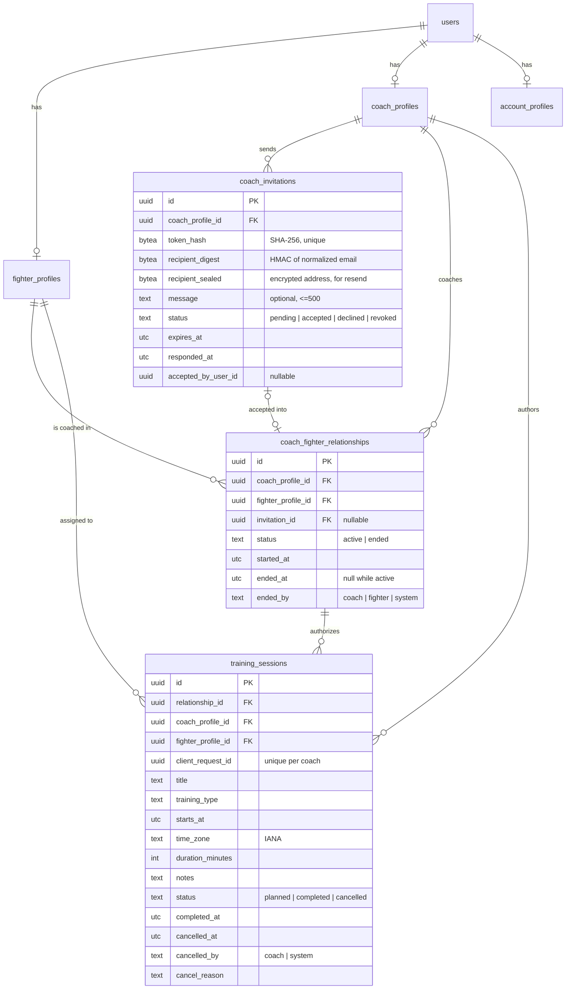
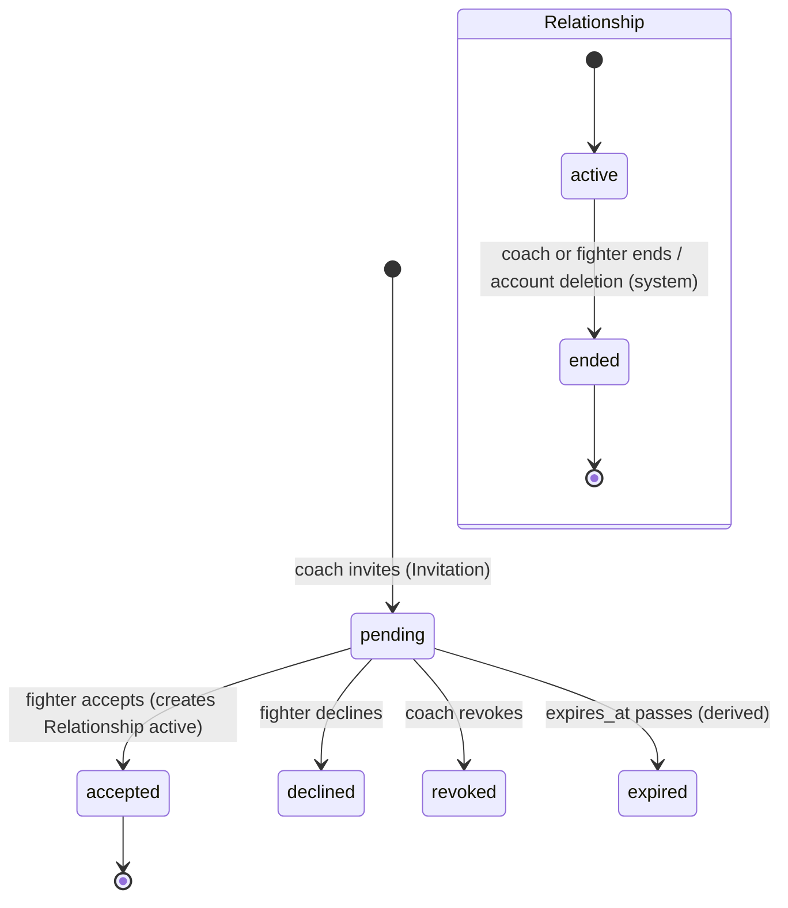
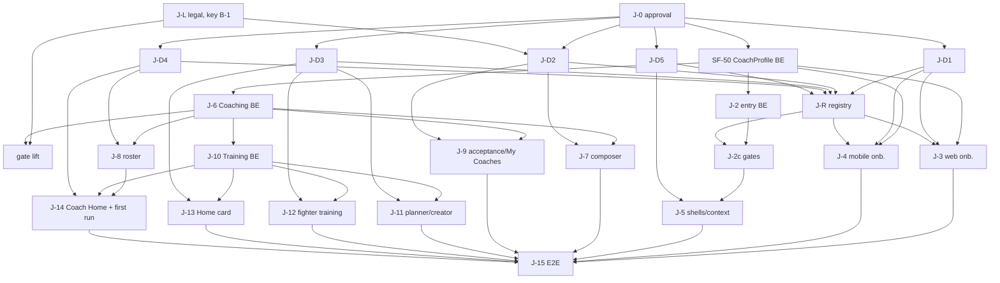

# SF-49 — Coach & Training Domain Architecture + Design Reconciliation

**Status: PROPOSED.** Implemented and accepted since: §4.2/§20 (ADR 0020,
SF-50), §5 (ADR 0017 amendment, SF-51), §6 relationships (ADR 0021, SF-56,
with the gate-scope, disclosure-configuration and history decisions
recorded there), §8 TrainingSession except completion (ADR 0023, SF-62: the
§8.5 "no coach read after an end" rule was confirmed over §6.4.4's
authored-session reads; `pads` kept per O-5). Every other decision below still waits for explicit
product/architecture approval. SF-49 itself created no migration, schema,
controller, OpenAPI operation, client or screen.

Epic SF-48 (Coach–Fighter Coaching & Training MVP). Discovery date
2026-10-13.

**Revision 3 (2026-10-13).** Applies the product owner's final decisions
O-1…O-15 (§0): exact CoachProfile field and enum contract (§4.2), SF-45
precedence with zero/one/two completed contexts and a server-owned last
explicit choice (§5), four-class Fighter data access with a versioned
disclosure contract and the before/after-termination matrix (§6.4),
invitation permissions, token rotation, verified deep-link transfer and a
legal feature gate (§7), PostgreSQL-based IANA validation with DST
criteria (§8.3), single-session training only (§8, §11), final design
change requests and registry scope (§18), and the SF-50 implementation
contract (§20). Revision 2's text below is superseded where revision 3
restates a section.

**Revision 2 (2026-10-13).** Reconciles the product owner's approved
direction (§0), replaces the rejected "a completed role always wins" entry
rule with a deterministic precedence (§5), and fixes the CoachProfile
contract (§4.2), the Fighter data whitelist (§6.4) and the training-type
vocabulary (§8.2) to design evidence. Adds the Claude Design change request
(§18) and the SF-25/SF-44/SF-45 contradictions (§19). The document as a
whole remains **PROPOSED**: approved *direction* is recorded as such; every
concrete contract below still needs final approval.

---

## 0. Decision table (revision 3)

A-1…A-14 (revision 2 direction) are accepted as the foundation. O-1…O-15
are the product owner's final decisions (revision 3 brief); the column
"Contract" says where the exact contract derived from each decision lives.
ADRs stay **PROPOSED** until the exact field contracts below are reviewed.

| # | Final product decision | Contract | Status |
|---|---|---|---|
| O-1 | `coaching_formats` is canonical; no Independent / Gym coach / Both choice; levels, audiences and formats never share an enum; `fitness`/`womens` are not levels | §4.2: `coaching_formats` (4 values) + optional `competition_levels` (2 values); audiences deferred | Decided; contract for review |
| O-2 | Coaching languages `en`, `pl`, `ru`, `be`, `uk` (spoken/coaching languages, not UI locales) | §4.2 | Decided |
| O-3 | Explicit intent first; requested completed context opens it; 1 completed + 1 incomplete → completed; 2 completed → last explicit valid choice or selection; 1 incomplete only → resume; gym workspace selection separate | §5 | Decided; contract for review |
| O-4 | No unrestricted tier 2; four classes; relationship-scoped projection only; defer goals/next fight without UI | §6.4 (classes, disclosure contract v1) | Decided; contract for review |
| O-5 | Five training types only if the latest design supports them | §8.2.1: `technical`, `sparring`, `pads`, `strength_conditioning`, `roadwork` (W02 filter, design `1791877903-9d9a`) | Decided |
| O-6 | Immediate revocation; minimum history; future planned sessions cancelled with explicit reason | §6.3 matrix | Decided; contract for review |
| O-7 | Only the assigned fighter confirms completion; coach views the result | §8.2.2, §8.5 | Decided |
| O-8 | UTC + validated IANA ids; check runtime first; dependency rule if needed; DST criteria | §8.3 (PostgreSQL zone data, no new dependency) | Decided; mechanism for review |
| O-9 | Data-rules acknowledgement separate from SF-44; no invented legal text; CoachProfile not blocked by legal copy; feature gate | §4.2.4, §7.4; legal ticket key **unconfirmed** (§16) | Decided; one open fact |
| O-10 | Completed coach invites; completed fighter accepts; incomplete fighter goes through account/fighter gates; no email matching | §7 | Decided |
| O-11 | 14 days; resend = new one-time token, old one invalid; reuse hashing, limits, safe logging; verify fragment + deep links | §7.2, §7.3 | Decided |
| O-12 | E08: recipient name optional; `coaching_name` falls back to `display_name` | §7.5 | Decided |
| O-13 | Reduced Home: upcoming sessions, roster count, pending invitations, setup checklist — backend data only, approved empty states | §18 CR-8, §11 | Decided |
| O-14 | Mobile coach session creation in MVP; design first; same API | §18 CR-6 | Decided |
| O-15 | No batch/group assignment in MVP; one session for one authorized fighter per operation | §8, §11 | Decided |

Revision history: rev. 1 `3cf1f96`, rev. 2 `60c2aec` (branch
`SF-49-coach-training-architecture-discovery`), rev. 3 = this document.

---

## 1. Baseline

| Repo | Branch | HEAD | State |
|---|---|---|---|
| simplefit-api | main | `76926f2` (merge of SF-30, PR #20) | clean |
| simplefit-platform | main | `dbc7afd` (merge of SF-30, PR #31) | clean |
| simplefit-mobile | main | `5850402` (merge of SF-28, PR #29) | clean |

SF-18 (SF-19…SF-30) is merged in all three repos.

### Existing backend contexts (production-ready)

| Context | Owns | ADR |
|---|---|---|
| `SimpleFit.Accounts` | `users`, `identities`, `sessions`, `session_refresh_tokens`, `email_auth_challenges`, `account_profiles`, `account_consents` | 0009, 0010, 0012–0014, 0016 |
| `SimpleFit.Fighters` | `fighter_profiles` (one per user; `not_started` = no row / `in_progress` / `completed`; immutable completion trigger; unique `lower(username)`) | 0015 |
| `SimpleFit.Entry` | read-only resolver `GET /api/v1/me/entry` (no table) | 0017 |
| `SimpleFit.FirstRun` | `first_run_outcomes` (`fighter_web_tour`, `fighter_mobile_first_run`; first outcome wins) | 0018 |
| `SimpleFit.Email` + `Templates` | Oban delivery with encrypted payloads; **E08 `coach_invite` template exists, render-only, no trigger** | 0011 |
| `SimpleFit.RateLimit`, `Observability.Redaction`, `SimpleFitWeb.ClientIP` | Abuse limits (Postgres windows), log/Sentry redaction (`sf[argv]_` tokens), IPv6 /64 keys | 0012, 0019 |

8 migrations exist; none touches Coach, relationships, invitations or training.

**No Coach, Gym, relationship, invitation, workspace or training code exists
in the backend.** No admin capability exists in the backend (`ADMIN` appears
only in the route registry).

### Existing clients

* Web and mobile `docs/route-registry.json` are byte-identical (SF-31,
  design version `1791448557-b0b9`, read 2026-10-08). Registry `COACH` is
  `grantedBy: CoachProfile`; onboarding routes need only a session
  (`D-ONBOARDING-ENTRY-CAPABILITY`, resolved).
* Every Coach route in web (`/app/coach/*`, 17 pages) and mobile (`(coach)`
  group, tabs Today/Fighters/Board/Requests/Inbox) is a
  **`placeholderRoute` only**. The shells (`WorkspaceShell` web, `ShellTabs`
  mobile) are real. Registry status "IMPLEMENTED" means "route exists".
* `entryDestinations.coach_onboarding` already maps to
  `web.app.onboarding.coach` / `mobile.onboarding.coach`.
* All 32 design-proposed API rows (incl. `/api/v1/invites`,
  `/api/v1/sessions`, `/api/v1/me/workspaces`) are `DEFERRED` inventory
  (`D-BACKEND-PROPOSED`).

### Implementation findings (code, not design)

| ID | Finding | Evidence | Impact |
|---|---|---|---|
| F-1 | `Entry` rule 4 assumes FighterProfile is the only role state | `lib/simple_fit/entry.ex` `fighter_route/2`, `capabilities/1` | Must be extended (not rewritten) for Coach |
| F-2 | Web `FighterGate` renders only when `destination == "fighter_home"` | `simplefit-platform/src/features/session-gate/ui/fighter-gate.tsx` | A user who is completed Fighter **and** Coach would be bounced out of Fighter pages if the no-intent entry ever resolves elsewhere. Gate must check `capabilities` instead |
| F-3 | `entryHref` treats only `fighter_home` as "journey complete" | `features/session-gate/model/entry.ts` (web + mobile) | Generalise to every `*_home` destination |
| F-4 | Mobile `(fighter)`/`(coach)` layouts do not enforce capability ("registry metadata only") | `simplefit-mobile/src/app/(coach)/_layout.tsx` | Coach shell needs a capability gate like web |
| F-5 | No IANA time-zone database dependency (`tz`/`tzdata` absent) | `mix.exs`, `mix.lock` | TrainingSession time zones need a dependency decision (CLAUDE.md rule 18, ADR 0004) |
| F-6 | Redaction covers `sfa_ sfr_ sfv_ sfg_` only | `observability/redaction.ex:37` | A new invitation token prefix must be added |

---

## 2. Claude Design — version and inventory

* Artifact `JEsBg51MjX8KiHWEro8omY`, **live version `1791877903-9d9a`**
  (read 2026-10-13), 492 artboards, 11 pages. Structured `.dc.html` files
  and `project/canvas.json` were read; no screenshots used.
* The route registry was built from `1791448557-b0b9`. Every Coach **screen**
  artboard below is still referenced by the registry; the 44 boards the
  registry does not reference are flow/route/sheet boards (`FlowCoach`,
  `RouteCoach`, `FlowAuthModel`, tour-step sheets…). Content changes between
  the two versions were **not** diffed (no access to the old version) →
  D-SF49-17.

Status legend: **MVP** = proposed for SF-48; **REDUCED** = MVP with only real
data; **DEFER** = keep placeholder; **FUTURE** = design marks it future.

### 2.1 Coach registration and first run

| Artboard | File | Route | Owner | Required API | Existing | Gap / note |
|---|---|---|---|---|---|---|
| O05 Choose role | Onboarding | `mobile.onboarding.role` | Entry | entry | real (SF-47) | — |
| WA6 Where to start | WebRoleSelect | `web.app.onboarding.role` | Entry | entry | real | — |
| OC1 Coach profile | OnbCProfile | `mobile.onboarding.coach` | Coaches | coach-profile | placeholder | MVP · vocabulary differs from web (D-01) |
| OC2 Coaching type | OnbCType | same `?step` | Coaches | coach-profile | placeholder | MVP · D-01 |
| OC3 Credentials (optional) | OnbCCredentials | same | Trust (future) | uploads | placeholder | DEFER (uploads, review) D-02 |
| OC4 Business size | OnbCSize | same | Billing (future) | — | placeholder | DEFER D-02 |
| OC5 Where (gym) | OnbCWhere | same | Gyms (future) | — | placeholder | DEFER gym part D-03 |
| OC6 Plan | OnbCPlan | same | Billing (future) | — | placeholder | DEFER D-02 |
| OC7 Services | OnbCServices | same | Commerce (future) | — | placeholder | DEFER |
| OC8 Payouts | OnbCPayouts | same | Payments (future) | — | placeholder | DEFER |
| OC9 Invite fighters | OnbCInvite | same | Coaching | invitations | placeholder | MVP (email invite only) D-07 |
| OC10 Data rules | OnbCPrivacy | same | Coaching / legal | acknowledgement | placeholder | moved out of registration: before the first invitation (§7.4); legal ticket B-1 |
| OC11 Complete | OnbCReady | same | Coaches | coach-profile | placeholder | REDUCED (no trial/payout/licence states) |
| WCR1 Profile | WebRegCProfile | `web.app.onboarding.coach?step=profile` | Coaches | coach-profile | placeholder | MVP · D-01 |
| WCR2 Coaching type | WebRegCType | `?step=type` | Coaches | coach-profile | placeholder | MVP · D-01 |
| WCR3 Credentials | WebRegCCreds | `?step=credentials` | Trust (future) | uploads | placeholder | DEFER |
| WCR4 Business size | WebRegCSize | `?step=size` | Billing (future) | — | placeholder | DEFER |
| WCR5 Gym | WebRegCGym | `?step=gym` | Gyms (future) | — | placeholder | DEFER |
| WCR6 Plan | WebRegCPlan | `?step=plan` | Billing (future) | checkout | placeholder | DEFER |
| WCR7 Complete | WebRegCDone | `?step=complete` | Coaches | coach-profile | placeholder | REDUCED |
| CR1–CR3 Intro | FirstRunC1–C3 | `mobile.coach.welcome` | FirstRun | first-run | placeholder | MVP (copy shows invented team data → REDUCED) |
| CR4 Today checklist | FirstRunCToday | `mobile.coach.today` | FirstRun + Coaching | entry, first-run | placeholder | REDUCED (only profile/invite/session items) |
| CR5 Tour | FirstRunCSessionTip(+Steps) | `mobile.coach.today?tour` | FirstRun | first-run | placeholder | MVP if tour targets exist |
| CRW1 Dashboard first run | FirstRunWebC | `web.app.coach` | FirstRun | first-run | placeholder | REDUCED |
| CRW2 Tour | FirstRunWebCTour(+Steps) | `web.app.coach.sessions.new?tour=2` | FirstRun | first-run | placeholder | MVP if targets exist |
| E03 Welcome coach | EmailWelcomeCoach | — | Email | — | template exists | trigger on completion (optional) |

### 2.2 Coach application

| Artboard | File | Route | Owner | API | Existing | Gap |
|---|---|---|---|---|---|---|
| WC1 Dashboard | WebCoachDashboard | `web.app.coach` | projection | sessions, roster, invitations | placeholder | REDUCED: KPIs (attendance, rounds, camp), AI, sparring, booking requests are absent domains D-04 |
| Coach web nav | CoachWebNav | shell | client | entry | shell real, items placeholder | MVP items: Dashboard, Fighters, Programs & sessions, Calendar, Coach settings; others DEFER |
| C01 Today | CoachToday | `mobile.coach.today` | projection | sessions, roster | placeholder | REDUCED (AI summary, weight flags, video, booking absent) |
| Coach tab bar | CoachTabs | shell | client | — | real | Board/Requests/Inbox tabs DEFER |
| WC7 Fighters | WebCoachFighters | `web.app.coach.fighters` | Coaching | roster | placeholder | REDUCED: weight/camp/attendance/flags absent; groups absent D-06 |
| C03 Fighters | Fighters | `mobile.coach.fighters` | Coaching | roster | placeholder | REDUCED |
| WC4 Fighter 360 | WebFighter360 | `web.app.coach.fighters._fighter-id` | Coaching | roster detail, sessions | placeholder | REDUCED: Overview + Sessions only; Weight, Video, Notes, Medical DEFER D-10 |
| C04 Fighter quick view | FighterQuick | `mobile.coach.fighters._fighter-id` | Coaching | roster detail | placeholder | REDUCED |
| WC3 Program & session builder | WebProgramBuilder | `web.app.coach.sessions.new` | Training | training-sessions | placeholder | REDUCED: "Single fighter" only (O-15) only; blocks/timer/shared/class DEFER D-12 |
| W08 Calendar (shared) | WebCalendar | `web.app.calendar` | Training projection | training-sessions | placeholder | MVP subset (training layer only) |
| WC6 / CS1 Coach settings | WebCoachSettings / CoachSettings | `web.app.coach.settings` / `mobile.settings.coach` | Coaches | coach-profile | placeholder | REDUCED: profile edit only; services, booking rules, payouts, assistants, access log DEFER |
| A04 Workspaces | Workspaces | `mobile.workspaces` | Entry projection | entry | placeholder | MVP (personal Fighter + Coach contexts only; no gym rows) D-05 |
| WA2 Choose workspace | WebLoginWorkspace | `web.login?step=workspace` | Entry | entry | not built | MVP when ≥2 completed contexts (§6) |
| WC2/C12 Team activity, WC8/C11 Board, WC5/C14 Sparring, C05 Session control, C06 Sparring control, C02 Roster & attendance, C07 Quick note, C08 Video, C09 Booking requests, C10 AI drafts, C13 Shared roster, C15 Challenge, F07 Fight camp | various | various | Sparring / Camp / Social / Booking / Video / AI (future) | — | placeholder | DEFER — no approved domain |
| CC1–CC10, AV3–AV5, CO1 | commerce | `/app/coach/{services,earnings,payouts}…` | Commerce/Payments (future) | — | placeholder | DEFER |

### 2.3 Invitations and Fighter side

| Artboard | File | Route | Owner | API | Existing | Gap |
|---|---|---|---|---|---|---|
| E08 Coach invited you | EmailCoachInvite | email | Coaching → Email | invitation create | template only | MVP (variables need `coaching_name`, D-01) |
| INV1 Coach invites fighter (landing) | InviteCoach | `mobile.invite._code` | Coaching | invitation preview | placeholder | MVP; copy "land straight in Marek's team" conflicts with consent D-08 |
| A03 Join with invite | JoinInvite | `mobile.join._code` | Gyms (future) | — | placeholder | DEFER (gym member invite) |
| INV2 Gym invites coach | InviteGymCoach | `mobile.invite.coach._token` | Gyms (future) | — | placeholder | DEFER |
| OF7 Fighter · coach | OnbFCoach | fighter onboarding step 7 | Coaching | — | not built (ADR 0015 approved OF1–OF4 only) | DEFER; "Request coach"/"Find a coach" are fighter→coach requests + marketplace |
| WF3 Fighter web · coach | WebRegFCoach | — | Coaching | — | **FUTURE in design** ("needs the Coach domain") | DEFER |
| Invitation accept + consent | **missing** | — | Coaching | accept/decline | — | **Missing artboard (web + mobile)** D-08 |
| Fighter "My coaches" / remove access | **missing** | — | Coaching | list/end | — | **Missing artboard** D-09 |
| F24 Training hub | TrainingHub | `mobile.training` | Training projection | training-sessions | placeholder | REDUCED: "Up next · assigned by coach" + history of assigned sessions |
| F04 Session plan | SessionDetail | `mobile.sessions._session-id` | Training | training-session | placeholder | REDUCED: no block/timer structure D-12 |
| F05 Live training | LiveTraining | `…/live` | Timer (future) | — | placeholder | DEFER |
| F06 Training complete | SessionLog | `…/complete` | Training | complete | placeholder | REDUCED: done only; RPE/body flags/rounds DEFER D-14 |
| F12 Calendar | Calendar | `mobile.calendar` | Training projection | training-sessions | placeholder | MVP subset |
| Fighter Home (FRW1/W01, F01) | FirstRunWebF / WebHome / Main | `web.app.home`, `mobile.home` | projection | training-sessions | real (SF-40/41) | Add "next assigned session" card when sessions exist |
| S10/S16/S08 Shared sessions | SessionCreator, TrainingInvite, SharedSession | `mobile.shared-session.*` | Social training (future) | — | placeholder | DEFER (multi-participant) |

### 2.4 Shared flows read

FlowAuthModel (SF-21), RouteAuth, RouteCoach, FlowCoach, FlowWeb,
FlowWebRoute, FlowFirstRun, FlowOnboarding, GalleryIndex 1–4 were read for
paths and transitions. RouteAuth: "Sign-in … lands in the last workspace or
asks which one" (WA2 web, A04 mobile).

---

## 3. Proposed bounded contexts

```text
Accounts ◄── Fighters ◄──┐
   ▲            ▲         │
   │            │         │
   ├── Coaches ◄┼── Coaching (relationships + invitations) ◄── Training
   │            │         ▲                                     ▲
   └── Entry ───┴─────────┴─── (reads profiles, never writes)   │
FirstRun ── reads Fighters/Coaches completion ──────────────────┘ (no dep)
Email ◄── Coaching (E08 delivery)          RateLimit ◄── Coaching
```

Arrows point at the dependency. No cycles: Fighters and Coaches never call
Coaching or Training; Coaching never calls Training except the single
"relationship ended" hook, which is inverted (Training subscribes by being
called from Coaching's transaction through a public `Training.cancel_for_relationship/2`;
see §9). If that call direction is unacceptable, use an Oban job.

| Context | Responsibility | Owns | Owned transitions | Public interface (indicative) | Authorizes | Must NOT own |
|---|---|---|---|---|---|---|
| **Accounts** (existing) | Identity, sessions, account registration, consents | users, identities, sessions, account_profiles, account_consents | as today | unchanged | own data | roles, profiles of other domains |
| **Fighters** (existing) | Fighter profile + onboarding | fighter_profiles | not_started→in_progress→completed | + `get_profile_by_id/1` (internal), `coach_projection/1` (non-body fields) | owner access | relationships, who may see the fighter |
| **Coaches** (new) | Coach profile + onboarding | coach_profiles | not_started→in_progress→completed | `get_profile/1`, `update_profile/2`, `complete_onboarding/1`, `onboarding_status/1` | owner access | gyms, plans, services, payouts, credentials review, fighters |
| **Coaching** (new) | Coach↔Fighter relationships and the invitations that create them | coach_fighter_relationships, coach_invitations | invitation pending→accepted/declined/revoked/(expired); relationship active→ended | `invite/2`, `preview_invitation/2`, `accept/2`, `decline/2`, `revoke/2`, `list_roster/2`, `get_roster_entry/2`, `list_my_coaches/1`, `end_relationship/2`, `authorize(actor, relationship_id, action)` | **every coach→fighter data access** | training content, fighter profile fields, gym membership |
| **Training** (new) | Coach-assigned training sessions | training_sessions | planned→completed / planned→cancelled | `create/2`, `update/3`, `cancel/2`, `complete/2`, `list_for_coach/2`, `list_for_fighter/2`, `cancel_for_relationship/2` | session-level rules, delegating "is this coach related to this fighter" to Coaching | relationships, timer, programs, bookings, logs |
| **Entry** (existing, extended) | Post-auth destination | — | — | `resolve/2` | none (projection) | any write |
| **FirstRun** (existing, extended) | Tour outcomes | first_run_outcomes | first outcome wins | + coach keys | owner | — |
| Gyms, Fight Camps, Sparring, Booking/Payments, Timer/Training Log | **future** | — | — | — | — | — |

Events: none needed in MVP. Telemetry `[:simple_fit, :coaching, :invitation, …]`
counts outcomes only (ADR 0008/0019).

---

## 4. CoachProfile

### 4.1 Identity and ownership (proposed)

* `coach_profiles`, one row per user (`unique (user_id)`), created on first
  meaningful save; no row = `not_started`. Same structure as ADR 0015.
* **One CoachProfile per user.** Gym-coach roles later are
  *workspace memberships* (`gym_memberships` with role coach), not a second
  CoachProfile. Design A04 shows "Yauheni Coaching · COACH" and
  "Warsaw BC · COACH" as two *workspaces*; only the first is the personal
  CoachProfile.
* No `gym_id`. No role on `users`. Coexists with FighterProfile.

### 4.2 Field and enum contract — revision 3 (PROPOSED for final review)

**Rules.** A field is in the MVP only if the backend can own it without an
absent domain and both platforms show it after CR-1. Every enum key is the
snake_case form of an approved design label (design `1791877903-9d9a`); no
value is invented. Formats, competition levels and audiences are separate
concepts and never share an enum (O-1).

#### 4.2.1 Design source inventory (verbatim)

| Concept | Mobile (OC1 / OC2 / OC5) | Web (WCR1 / WCR2 / WCR5) |
|---|---|---|
| Public coach name | none — OC1 shows the account name read-only | none — only "Brand name" |
| Brand name | OC5 "Brand name" (under "Independent coach") | WCR1 "Brand name" |
| City / Country | OC1 "City", "Country" | WCR1 "City"; no country |
| Bio | OC1 "Bio" | WCR1 "Bio" |
| Languages | OC1: English · Polski · Русский · Беларуская · Українська | WCR1: Polish · English · Belarusian · Russian |
| Years coaching | OC1: < 1 · 1–3 · 3–5 · 5–10 · 10+ | — |
| Boxing background | OC1 free text | WCR3 free text (credentials step) |
| "How do you coach?" | OC2 multi: Personal Training (1:1 sessions) · Group Coaching (classes and team sessions) · Amateur Competition (corner and prep for bouts) · Professional Boxing (licensed pro fighters) · Online Coaching (video review, remote plans) · Fight Camps (6–12 week peaks) · Strength & Conditioning (S&C for boxers) | WCR2 practice (single): Independent · Gym coach · Both; "What you coach" (multi): Amateur boxing · Pro boxing · Fitness boxing · Youth · Women's boxing; "Delivery" (multi): In person · Online coaching · Fight camps |

#### 4.2.2 Classification of every design value

| Design value | Platform(s) | Concept | MVP decision |
|---|---|---|---|
| Personal Training | mobile | format (1:1) | `coaching_formats.personal_training` |
| Group Coaching | mobile | format (group) | `coaching_formats.group_coaching` |
| Online Coaching / Online coaching | both | format (remote) | `coaching_formats.online_coaching` |
| Fight Camps / Fight camps | both | format (6–12 week programme) | `coaching_formats.fight_camps` |
| In person | web | delivery channel, implied by personal/group | not adopted |
| Strength & Conditioning | mobile | training discipline (a training type, §8.2.1) | not a format; not adopted in CoachProfile |
| Amateur Competition / Amateur boxing | both | competitive level of fighters coached | `competition_levels.amateur` |
| Professional Boxing / Pro boxing | both | competitive level | `competition_levels.professional` |
| Fitness boxing | web | discipline / non-competitive audience — **not a level** | deferred (future `coaching_audiences`) |
| Women's boxing | web | audience — **not a level** | deferred (future `coaching_audiences`) |
| Youth | web | audience | excluded (A-14) |
| Independent / Gym coach / Both | web | practice / gym relation | removed from MVP (O-1, A-13) |

`competition_levels` keys match the corresponding FighterProfile
`experience_level` keys (`amateur`, `professional`, ADR 0015), so
"amateur" means the same thing in both profiles.

#### 4.2.3 CoachProfile field contract

| Field | Type | Required at completion | Validation | Editable after completion | Design source (after CR-1) |
|---|---|---|---|---|---|
| `display_name` | text | **yes** | trimmed, 1..60, printable | yes | new "Coach name" input on OC1 + WCR1 |
| `brand_name` | text | no | trimmed, 1..80 | yes | WCR1; moved to OC1 |
| `country_code` | text, ISO 3166-1 alpha-2 | **yes** | `Fighters.CountryCodes` allow-list (shared, SF-25) | yes | OC1; added to WCR1 |
| `city` | text | **yes** | trimmed, 1..80 | yes | OC1, WCR1 |
| `bio` | text | no | 0..500, plain text | yes | OC1, WCR1 |
| `languages` | text[] | no | ⊆ {`en`,`pl`,`ru`,`be`,`uk`}, unique, ≤ 5 | yes | OC1, WCR1 (labels per CR-1) |
| `coaching_formats` | text[] | **yes, ≥ 1** | ⊆ {`personal_training`,`group_coaching`,`online_coaching`,`fight_camps`}, unique | yes, stays ≥ 1 | OC2, WCR2 |
| `competition_levels` | text[] | no | ⊆ {`amateur`,`professional`}, unique | yes | OC2, WCR2 |
| `onboarding_completed_at` | utc timestamp | set by completion | immutable (trigger) | no | — |

`display_name` rules (A-3): the client may *suggest* the account
`full_name` as an editable starting value; the API never copies, syncs or
derives it, and an unchanged suggestion is saved only when the user
submits it. FighterProfile `display_name` stays independent; neither
profile updates the other.

Out of the initial model (each needs another domain or exists on one
platform only): photo, years coaching, boxing background, credentials and
verification documents, federation/licence, gym affiliation, practice
model, business size, plan/trial, services/prices, payouts, public slug,
audiences.

#### 4.2.4 Coach onboarding completion prerequisites

1. Authenticated session; account registration complete (SF-44 — adult by
   construction, A-14). Same `account_registration: required` error as
   Fighter completion.
2. `display_name`, `country_code`, `city` present and valid.
3. `coaching_formats` has at least one value.

Explicitly **not** prerequisites: the coach data-rules acknowledgement
(O-9: it gates Coach-to-Fighter access, §7.4, not the profile), brand name,
bio, languages, competition levels, any FighterProfile state.

#### 4.2.5 Storage plan (no extra migrations for vocabulary changes)

One additive migration in SF-50 creates `coach_profiles`; vocabulary lives
in the domain, as for `fighter_profiles` (text / text[] columns, Ecto
allow-lists, DB checks on shape only):

* columns as §4.2.3; arrays `text[] NOT NULL DEFAULT '{}'`;
* `unique (user_id)`; FK `users` `ON DELETE CASCADE`;
* CHECK `country_code ~ '^[A-Z]{2}$'`, no NULL array elements;
* CHECK completion shape: `onboarding_completed_at IS NULL OR (display_name,
  country_code, city IS NOT NULL AND cardinality(coaching_formats) >= 1)`;
* trigger `coach_profiles_completion_immutable` (copy of the Fighter one).

Adding an enum value later is a code change; adding `coaching_audiences`
later is one additive column. Nothing is split across tables.

### 4.3 Lifecycle — reuse the FighterProfile pattern

Recommended: identical semantics to ADR 0015.

* First save with at least one changed field creates the row (`in_progress`);
  empty or no-op PATCH returns current state and never creates.
* PATCH is partial; invalid PATCH changes nothing; row lock
  (`SELECT … FOR UPDATE`) serializes concurrent edits; last write per field
  wins, untouched fields preserved.
* `POST …/complete-onboarding` requires every required field **and**
  completed account registration (same `account_registration: required`
  error as Fighter); missing → `validation_error` with `required` per field.
* Repeat completion is a no-op returning the original `completed_at`
  (DB trigger forbids change, like `fighter_profiles_completion_immutable`).
* After completion every field stays editable with the same validation;
  removing a required field after completion is rejected (`required`).

---

## 5. SF-45 entry precedence (revision 3, PROPOSED for final review)

Revision 2's mixed-state rule (`context_selection`) is replaced by O-3.

### 5.1 Inputs and terms

| Term | Owner | Values | Effect | Grants anything? |
|---|---|---|---|---|
| Journey `intent` (query, exists) | navigation | `fighter`, `coach`, `gym`, `sponsor` | may start or resume onboarding | no |
| Requested `context` (query, new, additive) | navigation | `fighter`, `coach` | opens that context **only if completed**; otherwise ignored | no |
| Last explicit context choice (new, stored) | Entry (backend) | `fighter`, `coach` | default among ≥ 2 completed contexts | no |
| Gym workspace (future) | Gyms | gym ids | which organization inside the Gym context | membership-based |

* The **last explicit choice** is written only by an explicit user action —
  choosing on the context-selection screen or in the context switcher —
  through `PUT /api/v1/me/entry/context` (§11). The write is rejected
  (`422`, `context: not_available`) unless that context is completed. It is
  re-validated on every read. One row per user (`entry_context_choices`:
  `user_id` PK, `context`, `chosen_at`), owned by `SimpleFit.Entry`. The
  resolver itself stays read-only; no client-owned state machine exists.
* Profile contexts (Fighter, Coach) are the user's roles. A future gym
  workspace is chosen *inside* a Gym context by the Gyms domain
  (session-scoped, `D-WORKSPACE-NOT-IN-URL`); the entry resolver never lists
  individual gyms and never stores a gym id.

### 5.2 Decision table (`GET /api/v1/me/entry`)

First matching row wins. "Completed" = profile onboarding completed;
capabilities: `FIGHTER` iff Fighter completed, `COACH` iff Coach completed.

| Row | Condition | Destination | `mandatory` | Reason |
|---|---|---|---|---|
| E1 | account registration not complete | `account_registration` | yes | `account_registration_incomplete` |
| E2 | `intent=fighter`, Fighter completed | `fighter_home` | no | `fighter_onboarding_completed` |
| E3 | `intent=fighter`, Fighter not completed | `fighter_onboarding` | yes | `fighter_onboarding_not_started` / `_in_progress` |
| E4 | `intent=coach`, Coach completed | `coach_home` | no | `coach_onboarding_completed` |
| E5 | `intent=coach`, Coach not completed — **regardless of Fighter** | `coach_onboarding` | yes | `coach_onboarding_not_started` / `_in_progress` |
| E6 | `intent=gym` / `sponsor` | `gym_onboarding` / `sponsor_application` (unchanged) | no | `gym_intent` / `sponsor_intent` |
| E7 | `context=X`, X completed | X's home | no | `requested_context` |
| E8 | `context=X`, X not completed | ignored (no grant, no onboarding) → continue at E9 | — | — |

Default (no intent, no usable context), by number of completed contexts:

| Row | Completed | Other roles | Destination | `mandatory` | Reason |
|---|---|---|---|---|---|
| E9 | 0 | none started | `role_selection` | no | `no_role_started` |
| E10 | 0 | exactly 1 in progress | that role's onboarding (resume) | yes | `…_onboarding_in_progress` |
| E11 | 0 | 2 in progress | `role_selection` (WA6 shows both as "continue") | no | `multiple_roles_in_progress` |
| E12 | 1 | the other not started **or in progress** | the completed role's home | no | `…_onboarding_completed` |
| E13 | 2 | — | last explicit choice if valid → its home | no | `last_context` |
| E14 | 2 | no valid last choice | `context_selection` | no | `context_choice_required` |

`intent` and `context` together: `intent` wins. Invalid values:
`validation_error` (`invalid_choice`). `coach_intent` stays in the API enum
(additive rule) and is no longer emitted. Response gains `coach_profile`
and `context` (the context applied, or `null`).

E11 is the only row not dictated by O-3; it is proposed (non-blocking for
SF-50).

### 5.3 `returnTo` validation and precedence (client-side; never sent to the API)

Validation is the existing `sanitizeReturnTo` (SF-24, web
`shared/routes/return-to.ts`; mobile equivalent) plus one rule:

1. string, starts with `/`, not `//`, ≤ 2048 chars, no backslash,
   whitespace or control characters;
2. resolves on a sentinel origin to the same origin; leading locale
   removed; hash discarded;
3. matches a canonical registry route that is not guest-only, not
   onboarding, not restricted-account, not not-found, not the verification
   link;
4. **new:** the route's capability is `null` or held in
   `entry.capabilities` (`usableReturnTo`, already implemented).

Precedence after the resolver answers:

| Destination came from | `returnTo` used? |
|---|---|
| `mandatory` destination (E1, E3, E5, E10) | no — kept as continuation, re-resolved after the step |
| E2 / E4 (intent → home) | only if the route's capability equals the intent's capability |
| E7 (requested context) | only if the route's capability equals that context's capability |
| E9, E11, E12, E13, E14 | yes, if valid (rules 1–4) |
| otherwise | destination |

A `returnTo` never writes the last explicit choice.

### 5.4 Gates, switching, restore

* Area gates check capability (`FIGHTER` / `COACH` ∈ `capabilities`), never
  destination equality (F-2); without it they resolve with no intent and
  redirect with the page as `returnTo`.
* `entryHref` treats every `*_home` as a completed journey (F-3); mobile
  groups get capability gates (F-4).
* Switcher / context selection: list completed contexts (+ "Continue coach
  setup" → `intent=coach` when Coach is in progress; + "Set up another
  role" → WA6). Choosing writes the last explicit choice, then navigates.
* Session restore re-resolves (SF-28); the stored choice is server-side, so
  nothing leaks between accounts on a shared device.

### 5.5 Examples

| Situation | Row |
|---|---|
| Completed Fighter taps "Become a coach" | E5 → `coach_onboarding` |
| Same user signs in later, no intent, Coach still in progress | E12 → `fighter_home` (switcher offers "Continue coach setup") |
| Dual user, last chose Coach | E13 → `coach_home` |
| Dual user, never chose | E14 → `context_selection` |
| Fighter-only user sends `context=coach` | E8 ignored → E12 `fighter_home` |
| Dual user opens a `/app/coach/fighters` deep link | E13/E14, then `returnTo` (COACH held) |

---

## 6. Coach–Fighter relationship

### 6.1 Cardinality — **Option B, multiple active coaches, no primary** (direction approved, A-5)

| | A: one active coach | B: many, no primary | C: many + primary |
|---|---|---|---|
| Design evidence | OF7 "Do you have a coach?" (singular) | WC4/WC7 "visible to the fighter's **coaches** only"; WC3 "Coaches: Marek · Ola (pads)"; WC6 assistant coach; A04 coach in two workspaces | no artboard shows "primary" |
| Boxing reality | breaks boxing coach + S&C coach, club coach + personal coach | fits | fits, extra concept |
| Future gyms | gym coach + independent coach collide | independent rows, gym relationship separate | primary ambiguous across gyms |
| Training assignment | trivially one author | each session names its coach | primary-only assignment unclear |
| Privacy | simplest | each relationship is its own grant, revocable alone | same as B |
| Complexity | lowest | low: unique per pair | + rules for primary transfer |

Option B is the approved direction (A-5): the design consistently speaks
of a fighter's *coaches*, real training uses several, and each relationship
is an independent, revocable grant.

### 6.2 Model



Constraints:

* `unique (coach_profile_id, fighter_profile_id) where status = 'active'`
  — at most one active relationship per pair; re-connection after `ended`
  inserts a new row (history kept).
* `check (status = 'active' and ended_at is null or status = 'ended' and ended_at is not null)`.
* Self-coaching forbidden (coach and fighter profiles of the same user) —
  enforced in Coaching (cross-table, not a DB check); tested.
* `ended` is terminal (trigger, like other append-only rows).
* Both profiles must be **completed** to relate (O-10).

### 6.3 Lifecycle



Pending lives **only** on the invitation; the relationship has no pending
state (single source of truth).

| Action | Who | Effect |
|---|---|---|
| Invite | completed Coach | pending invitation + E08 email |
| Accept | the signed-in user holding the token, with a completed FighterProfile | invitation accepted; relationship `active` (or the existing active one, idempotently) |
| Decline | token holder (signed in) | invitation declined; coach sees "declined" without reason |
| Revoke | the inviting coach | pending → revoked |
| End | either side | relationship `ended`; future planned sessions cancelled (`system`, `relationship_ended`); access revoked immediately |
| Re-invite | coach, after decline/expiry/revoke/end | new invitation; rate-limited per recipient digest |

### 6.4 Fighter data access, disclosure and termination (revision 3, PROPOSED for final review)

#### 6.4.1 Four classes (O-4)

| Class | FighterProfile / other data | MVP coach access | Basis |
|---|---|---|---|
| **C1 identity** (public fighter identity, ADR 0015) | `display_name`, `username`, `country_code`, `city` | read, active relationship only | disclosure v1 |
| **C2 basic coaching-relevant boxing info** | `experience_level`, `stance`, `amateur_bout_count` | read, active relationship only | disclosure v1 |
| **C3 personal goals and future fights** — needs an explicit sharing policy | `goals`, `next_fight_on`, `next_fight_name` | **none in MVP (deferred)** | no per-field sharing UI exists; never exposed silently |
| **C4 sensitive / private** — never automatically disclosed | `weight_class`, `current_weight_kg`, `height_cm`; AccountProfile `full_name`, `date_of_birth`, consents; email, identities, sessions/devices; other coaches' sessions and relationships; first-run/entry state | **never** | ADR 0015 owner-only, SF-44 privacy, OC10 "never" list |

Only the relationship-scoped projection (`Coaching` authorizes,
`Fighters` builds it) exposes C1+C2; no other endpoint returns another
user's FighterProfile.

#### 6.4.2 Minimal disclosure contract (field-level, versioned)

* A server constant `coach_disclosure_v1` = the C1 + C2 field list above,
  plus its human-readable copy version (from the legal ticket, §7.4).
* `preview` returns `disclosure: {version, fields}`; the acceptance screen
  shows exactly these fields and the C4 "never" list (CR-2).
* `accept` must echo `disclosure_version`; a stale version → `409 conflict`
  (the fighter sees the current list again). Nothing is accepted for a
  version the fighter did not see.
* The relationship stores `disclosure_version` and `accepted_at`. The
  projection returns `fields(disclosure_version) ∩ current allow-list` —
  never wider than what was accepted; narrowing later applies at once.
* Adding C3 (or any field) needs a new version **and** fighter opt-in UI;
  existing relationships keep v1 until the fighter accepts the new one.
* My Coaches (CR-3) shows, per coach, the fields disclosed.

#### 6.4.3 ADR 0015 amendment (required)

ADR 0015 makes FighterProfile owner-only and weight data private. Amend:
"A FighterProfile may also be read through the Coaching relationship
projection, limited to the fields of the disclosure version the fighter
accepted (v1: C1 + C2). Body measurements (`weight_class`,
`current_weight_kg`, `height_cm`) remain owner-only." No other change to
ADR 0015.

#### 6.4.4 Access matrix before and after termination (O-6)

| Data / action | Coach, active | Coach, after end | Fighter, active | Fighter, after end |
|---|---|---|---|---|
| C1 + C2 projection | read | **none** (404) | own profile always | own profile always |
| C3 / C4 | none | none | own | own |
| Relationship record | read | stub only: `id`, `started_at`, `ended_at`, `ended_by`, fighter `display_name` **snapshot taken at end** | read (coach `display_name`/`brand_name` live) | stub: coach name snapshot, dates, `ended_by` |
| Create / edit / cancel sessions | yes (own, planned) | **no** | — | — |
| Planned future sessions | — | cancelled at end (`cancelled_by=system`, `cancel_reason=relationship_ended`), same transaction | sees them as cancelled with reason | sees them as cancelled with reason |
| Past sessions (completed / cancelled) | read own authored | read own authored: plan fields (`title`, `training_type`, `starts_at`, `time_zone`, `duration_minutes`, `notes`) and terminal `status`; no projection fields beyond the snapshot name | read | read (own training history) |
| New actions on the relationship | end | none | end | none (a new invitation creates a new relationship) |

Retention: rows are kept (no hard delete in MVP). How long the coach-side
stub and authored sessions stay visible is a **retention policy** item for
the legal ticket (§16); until it is decided, the stub list is the only
coach-side history and contains no C1/C2 data except the name snapshot.

---

## 7. Invitation domain (revision 3)

### 7.1 Mechanism and permissions (A-7, O-10)

* Email invitation (E08) only. Deferred: share link/QR with coach approval,
  fighter→coach requests, invite codes, roster import, marketplace.
* **Send:** only a user whose CoachProfile is completed (and §7.4 gate on).
* **Accept/decline:** only a signed-in user whose FighterProfile is
  completed. A signed-out or incomplete user passes through the canonical
  gates first — sign-in → account registration (E1) → Fighter onboarding
  (`intent=fighter`, E3) — then returns to the acceptance screen.
* No account linking, profile creation or relationship activation from an
  email match; sending creates nothing but the invitation; acceptance is
  always an explicit action on the acceptance screen (CR-2).
* Self-invitation (coach accepting their own invitation as fighter) →
  `invitation_unavailable`.

### 7.2 Token security and lifecycle (O-11)

* Token `sfi_` + 32 random bytes (base64url); stored only as SHA-256 hash
  (unique); shown once, in the email link. Redaction gains the `sfi_`
  prefix (`sf[agiv]_`); the SF-29 canary probe covers the new endpoints.
* Expiry **14 days**. One-time use: accept/decline/revoke lock the row.
* **Resend** rotates the token on the same pending invitation (new hash,
  `expires_at = now + 14 d`); the old token stops matching immediately →
  `invitation_unavailable`. Resend is limited per invitation and per coach.
* Unknown / used / expired / revoked / rotated token → one normalized
  error `invitation_unavailable` (no state oracle).
* Rate limits (`SimpleFit.RateLimit`): create per coach (hour/day), per
  recipient digest (day), preview/accept/decline per client
  (`ClientIP.limit_key`, IPv6 /64).
* Recipient stored as HMAC digest (dedupe, limits) + sealed address
  (Plug.Crypto, existing key pattern) for resend; never plaintext, never
  logged; telemetry carries outcomes only.
* Duplicate pending invitation to the same digest from the same coach →
  the existing invitation is returned (idempotent).

### 7.3 Link and deep-link transfer — verified against current code

| Platform | Current capability (verified) | Design |
|---|---|---|
| Web | E01 already uses a URL fragment: `/verify-email#token=…`; `verification-link-result.tsx` reads `location.hash` and posts the token in the request body | E08 link `https://<web>/<locale>/invite/coach#token=sfi_…`. The page reads the fragment, removes it (`history.replaceState`), keeps the token in `sessionStorage` (tab-scoped) across sign-in, account registration and Fighter onboarding, and sends it only in POST bodies (`preview`, `accept`, `decline`). Never in a query string, `returnTo`, analytics, logs or Sentry breadcrumbs. Cleared on accept, decline, unavailable, or sign-out. |
| Mobile | Only the custom scheme `simplefit://` (`app.config.ts`); **no** iOS Associated Domains or Android App Links | The emailed https link opens the browser; **MVP acceptance happens on web** (responsive), and the new relationship appears in the app. The token is never passed through the custom scheme (any app can claim it). Universal links (AASA + assetlinks + native build) are a separate future task; native builds are currently blocked by the Xcode 26 toolchain. |

### 7.4 Legal gate for Coach-to-Fighter access (O-9)

* The coach data-rules acknowledgement (OC10) is **separate** from SF-44
  Terms/Privacy: a Coaching-owned, append-only record
  (`coach_profile_id`, `document_version`, `acknowledged_at`) — not an
  `account_consents` kind and not a CoachProfile field.
* Fighter disclosure acceptance is recorded on the relationship
  (`disclosure_version`, §6.4.2).
* No legal text is written or approved here. The texts come from the
  legal-document ticket, whose key is **not confirmed** (§16).
* Feature gate `SimpleFit.Coaching, access_enabled` (runtime config,
  default `false`; enabled per environment only when the legal versions
  are configured): while off, every invitation and relationship endpoint
  answers `404 not_found` (same as an unknown route; no new error code),
  and E08 is never sent. CoachProfile (SF-50) and entry are unaffected.
* With the gate on, a coach must have acknowledged the current data-rules
  version before sending an invitation (`409 conflict`, detail
  `data_rules_acknowledgement: required`).
* Public launch stays blocked until the applicable legal materials exist.

### 7.5 E08 template change (O-12)

* `fighter_name` becomes **optional**: with it, "Hi {name}, train with me
  on SimpleFit."; without it, the heading variant from CR-12 (copy to be
  designed, not invented here).
* `coaching_name` = CoachProfile `brand_name` if present, otherwise
  `display_name`. `coach_name`/`coach_initials` derive from `display_name`.
* Other template contracts (E01–E19 and their validations) are unchanged;
  the composer's optional recipient name is the only source of
  `fighter_name` (never derived from the email address).

---

## 8. TrainingSession

### 8.1 Terminology

| Term | Meaning | MVP? |
|---|---|---|
| **TrainingSession** | one planned training for one fighter, authored by a coach within a relationship; it carries its own completion | **yes** |
| Scheduled class | gym timetable entry, many members book | no (Gyms) |
| Booking | a purchase/reservation of a coach or class slot | no (Booking/Payments) |
| Training program / template | reusable multi-session plan, blocks library (WC3) | no |
| Shared session | several fighters train together (S10/S08) | no |
| Training log / completed workout | fighter's self-logged training, rounds, RPE, body flags | no (Training Log) |
| Round/timer execution | timer run (F05, T-screens) | no (Timer) |

MVP TrainingSession = **plan + its completion** in one row (no separate
execution entity yet). Group assignment ("same plan, trained separately",
WC3) is **deferred** (O-15): one operation creates one TrainingSession for
one authorized fighter. A future batch API must be designed separately
(idempotency, partial failures, authorization, abuse limits).

### 8.2 Field contract (proposed)

| Field | Type | Required | Set by | Validation | Editable |
|---|---|---|---|---|---|
| `relationship_id` | uuid | yes | coach (server-checked) | active, owned by caller | no |
| `coach_profile_id`, `fighter_profile_id` | uuid | derived | server | from relationship | no |
| `client_request_id` | uuid | yes | client | unique per coach (idempotency) | no |
| `title` | text 1..80 | yes | coach | — | while planned |
| `training_type` | enum, §8.2.1 (O-5) | yes | coach | allow-list | while planned |
| `starts_at` | UTC instant | yes | coach | within −1 day … +1 year (decision) | while planned |
| `time_zone` | IANA zone id | yes | coach client | validated against a tz database (A-12; dependency O-8) | while planned |
| `duration_minutes` | int 5..600 | yes | coach | — | while planned |
| `notes` | text ≤ 2000 | no | coach | plain text | while planned |
| `status` | `planned/completed/cancelled` | server | transitions | — | — |
| `completed_at` | UTC | server | on complete | — | no |
| `cancelled_at`, `cancelled_by`, `cancel_reason` | UTC, enum, enum | server | on cancel | — | no |

No metrics, calories, AI scores, RPE, rounds or body flags in MVP (A-11).

#### 8.2.1 Training-type vocabulary (PROPOSED — O-5)

The design has one recurring five-value taxonomy and one divergent picker:

| Source | Role in the design | Values |
|---|---|---|
| WebBoard (Live Board web) | **filter "TRAINING TYPE"** + legend | Technical · Sparring · Pads · S&C · Roadwork |
| WebAnalytics (W07) | "Training mix" breakdown | Technical 34% · Sparring 24% · Pads 20% · S&C 12% · Roadwork 10% |
| WebCampBoard | colour keys | Technical · Sparring · Pads · S&C · Roadwork |
| WebHome (W01) | week strip | Pads · Roadwork · S&C · Sparring · Technical |
| WebCoachActivity (WC2) | grouped legend | "Technical / pads" · "Sparring" · "S&C / road" |
| WebFighter360, WebCoachFighters, TrainingHub, Calendar, WebCalendar, GymClasses, WebTimetable | session titles | "Technical", "Technical Boxing", "Sparring", "Pads", "Roadwork", "S&C", "PT" |
| SessionCreator (S10, fighter *shared* training) | the only explicit **type picker** | Technical + Sparring · Bag work · Roadwork · S&C |
| WebProgramBuilder, SessionDetail, SessionLog, ActivityDetail | **blocks inside a session**, not session types | Warm-up, Shadow(boxing), Pads, Heavy bag, Sparring, Drill, S&C circuit, Roadwork, Cool-down, Conditioning |

Recommended `training_type` (single value):

| Key | Label | Evidence |
|---|---|---|
| `technical` | Technical | WebBoard, W07, camp board, W01, WC2, rosters ("Technical Boxing" titles) |
| `sparring` | Sparring | same |
| `pads` | Pads | same (absent from S10) |
| `strength_conditioning` | S&C | same, S10 |
| `roadwork` | Roadwork | same, S10 |

Not adopted: "Technical + Sparring" (a combination; the five-value filter
cannot classify it), "Bag work" (only in S10; "Heavy bag" is a block),
"PT" (a booking/service type, Commerce), blocks (Templates/Timer, later).
O-5 asks the product owner to confirm the five values and drop S10's set
when S10 is designed for real (shared sessions are out of MVP).

#### 8.2.2 Backend-confirmed completion (A-10)

`POST …/complete` takes no client timestamp or metrics; the server sets
`completed_at = now()` under a row lock and returns the session. Who may
call it is **O-7** (recommended: the assigned fighter only — the record is
the fighter's training; coach "End session" (C05) belongs to future group
session control).

### 8.3 Temporal semantics (revision 3, O-8)

**Runtime inspection (2026-10-13):**

* Elixir/OTP: default `Calendar.UTCOnlyTimeZoneDatabase`; no `tz` or
  `tzdata` in `mix.exs`/`mix.lock`; no `:time_zone_database` config. The
  API cannot convert or validate IANA zones in Elixir today.
* PostgreSQL (the only database, already a runtime dependency): ships IANA
  zone data — `pg_timezone_names` has 597 names on the local 14.17 server,
  including `Europe/Warsaw`, `Europe/Kyiv` and the legacy alias
  `Europe/Kiev`.

**Mechanism (proposed, no new dependency):** clients send `starts_at` as a
UTC instant (RFC 3339 with offset) and `time_zone` as an IANA id. The API
stores both and validates the id with PostgreSQL:
`name ∈ pg_timezone_names` **and** the id is `UTC` or matches
`^[A-Za-z_]+(/[A-Za-z0-9_+-]+)+$` **and** it does not start with `posix/`,
`right/` or `Etc/` (this excludes abbreviations and POSIX-style entries).
The API performs no wall-clock arithmetic in the MVP. If a later feature
needs server-side conversion (recurring schedules, "today" in a coach's
zone), adding `tz` follows CLAUDE.md rule 18 and ADR 0004 at that time.
The production database's tz data version must be checked during J-10.

**DST acceptance criteria (J-10, J-11, J-12):**

1. A non-existent local time (e.g. 02:30 on the last Sunday of March in
   `Europe/Warsaw`) cannot be submitted: the client rejects it; the API
   receives only instants.
2. An ambiguous local time (02:30 on the last Sunday of October in
   `Europe/Warsaw`) requires an explicit offset choice in the client; both
   instants round-trip exactly.
3. A session created on one side of a DST change and displayed on the other
   side shows the wall time the coach chose (rendered in `time_zone`).
4. Rescheduling across a DST boundary recomputes the instant from the new
   wall time; the stored instant matches the displayed wall time.
5. Listing by `from`/`to` (UTC) returns sessions on DST-transition days
   exactly once.
6. Legacy aliases (`Europe/Kiev`) are accepted; an unknown id → `422`
   `time_zone: invalid`; a client zone newer than the server's tz data →
   the same `422` (documented, not silent).
7. Viewer in a different zone sees the session's zone and their own local
   time.

### 8.4 State transitions

| From | Action | Actor | To | Repeat | Conflict |
|---|---|---|---|---|---|
| — | create | coach (active relationship) | planned | same `client_request_id` → same row (200) | — |
| planned | update | authoring coach | planned | — | non-planned → 409 `conflict` |
| planned | complete | **fighter** (O-7) | completed | completed → 200 same | cancelled → 409 |
| planned | cancel | authoring coach | cancelled | cancelled → 200 same | completed → 409 |
| planned | relationship ends | system | cancelled (`relationship_ended`) | — | — |
| completed / cancelled | any | — | terminal | — | 409 |

Concurrent complete vs cancel: row lock; first wins, second gets 409.

### 8.5 Permissions

| Operation | Authoring coach (active rel.) | Same coach after end | Other coach | Fighter (assignee) | Other user |
|---|---|---|---|---|---|
| Create | ✓ | ✗ | ✗ | ✗ (self-training future) | ✗ |
| Read | ✓ | ✗ (O-6) | ✗ | ✓ (always, own history) | ✗ → 404 |
| Update / cancel | ✓ while planned | ✗ | ✗ | ✗ | ✗ |
| Complete | ✗ (O-7) | ✗ | ✗ | ✓ while planned | ✗ |

Extension points: nullable `coach_profile_id` for self-training, a
`training_session_participants` table for shared/group sessions, a
`program_id` for templates, a separate `training_logs` for execution data —
all added only by their tickets. `gym_id` never required.

---

## 9. Gym boundary

* Personal: CoachProfile, COACH capability, independent relationships,
  coach-authored sessions — work with no gym.
* Organizational (future): gym workspace, gym memberships with roles
  (owner, coach, staff, member), classes, gym-coach access to gym members.
* A gym-coach seeing gym members' data will come from **gym membership +
  gym consent**, never from `coach_fighter_relationships`. A relationship
  belongs to the coach (personal), not the gym; leaving a gym never ends
  personal relationships (WC6: "Your private clients stay").
* A coach may later hold memberships in several gyms; each is a separate
  workspace (A04), switched via session context (`D-WORKSPACE-NOT-IN-URL`).
* No foundational permission change is needed now; no `gym_id` anywhere.

---

## 10. Authorization matrix (backend; every grant from session identity + persisted state)

| Actor \ Resource | Own CoachProfile | Own FighterProfile | Invitations | Relationships | TrainingSessions |
|---|---|---|---|---|---|
| Anonymous | ✗ 401 | ✗ 401 | preview by token only (rate-limited) | ✗ | ✗ |
| Auth, no profiles | create/update (in_progress) | create/update | accept/decline ✗ (needs completed fighter) | ✗ | ✗ |
| Fighter incomplete | create/update | update | accept ✗ (O-10) | ✗ | ✗ |
| Fighter completed | create/update | read/update | accept/decline by token; list none | list/end own | read/complete own |
| Coach incomplete | update/complete | — | ✗ (needs completed coach) | ✗ | ✗ |
| Coach completed | read/update | — | create/list/revoke/resend own | list/read/end own roster | create/update/cancel/list own |
| Coach, no relationship with F | — | — | — | F's data → **404** | create for F → 404 |
| Coach + Fighter (same user) | both | both | cannot invite self | no self-relationship | as each role |
| Future gym member | boundary only: no access through gym | — | — | — | — |
| Platform admin | **no backend capability exists**; no admin path proposed (D-18) | | | | |

IDOR rules: no endpoint accepts `coach_id`, `fighter_id` or `user_id` as
authority; coach endpoints address fighters by **relationship id** checked
against the caller's CoachProfile and `status = active`; foreign or ended
ids answer `404 not_found` (never 403, no existence oracle). Tests per ticket:
cross-coach, cross-fighter, ended relationship, self-relationship.

---

## 11. Proposed API (revision 3; indicative, nothing added to OpenAPI)

| Method | Path | Owner | Auth / gate | Notes |
|---|---|---|---|---|
| GET | `/api/v1/me/coach-profile` | Coaches | session | `CoachProfileResponse` incl. `onboarding {status, completed_at, missing_requirements}` (SF-50) |
| PATCH | `/api/v1/me/coach-profile` | Coaches | session | partial; `422` with `field_codes` (SF-50) |
| POST | `/api/v1/me/coach-profile/complete-onboarding` | Coaches | session | idempotent (SF-50) |
| GET | `/api/v1/me/entry` | Entry | session | additive: query `context`; response `coach_profile`, `context`; destinations `coach_home`, `context_selection`; reasons §5.2; `COACH` |
| PUT | `/api/v1/me/entry/context` | Entry | session | `{context}`; `204`; `422 not_available` if not completed |
| PUT | `/api/v1/me/first-run/{experience}` | FirstRun | session | additive keys `coach_web_tour`, `coach_mobile_first_run` |
| POST | `/api/v1/me/coach/data-rules/acknowledge` | Coaching | completed coach, gate | `{document_version}`; idempotent |
| POST | `/api/v1/me/coach/invitations` | Coaching | completed coach, gate, acknowledged | `{email, recipient_name?, message?}` → `201` / `200` existing; `429` |
| GET | `/api/v1/me/coach/invitations` | Coaching | completed coach, gate | cursor pagination; email masked |
| POST | `/api/v1/me/coach/invitations/{id}/resend` · `/revoke` | Coaching | inviting coach, gate | `404` foreign; `409` not pending |
| POST | `/api/v1/coach-invitations/preview` | Coaching | none, gate | `{token}` → coach public info + `disclosure {version, fields}`; `invitation_unavailable` |
| POST | `/api/v1/me/coach-invitations/accept` | Coaching | completed fighter, gate | `{token, disclosure_version}`; `409` stale version |
| POST | `/api/v1/me/coach-invitations/decline` | Coaching | completed fighter, gate | `{token}` |
| GET | `/api/v1/me/coach/fighters` | Coaching | completed coach, gate | roster (active), C1+C2, cursor |
| GET | `/api/v1/me/coach/fighters/{relationshipId}` | Coaching | completed coach, gate | projection §6.4 |
| GET | `/api/v1/me/coach/relationships?status=ended` | Coaching | coach, gate | ended stubs only |
| POST | `/api/v1/me/coach/fighters/{relationshipId}/end` | Coaching | coach, gate | idempotent |
| GET | `/api/v1/me/coaches` | Coaching | completed fighter, gate | active coaches + disclosed fields |
| POST | `/api/v1/me/coaches/{relationshipId}/end` | Coaching | fighter, gate | idempotent |
| POST | `/api/v1/me/coach/training-sessions` | Training | completed coach, gate | **one** session for one active relationship; `client_request_id` idempotency |
| GET | `/api/v1/me/coach/training-sessions` | Training | coach, gate | `from`, `to`, `relationship_id`; cursor |
| PATCH | `/api/v1/me/coach/training-sessions/{id}` | Training | authoring coach, active relationship | planned only |
| POST | `/api/v1/me/coach/training-sessions/{id}/cancel` | Training | authoring coach, active relationship | idempotent |
| GET | `/api/v1/me/training-sessions` · `/{id}` | Training | fighter | own sessions |
| POST | `/api/v1/me/training-sessions/{id}/complete` | Training | assigned fighter | no body; server time; idempotent |

Errors: existing envelope and codes plus `invitation_unavailable`. No
batch/group endpoint (O-15). Generated clients: web + mobile.

---

## 12. Web and mobile module map

| Screen | Route | UI owner (FSD) | API | Current | Ticket |
|---|---|---|---|---|---|
| Coach onboarding (WCR1–2, 7 reduced) | `web.app.onboarding.coach` | `widgets/coach-onboarding` + `features/coach-profile-form` + `entities/coach-profile` | coach-profile | placeholder | Coach Web Onboarding |
| Coach onboarding (OC1–2, 9, 10, 11 reduced) | `mobile.onboarding.coach` | same layering in mobile | coach-profile, invitations | placeholder | Coach Mobile Onboarding |
| Coach shell + gate | `web.app.coach` layout / `(coach)` | `widgets/workspace-shell`, `features/session-gate` | entry | shell real | Coach Shells + Entry |
| Context switcher / WA2 / A04 | in-shell / `web.login?step=workspace` / `mobile.workspaces` | `features/context-switch` | entry | placeholder | Coach Entry |
| Coach dashboard / Today (reduced) | `web.app.coach` / `mobile.coach.today` | `widgets/coach-home` | sessions, roster, invitations | placeholder | Coach Home |
| Roster | `web.app.coach.fighters` / `mobile.coach.fighters` | `widgets/coach-roster`, `entities/coach-relationship` | roster | placeholder | Coach Roster |
| Fighter 360 / quick view (reduced) | `…/fighters/:fighterId` (= relationship id) | `widgets/fighter-detail-coach` | roster detail, sessions | placeholder | Coach Roster |
| Invite fighters | web composer (**missing artboard**), OC9 | `features/invite-fighter` | invitations | placeholder | Invitations UI |
| Invitation accept/consent | **missing artboard**; INV1 landing | `features/accept-coach-invitation` | preview/accept | placeholder | Fighter Invitation Acceptance |
| My coaches / remove access | **missing artboard** | `features/my-coaches` | coaches | — | Fighter Invitation Acceptance |
| Session planner (single fighter, O-15) | `web.app.coach.sessions.new` | `widgets/session-planner`, `entities/training-session` | training-sessions | placeholder | Coach Training Planner |
| Coach calendar | `web.app.calendar` (coach context) | `widgets/calendar` | training-sessions | placeholder | Coach Training Planner |
| Fighter training hub / detail / complete | `mobile.training`, `mobile.sessions._session-id(+/complete)`; web `web.app.calendar` | `widgets/fighter-training` | training-sessions | placeholder | Fighter Training Screens |
| Fighter Home next session | `web.app.home` / `mobile.home` | existing home widgets | training-sessions | real | Fighter Home Integration |

Registry: **no change in SF-49**. Later registry ticket: `coach_home`,
`context_selection` destinations (§18.2 R-2), design version re-sync to
`1791877903-9d9a`, invitation accept route(s) once designed.

---

## 13. Future compatibility

| Future domain | Supported by model? | Future addition | Not now |
|---|---|---|---|
| Gym management | yes (no gym coupling) | Gyms context, gym memberships, workspace session context | gym_id, fake memberships |
| Gym coach memberships | yes | membership role `coach` | second CoachProfile |
| Templates / programs | yes | `training_programs`, `program_id` on sessions | block library, JSON plan |
| Round Timer | yes | Timer executions referencing a session | timer fields on session |
| Training Log | yes | `training_logs` (RPE, rounds, body flags) with consent scopes | RPE/body on session |
| Fight Camps | yes | `fight_camps` per relationship | camp fields |
| Sparring | yes | sparring pairs/requests context | — |
| Booking & payments | yes | services, bookings, payouts | plan/trial on profile |
| Live Board / graph | yes (relationships are edges) | projections | graph DB |

---

## 14. Discrepancy register

*Revision 2:* D-02, D-03, D-07, D-11, D-20, D-21 are settled in direction
(§0); D-01 → O-1/O-2, D-04 → O-13, D-10 → O-4/O-6, D-12 → O-14/O-15,
D-13 → O-5, D-14 → O-7, D-15 → O-10, D-16 → O-8. Design fixes are §18.

| ID | Source | Conflict | Sev. | Recommended resolution | Owning task | Approval |
|---|---|---|---|---|---|---|
| D-01 | OnbCProfile/OnbCType vs WebRegCProfile/WebRegCType | Coach fields differ by platform: mobile has years coaching, boxing background, country, languages {en,pl,ru,be,uk}, 7 "coaching types" mixing format/level/service; web has brand name, practice model (independent/gym/both), "what you coach" {amateur, pro, fitness, youth, women's}, delivery {in person, online, fight camps}, languages {pl,en,be,ru} | **High** | One backend vocabulary (§4.2) chosen by product; both clients render it | CoachProfile BE | **Yes** |
| D-02 | OC3/4/6/7/8, WCR3/4/6 | Credentials, business size, plan, services, payouts are non-skippable or prominent registration steps but their domains (uploads/trust, billing, commerce, payments) do not exist | **High** | MVP registration = profile + type + data rules (+ optional invite); other steps hidden, not faked; done screens drop trial/licence/payout states | Coach onboarding (web/mobile) | **Yes** |
| D-03 | OC5, WCR5 | Gym affiliation/pending owner approval inside registration | High | Defer to Gyms; keep "independent/online" only if D-01 keeps practice model | Coach onboarding | Yes |
| D-04 | WC1, C01, CR1, CRW1, FighterQuick | Home/dashboard filled with absent domains (AI summary, weight corridor, attendance %, rounds, camp, sparring approvals, bookings, video, revenue) | High | Reduced home with real data + designed empty states (as SF-40 Fighter home) — needs reduced-state artboards or explicit approval to omit cards | Coach Home | **Yes** |
| D-05 | Workspaces (A04), CoachWebNav | Coach identity shown as gym context ("WARSAW BC · HEAD COACH", "Competition Team") | Med | MVP shows personal coach context only | Coach shells | Yes |
| D-06 | WC7, C03, C01 | Groups/teams ("Competition 14", "In camp 4") not modelled | Med | Defer groups; roster = active relationships | Coach Roster | Yes |
| D-07 | OC9, E08, OF7, WF3 | Four invitation mechanisms/directions (share link with coach approval, email invite, fighter request, invite code) | **High** | MVP: email invite only (§7) | Invitation BE | **Yes** |
| D-08 | InviteCoach (INV1) | "After you sign in you land straight in Marek's team" implies auto-join; no consent step artboard | **High** | Explicit accept + data-scope consent screen (new artboard web + mobile); never auto-accept | Invitation acceptance | **Yes** |
| D-09 | E08 "remove access any time", OC10 | No fighter-side "my coaches / remove access" screen | High | New artboard (mobile + web) | Invitation acceptance | **Yes** |
| D-10 | OnbCPrivacy (OC10), E08, ADR 0015 | Consent categories (logs, RPE/pain/body, weight in camp, videos) "only with fighter's consent"; ADR 0015 makes body data owner-only; no per-category consent UI | **High** | MVP shares no body/weight data; relationship acceptance = consent to the §6.4 scope; category consents later; legal text via SF-48 | Coaching BE + legal | **Yes** |
| D-11 | Design plurality vs OF7 singular | Coach cardinality undefined | **High** | Option B (§6.1) | Relationship BE | **Yes** |
| D-12 | WebProgramBuilder (WC3), S10 | Builder is block/timer/program based with 4 assign modes; mobile coach has no single-fighter session creator | High | MVP: single + batch "group" sessions with notes; mobile creator artboard missing or web-only planner for MVP | Training planner | **Yes** |
| D-13 | SessionCreator, TrainingHub, WebFighter360, Calendar | Training type vocabulary inconsistent (Technical+Sparring, Bag work, Roadwork, S&C, Pads, Technical Boxing, Sparring) | Med | One enum approved by product | TrainingSession BE | **Yes** |
| D-14 | SessionLog (F06), SessionControl (C05) | Completion = fighter's rich log (rounds per block, RPE "private by default", body flags "coach only") vs coach "End session"; actor differs | High | MVP: fighter marks complete; no metrics; coach cannot complete | TrainingSession BE | **Yes** |
| D-15 | — | Can an incomplete Fighter accept? (OF7 sits inside fighter onboarding, ADR 0015 built only OF1–OF4) | Med | Require completed FighterProfile; continuation carries token through onboarding | Invitation BE | Yes |
| D-16 | F-5 | IANA zones need a tz database dependency | Med | Add `tz` (or `tzdata`) with ADR 0004 justification, or accept client-asserted zone | TrainingSession BE | **Yes** (dependency) |
| D-17 | registry `source.version` | Registry built from `1791448557-b0b9`; live is `1791877903-9d9a`; content not diffed | Med | Registry re-sync ticket before Coach UI tickets | Registry | No (process) |
| D-18 | registry `ADMIN` | Admin capability has no backend; matrix row "platform admin" empty | Low | No admin access to coaching data in MVP | — | Yes |
| D-19 | WebCoachSettings, CoachSettings | Assistant coaches ("can see logs, not notes"), fighter-visible access log | Med | Future; record that access is per relationship so delegation can be added | — | No |
| D-20 | WebRegCType "Youth" vs ADR 0016 under-16 rejection | Coaching minors implied but minors cannot register | Med | Remove "Youth" or define guardian flow (legal) | Product/legal | **Yes** |
| D-21 | OnbCProfile vs WebRegCProfile | Coach public name: account full name (mobile shows it) vs brand name (web) | Med | `display_name` separate from `full_name`; brand optional (D-01) | CoachProfile BE | Yes |
| D-22 | OnbCInvite, OnbCReady, FirstRunWebC | Public coach link `sfit.box/c/…` (slug) | Low | Defer with marketplace; no slug in MVP | — | Yes |
| D-23 | F-2, F-3, F-4 | Client gates hard-code Fighter | Med (code) | Fix in Coach Entry ticket | Coach Entry | No |
| D-24 | D-WEB-COACH-FIGHTER-INVITE (registry) | Web "Invite fighters" targets mobile INV1 | Med | Web invite composer artboard | Invitations UI | Yes |

---

## 15. Proposed ADRs (all PROPOSED)

1. **ADR 0020 — Coach profile and onboarding** (new; mirrors 0015).
   Problem: a Coach capability needs a backend profile. Constraints: ADR
   0009 (no roles on users), 0015 pattern, 0016 registration gate. Options:
   reuse FighterProfile with a role flag (rejected: one profile per role,
   ADR 0009); generic `role_profiles` JSON (rejected: speculative, untyped);
   dedicated `coach_profiles` (recommended). Trade-off: duplication of the
   lifecycle code with Fighters (acceptable, two instances; extract later if
   a third appears). Compatibility: additive. Open: O-1, O-2, O-9.
   Includes the personal-Coach vs Gym boundary (§9).
2. **ADR 0017 amendment — Coach entry and context precedence.** Adds the
   `coach_profile` fact, the `context` request parameter (completed profile
   contexts only), `coach_home`, `context_selection`, `COACH` capability and
   the precedence P1–P4 of §5.2; separates profile contexts from gym
   workspaces. Rejected: "a completed role always wins" (overrides explicit
   journeys), server "active context" state (unnecessary for profile
   contexts), client-only resolution (duplicated state machines).
   Compatibility: additive parameter, fields and enum values; clients already
   fail safely on unknown destinations. Open: O-3.
3. **ADR 0018 amendment — Coach first-run keys** (`coach_web_tour`,
   `coach_mobile_first_run`); availability = coach completed.
4. **ADR 0021 — Coach–Fighter relationships and invitations.**
   Cardinality B, invitation-only creation, pending on invitation only,
   relationship id as the access handle, privacy scope §6.4, token security
   §7.2, termination and history. Rejected: relationship with `pending`
   state (two sources of truth), email-matched acceptance (ADR 0009),
   gym-membership-as-relationship. Open: O-4, O-6, O-10, O-11, O-12.
5. **ADR 0022 — Training sessions.** Plan + completion in one row,
   relationship-anchored authorization, backend-confirmed completion, UTC +
   validated IANA zone,
   `client_request_id` idempotency, cancellation on relationship end.
   Rejected: generic polymorphic activity table, JSON plan blocks, booking
   coupling. Open: O-5, O-7, O-8, O-15.
6. Personal Coach vs Gym workspace boundary: **folded into 0020/0021**
   (no separate ADR, to avoid a redundant document).

---

## 16. Remaining open items and blockers (revision 3)

### 16.1 Blockers to SF-50 (CoachProfile backend)

**None**, provided the product owner approves the exact contract in §4.2
and §20 (field names, lengths, the four `coaching_formats` values, the two
`competition_levels` values, the five languages, completion prerequisites).
SF-50 needs no legal text (O-9), no design change merged, and no entry or
Coaching work.

### 16.2 Open items that block later tasks (not SF-50)

| # | Item | Blocks | Owner |
|---|---|---|---|
| B-1 | **Legal-document ticket key is unconfirmed.** Repo docs/code still say "Terms and Privacy documents (SF-48)" (web `docs/role-selection-web.md:106`, `docs/fighter-home-web.md:197`; mobile `docs/auth-mobile.md:53`, `src/features/account-registration/ui/account-basics-form.tsx:46`), but SF-48 is now the Coach–Fighter epic. No repository, commit or ADR records the real key. | lifting the §7.4 gate (J-6/J-9), public launch, the reference fix (J-DOC) | product owner (provide the Jira key) |
| B-2 | Legal scope for that ticket: coach data-rules text, fighter disclosure copy (v1), retention period for ended-relationship history | §7.4 gate, CR-2 final copy | legal |
| B-3 | Claude Design CR-1…CR-16 approved | UI tasks (J-3, J-4, J-5, J-7, J-8, J-9, J-11–J-14) | design |
| B-4 | Route registry reconciliation after B-3 | client tasks | platform + mobile |
| B-5 | E11 (two roles in progress, none completed → `role_selection`) — proposed, not covered by O-3 | J-2 | product owner (minor) |
| B-6 | Production PostgreSQL tz data version check | J-10 | backend |
| B-7 | Mobile universal links (AASA + assetlinks + native build; native build toolchain blocked by Xcode 26) | in-app invitation acceptance (future; MVP uses web) | mobile |

---

## 17. Implementation tasks and dependencies (revision 3; proposal — no tickets created)

| Key | Task | Repos | Depends on | ADR |
|---|---|---|---|---|
| J-0 | Final approval of §4.2, §5, §6.4, §8.2.1, §20 | — | this document | — |
| **SF-50** | CoachProfile backend (§20) | api | J-0 | 0020 |
| J-L | Legal documents (coach data rules, fighter disclosure v1, retention) — ticket key B-1 | legal | — | — |
| J-DOC | Fix stale "SF-48" legal references (4 places, B-1) | platform, mobile | B-1 key | — |
| J-D1 | Design CR-1 Coach registration | Claude Design | J-0 | — |
| J-D2 | Design CR-2…CR-5, CR-11, CR-12 invitations | Claude Design | J-0, J-L (copy) | — |
| J-D3 | Design CR-6, CR-7, CR-10 training | Claude Design | J-0 | — |
| J-D4 | Design CR-8, CR-13, CR-14, CR-15 Home, first run, roster | Claude Design | J-0 | — |
| J-D5 | Design CR-9 context selection | Claude Design | J-0 | — |
| J-R | Route-registry reconciliation (§18.2) | platform, mobile | J-D1…J-D5 | — |
| J-2 | Entry precedence backend + `entry_context_choices` | api | SF-50 | 0017 amd. |
| J-2c | Client entry + capability gates (F-2…F-4) | platform, mobile | J-2, J-R | — |
| J-3 / J-4 | Coach onboarding web / mobile | platform / mobile | SF-50, J-D1, J-R | — |
| J-5 | Coach shells + context selection | platform, mobile | J-2c, J-D5 | — |
| J-6 | Coaching backend: invitations, relationships, disclosure v1, acknowledgement, gate, Fighters projection, `sfi_` redaction, E08 trigger + template change | api | SF-50 | 0021, 0015 amd., 0011 amd. |
| J-7 | Invitation composer (web) + OC9 (mobile) | platform, mobile | J-6, J-D2, J-R | — |
| J-8 | Roster + Fighter 360 (C1+C2) | platform, mobile | J-6, J-D4, J-R | — |
| J-9 | Web acceptance/disclosure + My Coaches (web + mobile) | platform, mobile | J-6, J-D2, J-R | — |
| J-10 | TrainingSession backend (single session, completion, PG zone validation, DST tests) | api | J-6 | 0022 |
| J-11 | Coach planner web (single) + mobile creator | platform, mobile | J-10, J-D3, J-R | — |
| J-12 | Fighter training screens | platform, mobile | J-10, J-D3, J-R | — |
| J-13 | Fighter Home next-session card | platform, mobile | J-10, J-D3 | — |
| J-14 | Reduced Coach Home + Coach first run | api, platform, mobile | J-8, J-10, J-D4 | 0018 amd. |
| J-15 | E2E hardening (dual role, entry rows E1–E14, invitation, disclosure, termination, IDOR, DST) | all | J-2c…J-14 | — |
| Gate lift | Enable `Coaching.access_enabled` per environment | ops | J-L, J-6 | — |



Parallel after J-0: SF-50 ∥ J-D1…J-D5 ∥ J-L. After SF-50: J-2 ∥ J-6.
Milestones: **M1** SF-50, J-2, J-2c, J-3–J-5 · **M2** J-6–J-9 · **M3**
J-10–J-14 · **M4** J-15 + gate lift (legal).

---

## 18. Final Claude Design change requests and registry scope (revision 3)

Nothing is changed in Claude Design or the registries by SF-49. Base
version: `1791877903-9d9a` (re-verified 2026-10-13).

### 18.1 Claude Design (artifact `JEsBg51MjX8KiHWEro8omY`)

| CR | Change | Artboards | Platform |
|---|---|---|---|
| CR-1 | **Canonical Coach registration**: add "Coach name" (`display_name`, prefilled from the account name as an editable suggestion); Brand name optional on the profile step; Country on web; Languages = English, Polski/Polish, Русский/Russian, Беларуская/Belarusian, Українська/Ukrainian (`en pl ru be uk`); "How do you coach?" = exactly Personal Training · Group Coaching · Online Coaching · Fight Camps (≥ 1); separate optional "Competition level" = Amateur · Professional; remove Strength & Conditioning, In person, Fitness boxing, Women's boxing, Youth and the Independent/Gym coach/Both choice; mark OC3–OC8, WCR3–WCR6 FUTURE; data-rules step moved out of registration (shown before first invitation, §7.4); step counters | OnbCProfile, OnbCType, OnbCWhere, OnbCCredentials, OnbCSize, OnbCPlan, OnbCServices, OnbCPayouts, OnbCPrivacy, WebRegCProfile, WebRegCType, WebRegCCreds, WebRegCSize, WebRegCGym, WebRegCPlan | both |
| CR-1b | Truthful completion screens (no trial, plan, licence, payout, gym) | OnbCReady, WebRegCDone | both |
| CR-2 | **Invitation acceptance + data-sharing disclosure** (web; also reached from mobile via browser): coach public info; "Your coach will see" = C1 + C2 fields; "Never shared" = C4 list; Accept / Decline; states: signed out (continue after sign-in), account/fighter setup required, unavailable, already connected, own invitation, success | new | web (+ responsive) |
| CR-3 | **My Coaches / Remove access**: active coaches with disclosed fields, remove-access confirmation, ended list (stub), empty state | new | both |
| CR-4 | **Web invitation composer**: email, optional recipient name, optional message ≤ 500; sent list with pending / accepted / declined / expired / revoked; resend, revoke; limit reached; data-rules acknowledgement prompt before the first invitation; feature-unavailable state | new (from WC7, WC1) | web |
| CR-5 | Mobile OC9 → email invite only; share link/QR/import FUTURE | OnbCInvite | mobile |
| CR-6 | **Mobile Coach session creation**: one fighter; title, type (5), date/time + zone, duration, notes; edit; cancel; errors (invalid zone, DST-ambiguous time, relationship ended) | new (from C04, C01) | mobile |
| CR-7 | Web planner reduced to single-fighter creation (no block library, timer, group, shared, class, coaches, capacity, visibility) | WebProgramBuilder | web |
| CR-8 | **Reduced Coach Home**: upcoming sessions, roster count, pending invitations, setup checklist (profile ✓, data rules, first invitation, first session); designed empty states; remove AI, weight, attendance, rounds, camp, sparring, bookings, video, revenue, challenges | WebCoachDashboard, CoachToday | both |
| CR-9 | **Context selection**: WA2 post-auth chooser + A04 list Fighter / Coach / "Continue coach setup" / "Set up another role"; "we open your last choice next time" (server-remembered; remove the per-device checkbox); no gym rows until Gyms; shell identity shows the personal coach context; switcher action | WebLoginWorkspace, Workspaces, CoachWebNav, FighterWebNav, CoachToday header | both |
| CR-10 | **Honest training states**: planned / completed (confirmed by the fighter) / cancelled (by coach, or "relationship ended"); F04 without blocks/equipment/timer; F06 = confirm only (no rounds, RPE, body check, "trained with"); F24 coach sessions; calendar training layer; Fighter Home next-session card | SessionDetail, SessionLog, TrainingHub, Calendar, WebCalendar, WebHome, Main | both |
| CR-11 | Remove automatic-join copy ("you land straight in Marek's team") | InviteCoach (INV1) | mobile (+ web landing) |
| CR-12 | E08: optional recipient name variant; brand/display-name fallback; consent panel = C1 + C2 / never list | EmailCoachInvite | email |
| CR-13 | Fighter 360 / quick view = C1 + C2 + coach-authored sessions | WebFighter360, FighterQuick | both |
| CR-14 | Roster = name, username, level, stance, bouts, next/last coach session; no weight, attendance, flags, groups, next fight | WebCoachFighters, Fighters | both |
| CR-15 | Coach first run reduced (CR1–CR5, CRW1–CRW2): no invented team data; tour targets exist in the reduced Home | FirstRunC1–C3, FirstRunCToday, FirstRunCSessionTip(+Steps), FirstRunWebC, FirstRunWebCTour(+Steps) | both |
| CR-16 | Coach nav/tab bar: MVP items only (Dashboard/Today, Fighters, Sessions/Calendar, Settings); others FUTURE | CoachWebNav, CoachTabs | both |

### 18.2 Route registry reconciliation (after the CRs; web + mobile byte-identical)

| R | Scope |
|---|---|
| R-1 | `source.version` → the post-CR design version; re-read every Coach row |
| R-2 | `guards.entryDestinations`: `coach_home` → `web.app.coach` / `mobile.coach.today`; `context_selection` → web post-auth chooser (new authenticated route or reclassified `web.login?step=workspace`) / `mobile.workspaces`; `guards.workspaceChooser.web` updated |
| R-3 | New routes: web invitation acceptance (`/invite/coach`), My Coaches (web + mobile), mobile coach session create, web composer (route or in-page) |
| R-4 | FUTURE/DEFERRED for deferred registration steps and Coach nav items |
| R-5 | Close `D-WEB-COACH-FIGHTER-INVITE` (CR-4) |
| R-6 | Access metadata: acceptance = session; My Coaches = `FIGHTER`; composer/session create = `COACH` |

---

## 19. Contradictions with SF-25, SF-44, SF-45 (and SF-28/SF-29)

| # | Existing decision | Contradiction / interaction | Resolution (proposed) |
|---|---|---|---|
| X-1 | SF-25 / ADR 0015: weight class, current weight, height "returned only to its owner" | Coach rosters in the design show weight and weight class | Keep owner-only (class C4); a future consent ticket amends ADR 0015 |
| X-2 | SF-25 / ADR 0015: FighterProfile read only by its owner (no non-owner read exists) | Coaches need classes C1–C2 | ADR 0015 amendment: a coach projection exposed by Fighters, authorized by Coaching (J-6) |
| X-3 | SF-25 / ADR 0015: production onboarding is OF1–OF4; OF7 "Coach" step not built; WF3 is FUTURE | INV1/OF7 imply joining a coach inside onboarding | Acceptance happens after FighterProfile completion (O-10); the invitation token rides the continuation |
| X-4 | SF-25: FighterProfile `display_name` | A dual user has two public names (fighter, coach) | Intended: separate contexts; no copying either way (A-3) |
| X-5 | SF-44 / ADR 0016: under 16 rejected, no guardian flow | Web WCR2 "Youth" | Removed (A-14); any youth coaching needs a legal guardian design first |
| X-6 | SF-44: `full_name` private | OC1 shows the account name as the coach name | New `display_name` input (CR-1) |
| X-7 | SF-44: consents are `terms`, `privacy`, `product_news` | Coach data-rules acknowledgement (OC10) is a new versioned agreement | O-9: new consent kind (ADR 0016 amendment) or coach-owned record, with SF-48 legal text |
| X-8 | SF-45 / ADR 0017 rule 4: "the Fighter profile is the only role state" | No longer true | Amend with §5.2 |
| X-9 | SF-45: `capabilities` "never report Coach" (code comment) | COACH now real | Amend; `COACH` iff completed |
| X-10 | SF-45: reason `coach_intent` in the API enum | Replaced by coach onboarding reasons | Keep in the enum (additive rule), stop emitting |
| X-11 | SF-45 clients: `FighterGate` destination check, `entryHref` `fighter_home` special case, mobile groups ungated | Dual-role users | J-2c (F-2…F-4) |
| X-12 | SF-45 web: `/app` is an ENTRY route to "the active workspace home" (`D-WEB-DEFAULT-WORKSPACE`) | "Active workspace" vs profile context | `/app` resolves via §5; "workspace" reserved for organizations |
| X-13 | SF-28: per-identity cache clearing and pending sign-out | Remembered context must not leak across accounts | Keyed by user id; cleared at the session boundary |
| X-14 | SF-29: Redaction covers `sfa_ sfr_ sfv_ sfg_` | New invitation token | Add `sfi_` (J-6) and extend the canary probe to new endpoints |
| X-15 | ADR 0011: E08 requires `fighter_name`, `coaching_name` | Email invite may target a person whose name the coach does not type; brand name optional | O-12 |
| X-16 | SF-48 cited as the Terms/Privacy legal ticket in 4 places | SF-48 is now the Coach–Fighter epic | B-1: real key needed; J-DOC fixes the references |
| X-17 | FighterProfile `experience_level` keys | Coach `competition_levels` reuse `amateur`, `professional` | Same meaning in both profiles; no shared enum module needed |

---

## 20. SF-50 implementation contract — CoachProfile backend (PROPOSED for final review)

**Scope:** `SimpleFit.Coaches` context, `coach_profiles` table, three
endpoints, OpenAPI, tests. Nothing else (no entry, Coaching, Training,
first run, UI).

**Migration (one, additive):** §4.2.5.

**Context (mirrors `SimpleFit.Fighters`, ADR 0015 semantics):**
`get_profile/1`, `update_profile/2` (row lock; first changed save creates;
empty/no-op save creates nothing and returns current/`nil`; invalid save
changes nothing), `complete_onboarding/1` (requires account registration
complete; `required` error per missing field; repeat = no-op keeping the
original time), `onboarding_status/1`, `missing_requirements/1`.

**Endpoints:** §11 rows 1–3 (`getMyCoachProfile`, `updateMyCoachProfile`,
`completeMyCoachOnboarding`), tag `Coach profile`, `no-store`, error
envelope with `field_codes`:

| Field | Codes |
|---|---|
| `display_name`, `city`, `brand_name`, `bio` | `required`, `too_long`, `invalid_format` |
| `country_code` | `invalid_choice` |
| `languages`, `coaching_formats`, `competition_levels` | `invalid_choice`, `duplicate`, `too_many` (languages), `required` (`coaching_formats` at completion / emptied after) |
| `account_registration` | `required` |
| read-only fields (`id`, `user_id`, `onboarding_completed_at`, …) | ignored, never written |

**Response:** the fields of §4.2.3 + `onboarding {status, completed_at,
missing_requirements}`; no `id`, `user_id`, internal timestamps; never
returns AccountProfile or FighterProfile data.

**Acceptance tests:** lifecycle (not_started/in_progress/completed);
partial and concurrent PATCHes preserve other fields; completion gated on
account registration; repeat completion; completed profile cannot drop a
required field; every enum allow-list and duplicate rejected; `display_name`
never derived from `full_name` (test with a registered account); a user
with a completed FighterProfile can create a CoachProfile and both stay
independent; OpenAPI schema assertions; SF-29 canary probe extended to the
three endpoints; logs carry no field values.

**Implemented in SF-50 as ADR 0020.** The catalog has no `duplicate` or
`too_many` codes: a repeated selection value is `invalid` (as for fighter
goals) and no separate size limit exists beyond the vocabulary and the
no-repeat rule.

**Out of SF-50:** COACH capability in entry (J-2), data-rules
acknowledgement (J-6), photo, every deferred field (§4.2.3).
