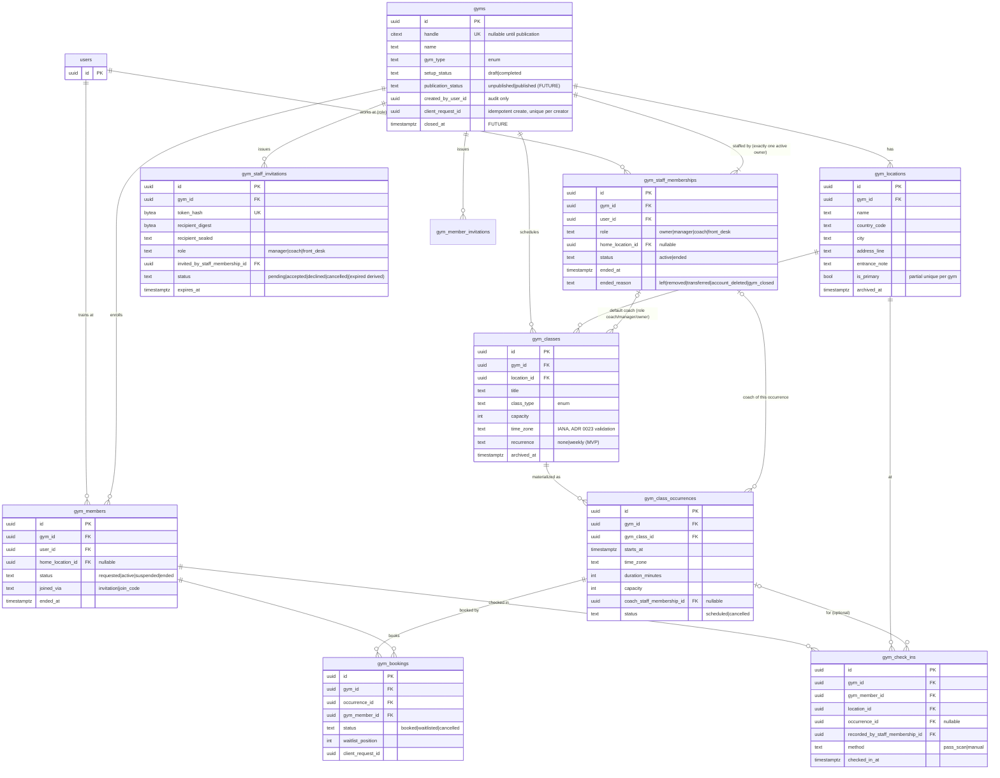

# SF-82 · 01 — Gym domain model and ERD

**Status: ACCEPTED (ADR 0026)** (SF-82, 2026-10-23). Part of the
[SF-82 package](README.md); decisions referenced as `D-Gnn` are in the
[decision register](10-decision-register.md).

This document defines the **minimum production-safe relational model** for
Gym & Club Management. It is a target for SF-83 onward: nothing here exists
yet, and no migration is created by SF-82.

## 1. Principles

1. **One global `users` row per person** (ADR 0009). No `User.role`,
   `User.type` or `users.gym_id`, ever.
2. **A Gym is a tenant.** Everything a gym owns carries `gym_id`; every
   gym-scoped read and write is filtered by it *and* authorized by an active
   staff membership of that gym (§4, [02](02-identity-roles-permissions.md)).
3. **Separate tables for separate meanings.** Working at a gym
   (`gym_staff_memberships`) and training at a gym (`gym_members`) are
   different facts with different lifecycles, privacy rules and authorizers.
   Neither is a Coach–Fighter relationship (ADR 0021,
   [04](04-gym-vs-coaching-contract.md)).
4. **No speculative tables.** An entity enters the schema with the ticket
   that first needs it (column "Ticket" below). No JSON blob stands in for a
   domain field. Feature flags, plans and payments get tables only when
   their product decision exists (`D-G09`, `D-G10`).
5. **Derived, not stored, state wherever it is cheap** (setup progress,
   booking counts, "at risk"), as in ADR 0015/0016/0020.

## 2. Entity summary

| Entity (table) | MVP? | Owner context | Purpose | Ticket (proposed, see [09](09-dependency-matrix.md)) |
| --- | --- | --- | --- | --- |
| `gyms` (Gym) | **MVP** | `SimpleFit.Gyms` | The tenant: name, handle, type, contact, setup and publication state | SF-83 |
| `gym_locations` (GymLocation) | **MVP** (≥ 1; one in the first UI) | `Gyms` | Address-only places of a gym; rooms/hours later | SF-83 |
| `gym_staff_memberships` (GymStaffMembership) | **MVP** | `Gyms.Staff` | A user's employment/affiliation and fixed role at one gym (incl. the owner) | SF-83 (owner row), SF-86 |
| `gym_staff_invitations` (GymStaffInvitation) | **MVP** | `Gyms.Staff` | Email-bound one-time invitations to staff roles (E06) | SF-86 |
| `gym_members` (GymMember) | **MVP** | `Gyms.Members` | A user's enrollment as a participant at one gym | SF-89 |
| `gym_member_invitations` (GymMemberInvitation) | **MVP** | `Gyms.Members` | Email-bound invitations to enroll (E07, without import) | SF-89 |
| `gym_classes` (GymClass) | **MVP** | `Gyms.Schedule` | A recurring or one-off class definition (title, type, location, capacity, default coach) | SF-92 |
| `gym_class_occurrences` (GymClassOccurrence) | **MVP** | `Gyms.Schedule` | One concrete instance in time (instant + IANA zone) — what is booked and attended | SF-92 |
| `gym_bookings` (GymBooking) | **MVP** | `Gyms.Bookings` | A member's place (booked / waitlisted / cancelled) in one occurrence | SF-94 |
| `gym_check_ins` (GymAttendance) | **MVP** | `Gyms.Attendance` | A recorded arrival of a member at a location (optionally for an occurrence) | SF-96 |
| `gym_audit_events` (GymAuditEvent) | **MVP** (`D-G18`) | `Gyms` | Append-only record of staff, role, ownership and member-status changes (actor, action, target id, time; no free text) | SF-83 onward |
| `gym_membership_plans` (GymMembershipPlan) | FUTURE | `Gyms.Commerce` | What a gym sells (recurring, package, drop-in) | after `D-G10` |
| member subscriptions, credits, invoices, payments, payouts | FUTURE / BLOCKED | `Payments` (new) | Money | after `D-G10` |
| `gym_business_verifications` | BLOCKED | `Gyms.Verification` | KYB evidence for payouts and Discover | after `D-G11` |
| gym platform subscription (SimpleFit plan) | BLOCKED | `Billing` (new) | Free/Starter/Pro… for the gym business | after `D-G09` |
| `gym_settings` | **No table** | — | Policies become columns on `gyms` when a ticket needs one (no key-value store) | — |
| `gym_branding` | **No table** | — | `accent_color` and `logo_object_key` columns on `gyms` (SF-98) | SF-98 |
| rooms, shifts, incidents, announcements, leads, community, challenges, open sparring, store, promotion, reports | FUTURE | various | Each needs its own decision and ticket | — |

## 3. ERD (MVP)

Every child table carries `gym_id` (redundant with its parent) and a
**composite foreign key** `(gym_id, parent_id) → parent(gym_id, id)`, the
technique ADR 0023 uses for relationship parties. It makes a cross-gym
reference (a booking of gym A pointing at an occurrence of gym B) impossible
at the database level, not just in code (threat T-1,
[08](08-security-threat-model.md)).

## 4. Entities in detail

### 4.1 `gyms` — the tenant (`D-G01`)

* **Meaning.** The organization members train at and staff work for. The UI
  calls the selected one the *Gym workspace*; the database calls it a gym.
  There is no generic `workspaces` table: Sponsor workspaces (later) are a
  different domain with different rules, so no polymorphic tenant table.
* **Fields (MVP).** `name` (1–80, trimmed), `gym_type`
  (`boxing_gym`, `boxing_club`, `amateur_club`, `professional_team`,
  `combat_sports_gym`, `fitness_boxing_studio` — OG1's six values, `D-G13`),
  optional `phone`, `website`; `setup_status` (`draft` → `completed`, monotonic);
  `created_by_user_id` (audit; ownership lives in staff memberships);
  `client_request_id` (UUID; unique per creator, `D-G05`).
* **Later columns, with their ticket.** `handle` (citext, unique,
  `^[a-z0-9-]{3,40}$`, reserved list) and `tagline`, `accent_color`,
  `logo_object_key`, `cover_object_key` (SF-98); `publication_status`
  (`unpublished` → `published`, FUTURE, needs `D-G11`); `closed_at` (SF-100).
* **Invariants.** Exactly one active owner (§4.3). `setup_status` never goes
  back to `draft`. A gym is never physically deleted while it has history
  (members, bookings, check-ins); closing is a state (SF-100).
* **Lifecycle.** Created `draft` with its owner membership and first
  location in one transaction (SF-83). `completed` when the backend's setup
  checks pass ([03](03-registration-workspace-lifecycle.md)). A draft has no
  history and may be discarded by its owner (`D-G20`).
* **Indexes.** unique `(created_by_user_id, client_request_id)`; unique
  `lower(handle)` where not null.
* **Projections.** *Staff view* (all fields, own gym only). *Public view*
  (name, type, handle, tagline, branding, primary location city — only once
  published; FUTURE). *Member view* (name, branding, member's location).

### 4.2 `gym_locations` (`D-G02`)

* **Fields.** `name` (default from the area, e.g. "Praga"), `country_code`
  (ISO 3166-1 alpha-2, the same list as profiles), `city`, `address_line`
  (free text; **no geocoding, no map, no tracking** — WebSetupLocations says
  so explicitly), optional `entrance_note`, `is_primary`, `archived_at`.
* **Invariants.** ≥ 1 non-archived location per gym; exactly one primary
  (partial unique index `(gym_id) WHERE is_primary AND archived_at IS NULL`).
  A location with future occurrences cannot be archived (409).
* **MVP UI.** One location (OG2 "Add another location" and WG23 multi-location
  are FUTURE); the model supports several from the start because it costs
  nothing and avoids a later split.

### 4.3 `gym_staff_memberships` — working at a gym (`D-G03`, `D-G04`)

* **Fields.** `gym_id`, `user_id`, `role`, optional `home_location_id`,
  `status` (`active` → `ended`, terminal), `ended_at`, `ended_reason`,
  `display_title` (optional free text such as "Head coach"; a label, never a
  permission, `D-G03`).
* **Invariants.**
  * At most one **active** staff membership per `(gym_id, user_id)`
    (partial unique). Rejoining after an end inserts a new row (history).
  * **Exactly one active owner per gym**: partial unique
    `(gym_id) WHERE role = 'owner' AND status = 'active'`, plus the
    transaction rule that the owner row can end only through transfer or
    gym closure (SF-100). Multiple co-owners are not supported (`D-G04`).
  * The owner's row is created with the gym, never through an invitation.
* **Roles (MVP).** `owner`, `manager`, `coach`, `front_desk`. Custom roles and
  per-person permission overrides are FUTURE (`D-G03`). Permissions are a
  **fixed matrix in code** ([02](02-identity-roles-permissions.md)), so the
  WG17 grid is read-only in MVP.
* **No CoachProfile requirement.** The `coach` staff role is gym
  employment; it does not need or create a CoachProfile, and a CoachProfile
  grants nothing at any gym (`D-G06`).
* **Deletion.** `ON DELETE CASCADE` from `users` would erase history and,
  worse, could leave a gym ownerless. Account deletion must refuse while the
  user is an active owner (transfer or close first), and ends other staff
  rows with `ended_reason = account_deleted` before the user goes (SF-100).

### 4.4 `gym_staff_invitations` (E06)

Same security shape as SF-57 coach invitations (ADR 0021 amendment), reused
deliberately:

* one-time token `sfs_` + 43 url-safe chars, **stored as a hash**; the plain
  token exists only in the E06 email (URL fragment, as `/invite/coach#token=`);
* recipient bound to a **verified email identity** of the accepting user
  (`recipient_digest`, `recipient_sealed` as in SF-57), never to "whoever
  holds the link"; OS1b (code confirmation) is the SF-21/SF-77 email-code
  path, not a new mechanism;
* `role` ∈ `manager | coach | front_desk` (never `owner`); who may invite whom
  is the matrix in [02](02-identity-roles-permissions.md) §4;
* one pending invitation per `(gym_id, recipient_digest)`; resend rotates the
  token; expiry 7 days (`D-G12`); abuse limits per gym/day and per recipient;
* acceptance inserts the staff membership and consumes the invitation in one
  transaction (locks: invitation `FOR UPDATE`, then gym owner check).

### 4.5 `gym_members` — training at a gym (`D-G07`)

* **Fields.** `gym_id`, `user_id`, `home_location_id`, `status`
  (`requested` → `active` or `ended`; `active` ⇄ `suspended`; `ended` terminal), `joined_via`, `ended_at`,
  `ended_reason` (`left`, `removed`, `account_deleted`, `gym_closed`).
* **Who can be a member.** A user with **completed account registration**
  (ADR 0016) — the 16+ shared account. **No FighterProfile required**
  (`D-G07`): fitness-boxing members and parents are not fighters. Minors'
  accounts are out of scope (registration is 16+).
* **Invariants.** At most one non-ended membership per `(gym_id, user_id)`.
  A staff member may also be a member (separate row, separate meaning).
* **How one becomes a member (MVP).** (a) accepting an email-bound member
  invitation (E07, without CSV import), or (b) entering a gym **join code**
  (A03), which creates a `requested` membership that staff approve. It becomes
  `active` immediately only when the gym has explicitly enabled
  auto-approval, and never without the joiner's verified identity (`D-G08`,
  approved). Invitations use one-time `sgm_` tokens, hashed and bound to a
  verified email exactly like staff invitations. CSV import (OG12) is
  FUTURE: it would store third parties' personal data before they have an
  account and needs a legal basis (`D-G08`).
* **What it is not.** A membership plan, a subscription, a payment status or
  a Coach–Fighter relationship. A suspended member cannot book or check in.

### 4.6 `gym_classes` and `gym_class_occurrences` (`D-G14`, [05](05-scheduling-and-commercial-boundaries.md))

* `gym_classes` is the definition (title 1–80, `class_type` from a small
  enum shared in spirit with ADR 0023 but its own column, location, capacity
  1–200, time zone, recurrence `none | weekly` with weekday and local start
  time, default coach staff membership).
* `gym_class_occurrences` are **materialized** for a rolling window (e.g. 8
  weeks) by the backend, each with its own `starts_at` (UTC instant),
  `time_zone`, `duration_minutes`, `capacity`, optional coach and `status`.
  Editing one occurrence never rewrites the series; editing the series
  regenerates only future, unbooked occurrences.
* Time handling **reuses** the ADR 0023 rules through an extracted shared
  module (`SimpleFit.Scheduling`), not a copy: explicit offsets, PostgreSQL
  zone validation, gap rejected, overlap disambiguated by offset.

### 4.7 `gym_bookings`

* `status` `booked | waitlisted | cancelled`; `waitlist_position` for
  waitlisted rows; `client_request_id` per member for idempotent booking.
* Invariants: one non-cancelled booking per `(occurrence_id, gym_member_id)`;
  booked count ≤ occurrence capacity, enforced under a lock on the
  occurrence row (`FOR UPDATE`) — no counter column that can drift.
* Waitlist promotion (manual in MVP, automatic later) happens in the same
  locked transaction as the cancellation that frees the place.

### 4.8 `gym_check_ins` (Attendance)

* An arrival of a member at a location, recorded by staff (`front_desk`,
  `coach`, `manager`, `owner`) by scanning the member's **rotating pass
  token** or manually. Optional `occurrence_id` links it to a class.
* The member pass token (G02, F16) is short-lived and signed server-side; a
  screenshot stops working (WebLocations: "rotate every 30 seconds").
* Attendance is *participation*, not training data: it carries no RPE,
  notes, weight or results (WebGymShared: "each athlete keeps their result").

## 5. Lifecycle and deletion behaviour (summary)

| Event | Effect |
| --- | --- |
| User deletes account | Refused while active owner of a **completed** gym (`D-G26`, approved; the account-deletion feature does not exist yet). Their **draft** gyms are deleted with the account (`D-G20`). Otherwise: staff rows ended (`account_deleted`), member rows ended, pending bookings cancelled, invitations to them left to expire; historical check-ins keep `gym_member_id` (the member row persists in `ended` state without personal fields beyond what retention allows — SF-100 decides). |
| Staff member removed / leaves | Row ended; occurrences they coach keep running with coach unset (staff sees "needs coach"). |
| Member removed / leaves | Row ended; future bookings cancelled in the same transaction. |
| Location archived | Refused while future occurrences exist there. |
| Draft abandoned | Kept and visible only to its owner; the owner may discard it (`DELETE /gyms/{id}`, draft only). No automatic deletion until a retention period is approved (`D-G20`). |
| Gym closed (FUTURE) | All memberships ended, future occurrences cancelled, record kept for a retention period that needs product/legal approval, then purged by a job. |

## 6. What is deliberately absent

`gym_id` on `users`, `coach_profiles`, `fighter_profiles`,
`coach_fighter_relationships` or `training_sessions`; a generic
`permissions` JSON; a `settings` key-value table; plan, trial, payment,
payout, verification, KYB, rooms, shifts, incidents, leads or community
tables. Each is either forbidden by an invariant or waits for its own
decision ([10](10-decision-register.md)).
