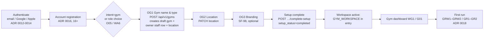
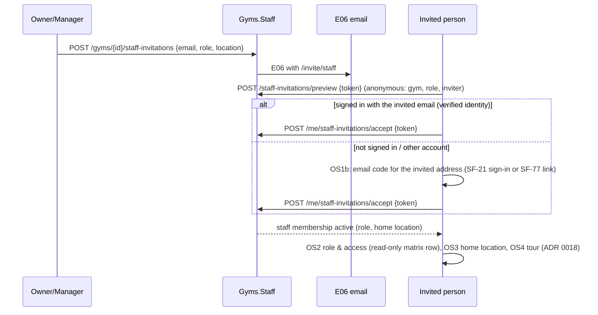
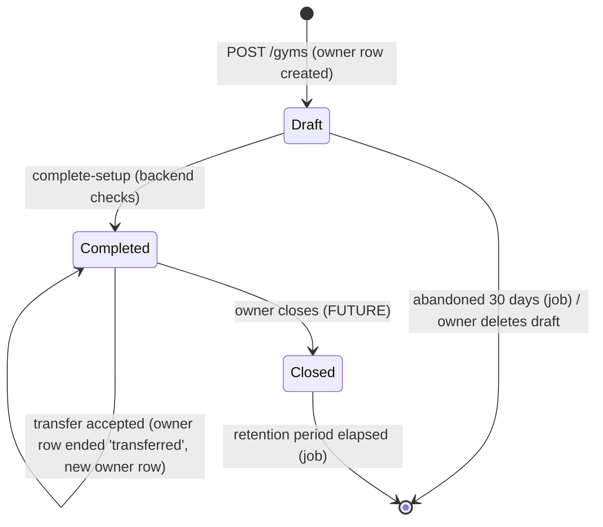

# SF-82 · 03 — Gym registration and workspace lifecycle

**Status: PROPOSED.** See the [package index](README.md).

## 1. Canonical flow

The authentication method does not matter after step A: the `intent`
continuation (`returnTo`, `intent=gym`) survives Google/Apple/email exactly as
for coach and fighter (SF-45). Account registration is mandatory first
(ADR 0017 rule 1).

## 2. Persistence model (`D-G05`)

| Question | Decision (recommended) |
| --- | --- |
| When is the gym first persisted? | On **OG1 Continue** — `POST /api/v1/gyms` with name, type and the first location's country/city/address (OG1 and OG2 may be one request or two; the gym is not useful without a location, so `setup_status` stays `draft` until a location exists). Nothing is persisted from intent or role selection. |
| Draft vs completed | `setup_status = draft` from creation; `completed` only through `POST /api/v1/gyms/{id}/complete-setup`, which the **backend checks**: name, type, ≥ 1 location with address, owner active. Completion is monotonic. |
| Resume | `GET /api/v1/me/gyms` lists the caller's gyms with `setup_status` and `missing_requirements` (as ADR 0015/0020). The entry resolves `intent=gym` to `gym_onboarding` while the newest owned gym is `draft` and to the gym home when completed. |
| Abandoned setup | A draft stays a draft; it is visible only to its owner, never public. Drafts untouched for 30 days are deleted by an Oban job (no members, staff or schedule can exist on a draft). |
| Already owns a gym | `intent=gym` opens that gym (completed) or resumes the draft. A *second* gym is an explicit "Create another gym" action, subject to the limits in [02 §6](02-identity-roles-permissions.md). |
| Multi-gym | Allowed (owner of several gyms, staff at several). Each gym is independent; nothing is shared across gyms except the user. |
| Duplicate requests | `client_request_id` (UUID per create, unique per creator): retries return the existing gym (`200`), a reused key with different content answers `409 {client_request_id: "reused"}`, the same pattern as ADR 0023. |
| Concurrency | One transaction inserts gym, location and owner row. The "≤ 1 draft" rule is enforced with a per-user advisory lock (or a partial unique index on `(created_by_user_id) WHERE setup_status='draft'`), so two tabs cannot create two drafts. |
| Branding | Logo/cover through the existing `SimpleFit.Storage` presigned-upload boundary (ADR 0005; Phoenix never proxies bytes); `accent_color` from a fixed, contrast-checked palette (OG3 shows six); public URL/handle only with publication (FUTURE). |
| Gym size (OG4), features (OG5) | Not persisted in MVP. OG4 only suggests a plan and OG5 maps to plan entitlements, both of which wait for `D-G09`. Keeping them would store numbers nobody uses. |
| Plan / trial (OG6, OG6b) | **BLOCKED** (`D-G09`). The MVP completion screen must not claim a trial, price or plan. OG6b is reused with truthful copy ("Your gym is created") once the design is updated. |

## 3. The 14-step design versus the MVP

The design's GymSetupSteps stepper has 14 steps: "Create your gym" (OG1–OG6)
then "Get ready to open" (OG7–OG14). MVP keeps the *structure* but only steps
whose data exists:

| Step | Design | MVP treatment |
| --- | --- | --- |
| OG1 | Name, handle, type, phone, website | MVP: name, type, optional phone/website. Handle → SF-98 with publication. |
| OG2 | Location (address only) | MVP: one location. "Add another location" FUTURE. |
| OG3 | Branding | SF-98 (optional, skippable). |
| OG4 | Gym size | FUTURE (plan suggestion). |
| OG5 | Features | FUTURE (plan entitlements). |
| OG6 / OG6b | Plan, trial, created | BLOCKED / copy change. |
| OG7 | Verify business | BLOCKED (`D-G11`). |
| OG8 | Memberships (products) | FUTURE (`D-G10`). |
| OG9 | Payments | BLOCKED (`D-G10`). |
| OG10 | Timetable | MVP after SF-92 (as a first-run checklist item, not a setup gate). |
| OG11 | Coaches & staff | MVP after SF-86 (checklist item). |
| OG12 | Import members | FUTURE (`D-G08`). |
| OG13 | Community defaults | FUTURE. |
| OG14 | Go live (publish) | FUTURE (needs `D-G11`, Discover). |

So the MVP wizard is OG1 → OG2 → (OG3) → completion, and OG10/OG11 become
items of the GRW1 first-run **checklist** ([ADR 0018](../../adr/0018-first-run-experiences.md)
pattern), which is truthful: each item is checked from real backend state
(timetable has ≥ 1 class, ≥ 1 staff invitation sent). This requires a
Claude Design revision of GymSetupSteps and OG6b (see
[06 §5](06-claude-design-inventory.md)).

## 4. Mobile (OG0)

Owners set up on the web (OG0 "continue on web"). MVP OG0 shows the web URL
and sends **no** login link: the design's "secure setup link valid 24 h ·
code 4K7-Q2" would be a new cross-device sign-in credential (ADR 0012 says a
session is issued only for a code entered on the requesting client). The
owner signs in on the web normally; their draft is resumed from the server.
E04 ("Finish gym setup") is an ordinary reminder email without credentials.

## 5. Staff onboarding (OS1–OS4)

* Accepting needs completed account registration (ADR 0016) but **no**
  Fighter or Coach profile.
* OS3 "shifts" are FUTURE; MVP stores only `home_location_id`.
* The mobile route `mobile.invite.coach._token` (INV2 "Gym invites coach")
  is the same staff-invitation flow with role `coach`; its path collides in
  meaning with SF-57/SF-80 coach invitations (`/invite/coach#token=`).
  `D-G16` recommends a single `/invite/staff#token=` entry for every staff
  role and retiring the INV2 route id.

## 6. Ownership, transfer, account deletion (`D-G04`, SF-100)

* Exactly one owner. Transfer (WG26) is a two-step request to an **existing
  active staff member**, accepted by them within 7 days; until then nothing
  changes. The previous owner may stay as manager.
* An active owner cannot delete their SimpleFit account: deletion first
  requires transfer or closure (WG26 says "Required before the owner deletes
  their account"). This is enforced in `Accounts` deletion by asking `Gyms`.
* "Identity verified" requirements for the new owner (WG26) depend on
  `D-G11` and are not MVP.

## 7. First run (ADR 0018)

New experiences, allow-listed keys: `gym_web_tour` (GRW2, 9 steps) and
`gym_mobile_first_run` (GR2, 8 steps), shown after setup completion, once
per user (not per gym: a second gym does not replay the tour). GRW1/GR1
"opening week" dashboards show only real data (classes today, check-ins
today when attendance exists); KPI tiles for revenue, MRR, failed payments
and trials stay hidden until their domains exist.
