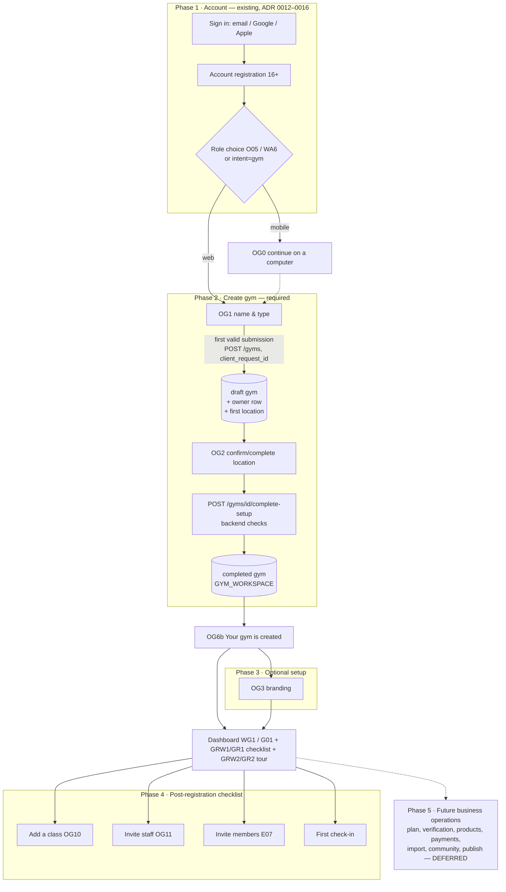
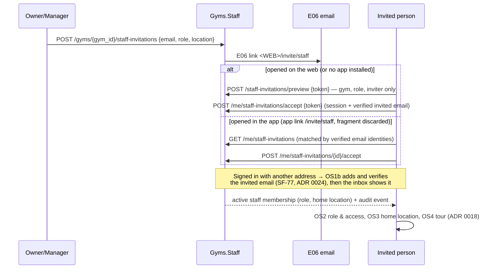
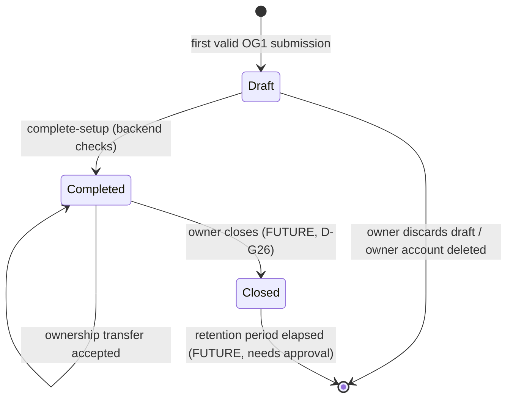

# SF-82 · 03 — Gym registration, first run and workspace lifecycle

**Status:**
* **Approved:** `D-G05` (a draft at the first valid submission, idempotent
  and resumable) and `D-G04` (one owner, transactional transfer).
* **Open:** `D-G20` (draft retention), `D-G21` (step redistribution), `D-G25`
  (limits) and `D-G26` (owner deletion).

See the [decision register](10-decision-register.md).

## 1. The canonical journey: four phases

| Phase | Purpose | Required? | Persisted | Backed by |
| --- | --- | --- | --- | --- |
| 1 · Account | One global user, completed registration | Yes (ADR 0017 rule 1) | existing | existing |
| 2 · Create gym | The gym exists as a private workspace | **Yes**: name, type, one location | draft at OG1, completed at OG2 | SF-83, SF-84 |
| 3 · Optional setup | Make it recognizable | No (skippable, resumable) | gym fields | SF-98 |
| 4 · Checklist | Get operating | No (each item reflects real state) | nothing extra; derived | SF-86, SF-89, SF-92, SF-96, SF-101 |
| 5 · Business operations | Sell, verify, publish | Not available | — | `D-G09`, `D-G10`, `D-G11` (deferred) |

The gym exists after phase 2, and `GYM_WORKSPACE` appears in the entry
projection at completion. Nothing in phases 3–5 can stop a gym from being
created or used.

## 2. Persistence and resume (`D-G05` approved)

| Question | Rule |
| --- | --- |
| First persistence | The first **valid** OG1 submission: `POST /api/v1/gyms` with name and type, plus the first location's country, city and address when OG1 and OG2 are combined. An invalid form persists nothing. Role choice and `intent=gym` persist nothing |
| Draft → completed | `POST /gyms/{id}/complete-setup`. The backend checks name, type, ≥ 1 location with an address and an active owner. Completion is monotonic; a repeat answers 200 |
| Idempotency | `client_request_id` per create: a retry returns the same gym; the same key with different content answers 409 |
| Concurrency | One transaction inserts the gym, location, owner row and audit event; a per-user advisory lock guards the draft limit (`D-G25`) |
| Resume | `GET /me/gyms` returns `setup_status` and `missing_requirements`. `intent=gym` with a draft resumes at the first missing step on any device |
| Already owns a completed gym | `intent=gym` opens it. "Create another gym" is explicit and subject to `D-G25` |
| Authentication method | Irrelevant after phase 1. The `intent`/`returnTo` continuation survives email, Google and Apple (SF-45) |

## 3. Keeping the 14-step design as a product journey (`D-G21`)

The 14 designed steps stay visible as the gym's **journey**. Each step is
placed in a phase and has a truthful state. None is required unless it is in
phase 2.

| Step | Phase | MVP state shown | Becomes available with |
| --- | --- | --- | --- |
| OG1 Name & type | 2 · Create | required | SF-84 |
| OG2 Location | 2 · Create | required | SF-84 |
| OG3 Branding | 3 · Optional | optional, skippable | SF-98 |
| OG4 Gym size | 5 · Later | "coming later" | `D-G09` |
| OG5 Features | 5 · Later | "coming later" | `D-G09` |
| OG6 Plan & trial | 5 · Later | "coming later" | `D-G09` |
| OG6b Created | end of 2 | "Your gym is created" (no plan) | SF-84 |
| OG7 Verify business | 5 · Later | "coming later" | `D-G11` |
| OG8 Membership products | 5 · Later | "coming later" | `D-G10` |
| OG9 Payments | 5 · Later | "coming later" | `D-G10` |
| OG10 Timetable | 4 · Checklist | done when ≥ 1 class exists | SF-92/SF-93 |
| OG11 Coaches & staff | 4 · Checklist | done when ≥ 1 staff invitation is accepted | SF-86/SF-87 |
| OG12 Import members | 4 · Checklist (as "Invite members") | done when ≥ 1 member is active; CSV import stays future (`D-G08`) | SF-89 |
| OG13 Community defaults | 5 · Later | "coming later" | future social domain |
| OG14 Go live | 5 · Later | "coming later" | `D-G11` |

Rules:

1. A "coming later" step is not a dead end and is never counted as missing.
   It opens no form and stores nothing.
2. The progress indicator counts only phase-2 steps for "created" and
   phase-4 items for "ready to operate". It never shows "6 of 14".
3. When a deferred decision is approved, its steps move into phase 3 or 4 by
   configuration in the client, with no change to gym creation.

## 4. Mobile owner handoff (OG0)

Owners create gyms on the web. OG0 shows the web address and states that
progress is saved. It sends no link and no code: a cross-device link would be
a new sign-in credential, which ADR 0012 forbids. E04 is an optional
reminder without credentials. Its frequency and consent follow the existing
transactional-email rules (ADR 0011).

## 5. Staff onboarding (OS1–OS4, `D-G16` approved, `D-G22` open)

* Accepting requires a completed account (ADR 0016) and nothing else: no
  Fighter or Coach profile.
* Binding: the accepter must hold a **verified** identity for the invited
  address. A forwarded email cannot be accepted by another account (T9).
* Coach–Fighter invitations (E08, `/invite/coach#token=sfi_…`, SF-57/SF-73/
  SF-80) are unchanged and remain a different table, token prefix, inbox and
  app-link path.

## 6. Lifecycle review

| Topic | Rule | Status |
| --- | --- | --- |
| Abandoned drafts | Kept. Visible only to their owner. No automatic deletion until a retention period is approved. The owner can discard a draft explicitly; it has no members, staff or schedule, so the delete is safe | `D-G20` open (30-day auto-deletion **not approved**) |
| Account deletion with a draft | The draft (and its owner row) is deleted with the account | `D-G20`/`D-G26` open |
| Account deletion while owning a completed gym | Refused until ownership is transferred. Closure is future | `D-G26` open; the account-deletion API does not exist yet |
| Account deletion as staff or member | Staff and member rows are ended (`account_deleted`); personal fields are removed per retention; future bookings are cancelled | depends on the account-deletion feature |
| Staff ownership | Exactly one active owner, enforced by a partial unique index. The owner cannot leave or be removed. A manager cannot promote anyone to owner | `D-G04` approved |
| Transfer | Owner → an **existing active staff member**; the target accepts within 7 days. One transaction under a gym-row lock ends the old owner row (`transferred`), activates the new one and optionally keeps the old owner as manager. A pending transfer blocks a second transfer | `D-G04` approved; SF-100 |
| Revocation | Takes effect on the next request (membership re-read per request) | proposed |
| Gym closure and retention | Future product and legal decision (WG26 shows "keeps records 5 years", not approved) | future |

## 7. First run (ADR 0018)

* Experience keys: `gym_web_tour` (GRW2) and `gym_mobile_first_run` (GR2),
  shown once per user after their first gym is completed. Staff get
  `gym_staff_tour` (OS4).
* The GRW1/GR1 "opening week" checklist is **derived from real state**:
  * gym created ✓;
  * a class exists;
  * a staff invitation was accepted;
  * a member is active;
  * a first check-in was recorded.

  It contains no "published", "payout verified", "invites sent: 175" or
  store items.
* Tour steps that point at future areas are removed from the MVP tour
  (C7 in [12](12-design-reconciliation-plan.md)).
