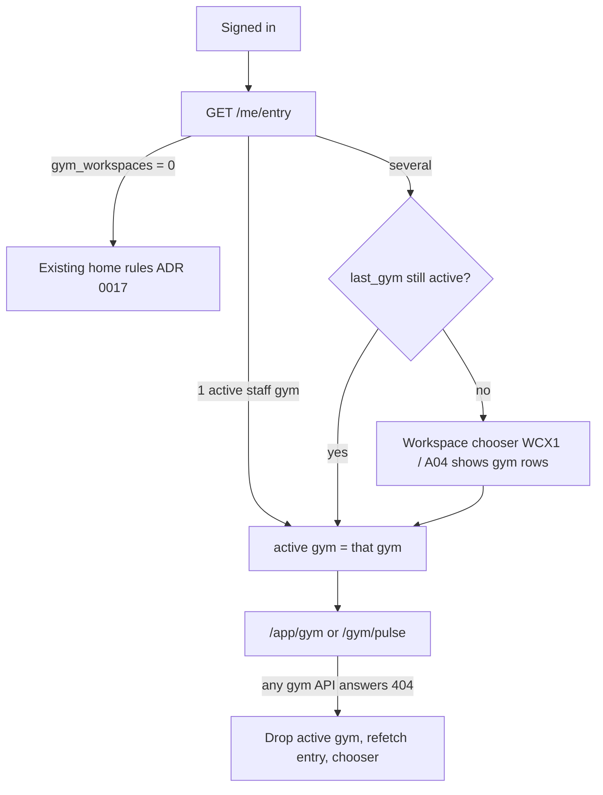

# SF-82 · 07 — Cross-platform Gym routing

**Status: PROPOSED.** The route registry (`simplefit-platform/docs/route-registry.json`,
synced to mobile) and `docs/route-architecture.md` are **not changed by
SF-82**. This document lists the changes the implementation tickets will
propose, each with its own registry PR.

## 1. Today

* 53 registry routes have `gym` in their id or path (web + mobile). All are
  `IMPLEMENTED` as SF-32/SF-33 feature placeholders ("not available yet"),
  so no Gym screen shows fabricated data today.
* Console routes require `GYM_WORKSPACE`, which **no user can hold yet**
  (the entry projection never emits it), so they are unreachable.
* Member-facing routes (`/gym/:gymId/...`, `/membership`, `/me/membership`,
  `/me/credits`, marketplace gym) require `FIGHTER`.
* Owner onboarding: `web.app.onboarding.gym` (`/app/onboarding/gym`) and
  `mobile.onboarding.gym` are account-level, phase `ONBOARDING`.
* Staff invitation: `mobile.invite.staff._token` (+ `/confirm`), and
  `mobile.invite.coach._token` (INV2, see `D-G16`).

## 2. Route groups

| Group | Web | Mobile | Gate | Ticket |
| --- | --- | --- | --- | --- |
| Public | `/gyms` (L4), `/pricing` (PR3 gym tab) | — | guest | SF-84 (copy only; prices BLOCKED) |
| Owner registration | `/app/onboarding/gym` (OG1–OG3, OG6b) | `/onboarding/gym` (OG0 handoff) | authenticated, account registration complete; **no** capability | SF-84 |
| Staff invitation | `/invite/staff#token=` (new web entry, `D-G16`) | `/invite/staff/:token` → **fragment form** recommended | anonymous preview; accept needs session | SF-87 |
| Staff onboarding | web: none (tour) | `/onboarding/staff/role|location|tour` | `GYM_WORKSPACE` | SF-87, SF-101 |
| Gym console | `/app/gym/**` | `/gym/**` (Gym tabs) | `GYM_WORKSPACE` + active gym + role (backend) | SF-85+ |
| Member side | `/app/me/gyms` (new, account area) | `/gym/:gymId/**`, `/membership` | account-level + backend membership check (`D-G07`) | SF-91, SF-95, SF-97 |
| Join | `/join/:code` (web, new) | `/join/:code` (A03) | anonymous preview, join needs session | SF-89 |

## 3. Workspace selection and switching (`D-G15`)

* UI paths stay id-free (`D-WORKSPACE-NOT-IN-URL` kept). The client holds
  the active gym (memory + per-tab `sessionStorage` on web, secure store
  keyed by user on mobile); the server stores only the last explicit choice
  (additive `gym_id` in `PUT /me/entry/context`).
* `route-architecture.md` §7 sentence "the active workspace is session
  context held by the backend session" must be amended to "client-held,
  with the last choice remembered by the backend; every Gym API request
  carries the gym id" once `D-G15` is approved.
* Two tabs on two gyms are independent; a switch in one tab does not
  re-target in-flight requests of the other.

## 4. Gates and resume

| Situation | Web | Mobile |
| --- | --- | --- |
| Not signed in, opens `/app/gym/**` | `/login?returnTo=` (existing) | `/welcome` (existing) |
| Signed in, no `GYM_WORKSPACE` | existing capability redirect (home) | same |
| `intent=gym`, no gym | `/app/onboarding/gym` (OG1) | `/onboarding/gym` (OG0) |
| `intent=gym`, draft gym | `/app/onboarding/gym` resumes at first missing step | OG0 |
| Completed gym, first visit | `/app/gym` + GRW1/GRW2 (ADR 0018) | `/gym/pulse` + GR1/GR2 |
| Route of a FUTURE/BLOCKED area | registry placeholder stays; nav item hidden | same |

## 5. Registry changes the tickets will propose (not made now)

1. `D-G07`: member-side routes `capability: FIGHTER → null` (account level),
   relying on backend membership checks (SF-91).
2. `D-G16`: web `/invite/staff` route; mobile staff invite moved to the
   fragment form (`#token=`), as SF-80 did for coach invitations;
   `mobile.invite.coach._token` retired or redirected (SF-87).
3. `/app/me/gyms` and web `/join/:code` (SF-89/SF-91).
4. Design IDs for revised screens (R1–R11 in [06](06-claude-design-inventory.md))
   once Claude Design is updated.
