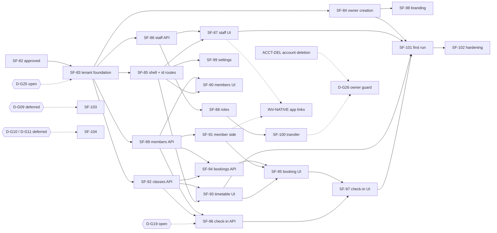

# SF-82 · 09 — Dependency matrix (SF-83 – SF-104)

**Status: reconciled with the final SF-82 approval (2026-10-23).** The Jira
contents of SF-83–SF-104 were **not available** to this work (no Jira access
from the session). The table is the architecture's split. Before SF-83
starts, the Jira titles and descriptions must be aligned with it.

## 1. Mapping, ownership and entry conditions

"Owner" is the backend context, or the client feature that owns the data or
screen. Entry conditions list only what is **still missing**; approved
decisions are named for traceability.

| Ticket | Scope | Owner | Repos | Depends on | Entry conditions | Class |
| --- | --- | --- | --- | --- | --- | --- |
| SF-83 | Tenant foundation: `gyms` (name, type, contact, `setup_status`), `gym_locations`, owner staff row, `gym_audit_events`, `Gyms.Policy` (fixed matrix), `POST /gyms` (draft, idempotent, one open draft, rate limits), `GET /me/gyms`, `GET/PATCH /gyms/{gym_id}`, locations, `complete-setup`, discard draft; entry projection `GYM_WORKSPACE` + `gym_workspaces` + `last_gym` (additive) | `SimpleFit.Gyms`; `SimpleFit.Entry` (projection via a public `Gyms` query) | api | — | **`D-G25` decision**; Jira aligned; start authorization. Approved: D-G01–05, D-G13, D-G15, D-G18, D-G20, D-G24 | MVP |
| SF-84 | Owner creation web OG1 → OG2 → OG6b (+ resume), OG0 text handoff, E04 reminder template, L4 copy | platform `onboarding/gym`; mobile OG0; api `Email.Templates` | platform, mobile, api | SF-83 | Design C1, C2, C3, C5, C6, C15 (E04), C17 approved and applied | MVP |
| SF-85 | Gym shell and navigation: `/app/gyms[/:gymId/…]` and `/gyms[/:gymId/…]` (registry migration of the id-free console routes), chooser and switcher, 404/403 handling; amend `route-architecture.md` (`D-G23` replaces `D-WORKSPACE-NOT-IN-URL` for Gym; rule-9 exception `D-G24`) | platform and mobile shells; registry | platform, mobile | SF-83 | Approved: D-G15, D-G23, D-G24 | MVP |
| SF-86 | Staff invitations API: `sfs_` tokens, 7-day expiry, web preview/accept, token-free inbox by verified email, E06 template | `Gyms.Staff`; `Email.Templates` | api | SF-83 | Design C15 (E06). Approved: D-G12, D-G16, D-G22 | MVP |
| SF-87 | Staff acceptance UI: web `/invite/staff`; mobile in-app inbox `/me/gym-invitations` + OS1/OS1b by id; OS2, OS3; WG16; registry: retire `/invite/staff/:token`, `/invite/staff/:token/confirm`, `/invite/coach/:token` | platform, mobile | platform, mobile | SF-85, SF-86 | Design C10, C11, C12, C16 | MVP |
| SF-88 | Role change, removal, leave; WG17 read-only matrix | `Gyms.Staff`, `Gyms.Policy` | api, platform | SF-86 | Design C10. Approved: D-G03 | MVP |
| SF-89 | Member enrollment API: E07 invitations (`sgm_`), web preview/accept, token-free inbox, join codes → `requested`, explicit auto-approval setting, approve/decline, suspend/resume/end | `Gyms.Members`; `Email.Templates` | api | SF-83 | Design C15 (E07). Approved: D-G07, D-G08, D-G22 | MVP |
| SF-90 | Members console WG3/WG14/WG15 + join requests; mobile G09/G04 | platform, mobile | platform, mobile | SF-85, SF-89 | Design C8, C14 | MVP |
| SF-91 | Member side: `/app/me/gyms[/:gymId]`, `/me/gyms[/:gymId]`, web `/invite/gym`, web and mobile `/join/:code` (A03); registry: member routes to account level under `/me/gyms/:gymId` | platform, mobile | platform, mobile | SF-89 | Design C13 | MVP |
| SF-92 | Classes + occurrences API, materialization job, `SimpleFit.Scheduling` extraction | `Gyms.Schedule`; `SimpleFit.Scheduling` | api | SF-83 | ADR 0023 suite green before and after the extraction. Approved: D-G14 | MVP |
| SF-93 | Timetable WG5, mobile G08, OG10 checklist destination | platform, mobile | platform, mobile | SF-85, SF-92 | Design C1 (OG10) | MVP |
| SF-94 | Bookings API: capacity, waitlist, cancellation window, staff booking for a member | `Gyms.Bookings` | api | SF-89, SF-92 | — | MVP |
| SF-95 | Booking UI: F13 (member), WG18 (console) | platform, mobile | platform, mobile | SF-91, SF-93, SF-94 | Design C9 | MVP |
| SF-96 | Check-in API + rotating member-pass token; attendance queries | `Gyms.Attendance` | api | SF-89, SF-92 | **`D-G19` decision** | MVP |
| SF-97 | G02 check-in, G03 roster, WG19 attendance, F16 member pass | platform, mobile | platform, mobile | SF-91, SF-94, SF-96 | **`D-G19` decision**; design C9 | MVP |
| SF-98 | Branding OG3 (storage presign, accent colour), private preview | `Gyms`, `SimpleFit.Storage` | api, platform | SF-84 | Design C4 | MVP |
| SF-99 | Gym settings WG22, locations WG23 | `Gyms` | api, platform | SF-85 | — | MVP |
| SF-100 | Ownership transfer WG26, leave rules | `Gyms.Staff` | api, platform | SF-88 | Design WG26 row. Approved: D-G04, D-G26 (the deletion guard itself waits for **ACCT-DEL**, §3) | MVP |
| SF-101 | First run GRW1/GRW2/GR1/GR2/OS4 + dashboards WG1/G01 from real state | platform, mobile; api experience keys (ADR 0018) | platform, mobile, api | SF-84, SF-87, SF-89, SF-93, SF-97 | Design C7. Approved: D-G21 | MVP |
| SF-102 | Gym E2E + security sweep (T1–T22), cross-gym and coaching-isolation contract tests | all | all | SF-83–SF-101 | — | MVP |
| SF-103 | SimpleFit plan / trial / billing; commercial ownership limits | future `Billing` | — | — | **DEFERRED PRODUCT DECISION `D-G09`** | DEFERRED |
| SF-104 | Gym commerce, payments, payouts, KYB, publishing | future `Gyms.Commerce`, `Payments`, verification | — | — | **DEFERRED PRODUCT DECISIONS `D-G10`, `D-G11`** | DEFERRED |

## 2. Corrections against the final architecture

| # | Correction | Reason |
| --- | --- | --- |
| 1 | SF-85 now migrates the registry's id-free console routes to `/app/gyms/:gymId/…` and `/gyms/:gymId/…` and amends route-architecture §7 and §8 rule 9 | `D-G23`, `D-G24` approved |
| 2 | SF-91 moves the member routes from `/gym/:gymId/…` (FIGHTER) to `/me/gyms/:gymId/…` (account level) and adds the web `/invite/gym` page | `D-G07`, `D-G22`, `D-G23` |
| 3 | SF-89 gains member invitations with an inbox, join requests and an explicit auto-approval setting | `D-G08`, `D-G22` |
| 4 | SF-83 drops the "3 owned gyms" cap; it implements rate limits and the one-open-draft rule only if `D-G25` is approved as proposed | `D-G25` |
| 5 | SF-96 depends on SF-92; SF-95 on SF-93; SF-97 on SF-91 and SF-94; SF-101 on SF-84, SF-87 and SF-89 | data dependencies |
| 6 | SF-96/SF-97 wait for `D-G19` | `D-G19` is not approved |
| 7 | The owner-deletion guard of `D-G26` waits for an account-deletion ticket (**ACCT-DEL**, §3) | missing dependency |
| 8 | App-link claims for `/invite/staff` and `/invite/gym` need a native build (**INV-NATIVE**, §3). SF-87/SF-91 ship the in-app inbox and the web pages without it | missing dependency |
| 9 | Entry projection changes are owned by `SimpleFit.Entry`; SF-83 adds a read-only public `Gyms` query, so there is no cross-context schema access | CLAUDE.md rule 3 |
| 10 | SF-103/SF-104 are not engineering tickets until their product decisions exist; nothing is stubbed ahead | `D-G09`–`D-G11` |

## 3. Missing dependencies (no ticket in SF-83–SF-104)

| Proposed ticket | Scope | Why it is needed | Blocks |
| --- | --- | --- | --- |
| **ACCT-DEL — Account deletion** (outside the Gym epic) | Account-deletion request and execution (the E14 "deletion scheduled" template already exists; there is no endpoint). Includes the cross-context hook: `Gyms` refuses while the user is the sole owner of a completed gym (`D-G26`), deletes the user's drafts (`D-G20`), and ends staff and member rows; `Coaching` and `Fighters` run their own clean-up | The API has no account-deletion endpoint or flow today | The `D-G26` guard. Not SF-83 or SF-100's transfer |
| **INV-NATIVE — Gym invitation app links** | Mobile: `systemPathOf` maps `https://<host>/invite/staff` and `/invite/gym` to the inbox and drops the fragment, with tests next to the `/invite/coach` ones; `ios.associatedDomains` and the Android intent filter add the two paths. Platform: the AASA served under `APP_LINKS_APPLE_TEAM_ID` adds `/invite/staff` and `/invite/gym`. **A new native build** (EAS credits need approval) | Without it, E06/E07 links open the web page (which works); the app does not open directly | Only the "open in app" experience |
| **Jira alignment** | Align SF-83–SF-104 with §1 | The Jira contents could not be verified | SF-83 start |

## 4. Critical path

## 5. SF-83 independence from deferred decisions

SF-83 is the tenant foundation and has **no dependency** on payments,
billing, plans, verification or publishing:

* **Tables:** `gyms`, `gym_locations`, `gym_staff_memberships` (owner row),
  `gym_audit_events`. SF-83 adds no `publication_status`, plan, trial,
  `verified` or payout column; each arrives with its own decision (CLAUDE.md
  rule 19).
* **Creation and completion** check only name, type, one location and an
  active owner (`D-G05`, `D-G21`). No step waits for `D-G09`–`D-G11`.
* **Limits** are anti-abuse rate limits (`D-G25`), not plan limits.
* **No provider boundary** is touched (no `Payments`, no verification
  adapter). Emails are not needed in SF-83 (E04 is SF-84).
* **Local development** runs with the normal stack; no bypass is needed
  (`D-G17`, open, does not block).

The remaining blockers for SF-83 are the `D-G25` decision, the Jira
alignment and an explicit start authorization.

## 6. Cross-cutting dependencies

| Dependency | Needed by | State |
| --- | --- | --- |
| ADR 0017 entry projection | SF-83, SF-85 | exists; additive change |
| ADR 0021 / SF-73 invitation and inbox pattern; ADR 0024 email linking | SF-86, SF-89 | exist; reused with separate tables |
| SF-80 app-link rules | SF-87, INV-NATIVE | exist; `/invite/coach` untouched |
| ADR 0023 time rules | SF-92 | exist; extracted to `SimpleFit.Scheduling` |
| ADR 0018 first run | SF-101 | exists; new allow-listed keys |
| ADR 0011 email templates | SF-84, SF-86, SF-89 | exist; E04, E06, E07 added |
| Storage presign (ADR 0005) | SF-98 | exists |
| Account deletion | `D-G26` guard | **missing** (ACCT-DEL) |
| Native build for app links | INV-NATIVE | **needs EAS approval** |
| Claude Design C1–C17 | UI tickets (see §1) | **awaiting separate approval** |
