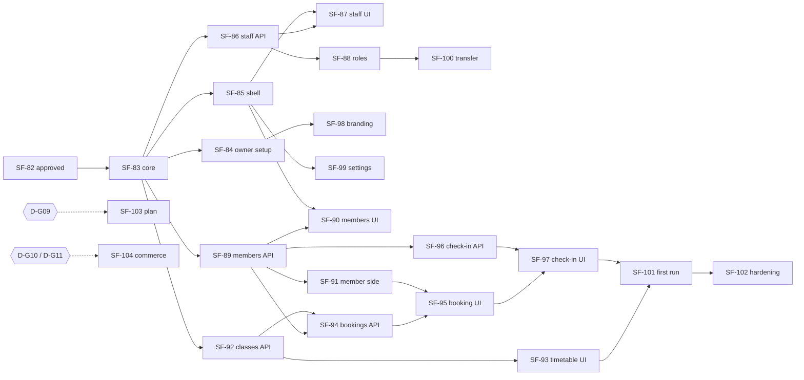

# SF-82 · 09 — Dependency matrix (SF-83 – SF-104)

**Status: PROPOSED.** The Jira contents of SF-83–SF-104 were **not
available** to this task (no Jira access from the session). The mapping
below is the architecture's proposed split; ticket titles in Jira must be
reconciled with it before SF-83 starts.

## 1. Proposed mapping and entry conditions

| Ticket | Scope (proposed) | Repos | Depends on | Entry conditions | Class |
| --- | --- | --- | --- | --- | --- |
| SF-83 | `SimpleFit.Gyms` core: `gyms`, `gym_locations`, owner staff row, `gym_audit_events`, `Gyms.Policy`, `POST/GET /gyms`, `GET /me/gyms`, entry `GYM_WORKSPACE` + `gym_workspaces` | api | SF-82 approved | `D-G01`–`D-G05`, `D-G13`, `D-G15`, `D-G18` approved | MVP |
| SF-84 | Owner registration web OG1→OG2→(OG3)→OG6b, OG0 handoff, E04 reminder, L4 copy | platform, mobile, api (E04) | SF-83 | R1–R3 design revision approved | MVP |
| SF-85 | Gym shell: GymWebNav, GymTabs, active-gym store, chooser rows, entry context `gym_id` | platform, mobile, api (additive) | SF-83 | `D-G15` approved; route-architecture §7 amended | MVP |
| SF-86 | Staff invitations API + E06 | api | SF-83 | `D-G12`, `D-G16` approved | MVP |
| SF-87 | Staff acceptance + onboarding OS1–OS4, INV2 → `/invite/staff`, WG16 staff list | platform, mobile | SF-85, SF-86 | registry change for `D-G16` | MVP |
| SF-88 | Roles & permissions: role change/remove, WG17 read-only matrix | api, platform | SF-86 | — | MVP |
| SF-89 | Member enrollment API: E07 invitations, join code/requests | api | SF-83 | `D-G07`, `D-G08` approved | MVP |
| SF-90 | Members console WG3/WG14/WG15, mobile G09/G04 | platform, mobile | SF-85, SF-89 | R6, R9 accepted | MVP |
| SF-91 | Member side: "My gyms", gym page, A03 join, member routes account-level | platform, mobile | SF-89 | registry change for `D-G07` | MVP |
| SF-92 | Classes + occurrences API, `SimpleFit.Scheduling` extraction | api | SF-83 | `D-G14` approved; ADR 0023 tests green | MVP |
| SF-93 | Timetable WG5, mobile G08, OG10 checklist item | platform, mobile | SF-85, SF-92 | — | MVP |
| SF-94 | Bookings API (capacity, waitlist, cancel window) | api | SF-89, SF-92 | — | MVP |
| SF-95 | Booking UI: F13 member, WG18 console | platform, mobile | SF-91, SF-94 | — | MVP |
| SF-96 | Check-in API + rotating member pass | api | SF-89 | — | MVP |
| SF-97 | G02 check-in, G03 roster, WG19 attendance, F16 member pass | platform, mobile | SF-95, SF-96 | — | MVP |
| SF-98 | Branding OG3, private profile preview (WG8 preview only) | api, platform | SF-84 | storage presign reuse | MVP |
| SF-99 | Gym settings WG22, locations WG23 | api, platform | SF-85 | — | MVP |
| SF-100 | Ownership transfer WG26, leave gym, account-deletion rules | api, platform | SF-88 | `D-G04` approved | MVP |
| SF-101 | First run GRW1/GRW2/GR1/GR2/OS4, dashboards WG1/G01 with real data | platform, mobile, api (experience keys) | SF-93, SF-97 | R5 accepted | MVP |
| SF-102 | Gym E2E + security hardening (T1–T22 test sweep, cross-gym contract tests) | all | SF-83–SF-101 | — | MVP |
| SF-103 | SimpleFit platform plan / trial (OG6, WG25, PR3, PR6m) | — | — | **BLOCKED** on `D-G09` | BLOCKED |
| SF-104 | Gym commerce, payments, KYB (OG7–OG9, WG6, WG7, GC1–GC12) | — | — | **BLOCKED** on `D-G10`, `D-G11` | BLOCKED |

## 2. Critical path

## 3. Cross-cutting dependencies

| Dependency | Needed by | State |
| --- | --- | --- |
| ADR 0017 entry projection | SF-83, SF-85 | exists; additive change |
| ADR 0021 invitation pattern | SF-86, SF-89 | exists; reused, separate tables |
| ADR 0023 time rules | SF-92 | exists; extracted to `SimpleFit.Scheduling` |
| ADR 0018 first-run | SF-101 | exists; new allow-listed keys |
| ADR 0011 email templates | SF-84, SF-86, SF-89 | exists; E04, E06, E07 added |
| Storage presign (ADR 0005) | SF-98 | exists |
| Claude Design revisions R1–R11 | SF-84, SF-87, SF-90, SF-101 | **not started** — needs design approval |
| Route registry changes | SF-85, SF-87, SF-91 | **not started** — platform PRs per ticket |
| Payment provider / KYB / plan decisions | SF-103, SF-104 | **not started** — separate approvals |
