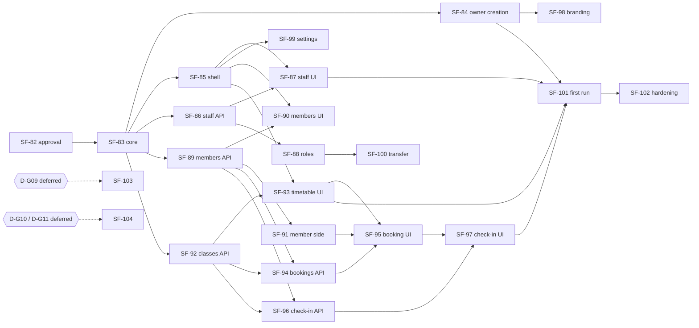

# SF-82 · 09 — Dependency matrix (SF-83 – SF-104)

**Status: PROPOSED, rechecked after the SF-82 review.** The Jira contents of
SF-83–SF-104 were **not available** to this work (no Jira access from the
session). The table is the architecture's proposed split. Before SF-83
starts, the Jira titles must be reconciled with it.

## 1. Mapping, ownership and entry conditions

"Owner" is the backend context, or the client feature that owns the data or
screen.

| Ticket | Scope (proposed) | Owner | Repos | Depends on | Entry conditions | Class |
| --- | --- | --- | --- | --- | --- | --- |
| SF-83 | Core tenant: `gyms`, `gym_locations`, owner staff row, `gym_audit_events`, `Gyms.Policy`, `POST/GET/DELETE(draft) /gyms`, `complete-setup`, `GET /me/gyms`, entry `GYM_WORKSPACE` + `gym_workspaces` + additive `PUT /me/entry/context` `gym_id` | `SimpleFit.Gyms`; `SimpleFit.Entry` (projection) | api | SF-82 approval | `D-G01`, `D-G02`, `D-G13`, `D-G18`, `D-G20`, `D-G25` decided; Jira reconciled | MVP |
| SF-84 | Owner creation web OG1→OG2→OG6b, OG0 text handoff, E04 reminder template, L4 copy | platform `onboarding/gym`; mobile OG0; api `Email.Templates` | platform, mobile, api | SF-83 | `D-G21` decided; design C1, C2, C5, C6, C17 approved and applied | MVP |
| SF-85 | Gym shell: GymWebNav, GymTabs, active-gym store, switcher rows, 404/403 handling; route-architecture §7 and rule-9 amendments | platform/mobile shell | platform, mobile | SF-83 | `D-G23`, `D-G24` decided | MVP |
| SF-86 | Staff invitations API (E06, `sfs_` tokens, token-free inbox by verified email), acceptance | `Gyms.Staff` | api | SF-83 | `D-G12`, `D-G22` decided | MVP |
| SF-87 | Staff acceptance UI: web `/invite/staff`, mobile inbox + OS1/OS1b by id, OS2–OS3, WG16 staff list; registry: retire path-token routes; app-link claim for `/invite/staff` (native build) | platform, mobile | platform, mobile | SF-85, SF-86 | design C10–C12, C16 applied; native build budget approved (EAS) | MVP |
| SF-88 | Role change, removal, leave; WG17 read-only matrix | `Gyms.Staff` + `Gyms.Policy` | api, platform | SF-86 | `D-G03` decided | MVP |
| SF-89 | Member enrollment API: E07 invitations, join code → request / auto-approve, suspend / resume / end | `Gyms.Members` | api | SF-83 | `D-G08` decided | MVP |
| SF-90 | Members console WG3/WG14/WG15, mobile G09/G04 | platform, mobile | platform, mobile | SF-85, SF-89 | design C8, C14 applied | MVP |
| SF-91 | Member side: "My gyms" (web `/app/me/gyms`, mobile settings), A03 join, web `/join/:code`; registry `FIGHTER → null` for book + member pass | platform, mobile | platform, mobile | SF-89 | design C13 applied | MVP |
| SF-92 | Classes + occurrences API, materialization job, `SimpleFit.Scheduling` extraction | `Gyms.Schedule`; `SimpleFit.Scheduling` (shared) | api | SF-83 | ADR 0023 suite green before and after extraction | MVP |
| SF-93 | Timetable WG5, mobile G08 | platform, mobile | platform, mobile | SF-85, SF-92 | — | MVP |
| SF-94 | Bookings API: capacity, waitlist, cancellation window, staff booking for a member | `Gyms.Bookings` | api | SF-89, SF-92 | — | MVP |
| SF-95 | Booking UI: F13 (member), WG18 (console) | platform, mobile | platform, mobile | SF-91, SF-93, SF-94 | design C9 applied | MVP |
| SF-96 | Check-in API + rotating member pass token; attendance queries | `Gyms.Attendance` | api | SF-89, **SF-92** (occurrence check-ins) | `D-G19` decided | MVP |
| SF-97 | G02 check-in, G03 roster, WG19 attendance, F16 member pass | platform, mobile | platform, mobile | SF-91, SF-94, SF-96 | design C9 applied | MVP |
| SF-98 | Branding OG3 (logo/cover upload via storage presign, accent colour), private preview | `Gyms` + `SimpleFit.Storage` | api, platform | SF-84 | design C4 applied | MVP |
| SF-99 | Gym settings WG22, locations WG23 | `Gyms` | api, platform | SF-85 | — | MVP |
| SF-100 | Ownership transfer WG26, leave rules; owner-deletion guard | `Gyms.Staff` | api, platform | SF-88; **account-deletion feature** for the guard | `D-G26` decided | MVP (transfer) |
| SF-101 | First run GRW1/GRW2/GR1/GR2/OS4 + dashboards WG1/G01 from real state | platform, mobile; api experience keys (ADR 0018) | platform, mobile, api | SF-84, SF-87, SF-89, SF-93, SF-97 | design C7 applied | MVP |
| SF-102 | Gym E2E + security sweep (T1–T22), cross-gym and coaching-isolation contract tests | all | all | SF-83–SF-101 | — | MVP |
| SF-103 | SimpleFit plan / trial / billing (OG4–OG6, WG25, PR3, PR6m) | future `Billing` | — | — | **DEFERRED PRODUCT DECISION `D-G09`** | DEFERRED |
| SF-104 | Gym commerce, payments, payouts, KYB, publishing (OG7–OG9, OG14, WG6, WG7, GC1–GC12, E05) | future `Gyms.Commerce`, `Payments`, verification | — | — | **DEFERRED PRODUCT DECISIONS `D-G10`, `D-G11`** | DEFERRED |

## 2. Corrections from the recheck

| # | Finding | Fix in the mapping |
| --- | --- | --- |
| 1 | SF-96 check-ins against an occurrence need occurrences | SF-96 now depends on SF-92 |
| 2 | SF-101's checklist reads staff, members, classes and check-ins | SF-101 also depends on SF-84, SF-87 and SF-89 |
| 3 | SF-95 needs the timetable screen | SF-95 depends on SF-93 |
| 4 | SF-97's member pass is reached from the member side | SF-97 depends on SF-91 and SF-94 (roster) |
| 5 | Owner-deletion guard (SF-100, `D-G26`) | **Missing dependency:** the API has no account-deletion endpoint yet (only the E14 "deletion scheduled" template). The guard is built with that feature; SF-100 delivers the transfer itself |
| 6 | Staff-invitation inbox matches verified emails | Depends on existing SF-73/SF-77 (ADR 0021 amendment, ADR 0024): available |
| 7 | Mobile app-link claim for `/invite/staff` | Needs a new native build, so EAS credits need approval. Until then the mobile inbox is reached in-app |
| 8 | Entry projection change | Owned by `SimpleFit.Entry`, not `Gyms`. SF-83 adds a read-only `Gyms` query that the entry calls (no cross-context schema access) |
| 9 | Design revisions | Every UI ticket's entry condition names its C-items ([12](12-design-reconciliation-plan.md)). The inventory is re-run on the new canvas version |
| 10 | Deferred decisions | SF-103/SF-104 are not engineering tickets until their product decisions exist; no stub or mock is built ahead |

## 3. Critical path

## 4. Cross-cutting dependencies

| Dependency | Needed by | State |
| --- | --- | --- |
| ADR 0017 entry projection | SF-83, SF-85 | exists; additive change |
| ADR 0021 / SF-73 invitation and inbox pattern | SF-86, SF-89 | exists; reused with separate tables |
| SF-80 app-link rules | SF-87 | exist; `/invite/coach` untouched |
| ADR 0023 time rules | SF-92 | exist; extracted to `SimpleFit.Scheduling` |
| ADR 0018 first run | SF-101 | exists; new allow-listed keys |
| ADR 0011 email templates | SF-84, SF-86, SF-89 | exist; E04, E06, E07 added |
| Storage presign (ADR 0005) | SF-98 | exists |
| Account deletion | SF-100 guard | **missing** |
| Claude Design revisions C1–C17 | SF-84, SF-87, SF-90, SF-91, SF-95, SF-97, SF-98, SF-101 | **awaiting approval** |
| Route registry changes | SF-85, SF-87, SF-91 | per ticket |
