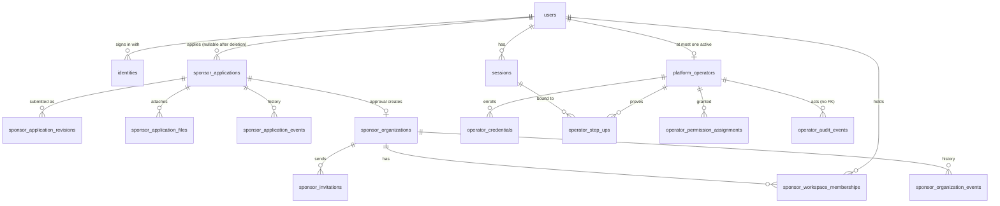

# Sponsor & Admin — ERD proposal (SF-107)

**Status: PROPOSED. No migration exists or is added by SF-107.** Conventions as elsewhere: UUID keys,
`utc_datetime_usec`, text status with a CHECK, triggers for transitions and append-only history,
no schema exposed directly in JSON.

## 1. Diagram

## 2. Sponsor tables

### `sponsor_applications`

| Column | Rule |
| --- | --- |
| `id` | PK |
| `applicant_user_id` | FK `users`, `ON DELETE SET NULL` |
| `status` | CHECK: `draft`, `submitted`, `under_review`, `changes_requested`, `approved`, `rejected`, `withdrawn` |
| `revision` | Integer ≥ 1. Bumped on each applicant edit |
| Draft answers | Typed columns: company name, website, country, industry, contact name, position, work email, phone, interests (text array with CHECK), market scope, countries, cities, budget band, goals |
| `client_request_id` | Unique per applicant |
| `assigned_operator_id` | FK `platform_operators`, nullable, `ON DELETE RESTRICT` |
| `submitted_at`, `decided_at` | Check against status |

| Constraint | Purpose |
| --- | --- |
| Partial unique on `applicant_user_id` where status in non-terminal states | One current application per user |
| Trigger | Only the [listed transitions](sponsor-application-lifecycle.md#3-transitions) |
| Check | `assigned_operator_id` set only in `under_review` and after |
| Deferred constraint trigger | `approved` must have exactly one organization, checked at commit |
| Index `(status, submitted_at, id)` | The queue |

### `sponsor_application_revisions`

Immutable snapshot per submission. PK `id`; FK application, `ON DELETE RESTRICT`; `revision`; the
same answer columns; declaration version; `submitted_at`. Unique `(application_id, revision)`.
Append-only trigger.

### `sponsor_application_files`

`application_id`, `purpose` (`logo`, `brand_deck`, `campaign_brief`, `other`), `object_key`,
`content_type`, `byte_size`, `sha256`, `scan_status` (`pending`, `clean`, `rejected`), `uploaded_by`,
`deleted_at`. Unique `(id, application_id)`. Join `sponsor_application_revision_files`
`(revision_id, application_id, file_id)` with composite FKs, so a revision can only cite its own
application's files.

### `sponsor_application_events`

Append-only: `application_id`, `from_status`, `to_status`, `revision`, `actor_user_id` or the trio
`operator_actor_id`, `operator_authority`, `operation_id` (all or none, as SF-136's constraint),
`reason_code`, `message` (shown to the applicant), `occurred_at`.

### `sponsor_organizations`

| Column | Rule |
| --- | --- |
| `id` | PK. The API's `sponsor_id` |
| `source_application_id` | FK, **unique**, NOT NULL, `ON DELETE RESTRICT`. No organization without an approved application |
| `legal_name`, `brand_name`, `website`, `country_code`, `industry`, `description`, `logo_object_key` | Copied at approval |
| `status` | CHECK: `active`, `suspended`, `closed`. Trigger enforces transitions; `closed` is terminal |
| `suspended_reason`, `closed_at` | Check against status |
| `revision` | For optimistic updates |

No `verified` column (see [D-SA04](sponsor-admin-decision-register.md)), no plan, no Stripe key.

### `sponsor_workspace_memberships`

As `gym_staff_memberships`: `organization_id` (FK, `ON DELETE RESTRICT`), `user_id` (FK,
`ON DELETE SET NULL`), `role` CHECK (`owner`, `manager`, `member`), `status` CHECK (`active`, `ended`),
`ended_at`, `ended_reason`.

| Constraint | Purpose |
| --- | --- |
| Partial unique `(organization_id, user_id)` where active | One active membership per person |
| Partial unique `(organization_id)` where owner and active | At most one owner at any commit |
| Deferred trigger | An active organization has exactly one active owner |
| Lifecycle check | `ended` columns agree with `status` |

### `sponsor_invitations`

As `gym_staff_invitations`: `organization_id`, `token_hash` (unique), `recipient_email_digest`,
encrypted address for sending, `role` CHECK (`manager`, `member`: **never `owner`**), `status`
(`pending`, `accepted`, `declined`, `cancelled`, `expired`), `expires_at`, `invited_by_user_id`,
`accepted_by_user_id`. Partial unique pending on `(organization_id, recipient_email_digest)`.

### `sponsor_organization_events`

Append-only history. Same actor columns as application events.

## 3. Operator tables

### `platform_operators`

| Column | Rule |
| --- | --- |
| `id` | PK, the immutable actor |
| `user_id` | FK `users`, NOT NULL, **`ON DELETE RESTRICT`** |
| `status` | CHECK: `pending_enrollment`, `active`, `suspended`, `revoked`. Trigger; `revoked` terminal |
| `bootstrap` | Boolean. **Partial unique index where true**: at most one row ever |
| `created_by_operator_id` | FK; NULL only where `bootstrap`, by check |
| `ceremony_id` | Set only where `bootstrap` or recovery |
| `enrollment_expires_at`, `activated_at`, `suspended_at`, `revoked_at` | Check against status |

Partial unique `(user_id)` where status isn't `revoked`. No delete path: rows are history.

### `operator_credentials`

`operator_id`, `credential_id` (unique bytes), `public_key`, `sign_count`, `aaguid`, `label`,
`created_at`, `last_used_at`, `revoked_at`. **Public material only.**

### `operator_step_ups`

`operator_id`, `session_id` (FK `sessions`, `ON DELETE CASCADE`), `credential_id`, `verified_at`,
`last_seen_at`, `expires_at`, `revoked_at`. A one-time challenge lives in its own short-lived row.
History goes to audit, so these rows may be cleaned up.

### `operator_permission_assignments`

**A table, not a JSON blob:** each grant needs its own grantor, reason, expiry and revocation, and
the database must be able to refuse a self-grant.

| Column | Rule |
| --- | --- |
| `operator_id` | FK, RESTRICT |
| `permission` | Text, CHECK against the [catalog](sponsor-admin-permissions.md#2-operator-capability-matrix). A new permission needs a reviewed migration |
| `scope` | `global` only in MVP, by CHECK. Market scope is FUTURE |
| `granted_by_operator_id` | NOT NULL except for ceremony rows. CHECK differs from `operator_id` |
| `reason_code`, `operation_id` | Required |
| `granted_at`, `expires_at`, `revoked_at`, `revoked_by_operator_id` | |

Partial unique `(operator_id, permission)` where not revoked. A trigger allows only the revocation
columns to change, once.

### `operator_audit_events`

**Separate from `gym_audit_events`:** different actor model, spans domains, and records reads and
refusals. Fields in [operator trust §8](platform-operator-trust.md#8-audit-requirements). Append-only
trigger. **No foreign keys**, so events outlive targets. Index `(occurred_at)`,
`(operator_id, occurred_at)`, `(target_type, target_id, occurred_at)`.

## 4. Existing tables

| Reused | How |
| --- | --- |
| `users`, `identities`, `sessions` | References only. **No new columns on `users`** |
| `first_run_outcomes` | New experience keys: `sponsor_web_first_run`, `sponsor_web_tour`, `admin_web_first_run` |
| `rate_limit_*` | New buckets |
| `gym_verification_events` | New allowed value for `operator_authority`; constraint otherwise unchanged |
| Context choice table | New `sponsor` context with `sponsor_id`, navigation only |
| Object storage | New purposes under a private prefix |

A **new user restriction table** is needed for suspension (`user_restrictions`: `user_id`, `kind`,
reason, `starts_at`, `ends_at`, `lifted_at`, actor trio). It's a separate table so `users` stays
clean. Its check belongs in session issue, refresh and authentication; the exact design is task A9.

Gyms have no suspended state today, and SF-139 needs a closure state too. Task A9 adds them to `gyms`.

## 5. Cross-tenant integrity

| Risk | Guard |
| --- | --- |
| A revision citing another application's file | Composite FK |
| An invitation accepted into the wrong organization | Token row carries the organization; the path id is checked against it |
| A sponsor resource reached by another organization's member | Every read joins through an active membership for that id. Not found otherwise |
| An operator row pointing at someone else's credential | Credentials FK to the operator; a step-up checks `operator_id` matches the session's user |

## 6. Deletion

| Parent gone | Effect |
| --- | --- |
| Applicant's user | `applicant_user_id` nullified; an open application becomes `withdrawn`; drafts deleted |
| Member's user | Membership ended and user nullified. An owner blocks deletion until transfer |
| Operator's user | **Blocked** by RESTRICT. Revoke first; identity retention then needs a policy |
| Organization | Never hard-deleted in MVP: closed instead |
| Application | Never hard-deleted once submitted. Drafts may be |
| Audit and history | Never deleted by application code |

## 7. Retention questions (for counsel)

None is decided, and the design's figures (5 years, 12 months, 7 years) aren't approved.

| Data | Question |
| --- | --- |
| Abandoned drafts | Delete after how long? |
| Rejected and withdrawn applications, files | How long, and on what basis? |
| Contact details in revisions | Personal data: erasure versus record of the decision |
| Operator audit | Period, and what happens to identities in it |
| Terminated operator's name | Pseudonymized how, while attribution stays? |
| Uploaded business documents | Period; deletion from object storage |

## 8. Deliberately not modelled

Campaigns, placements, contracts, invoices, analytics, CRM stages, partner managers, support tickets,
reports, enforcement cases, two-person approvals, market scope, feature flags. Each arrives with its
own approved task (CLAUDE.md rule 19).
